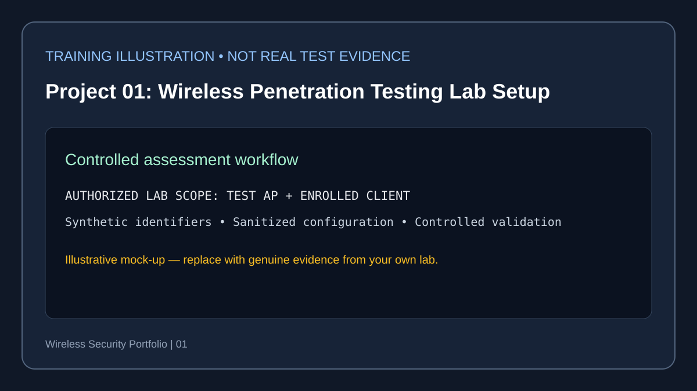
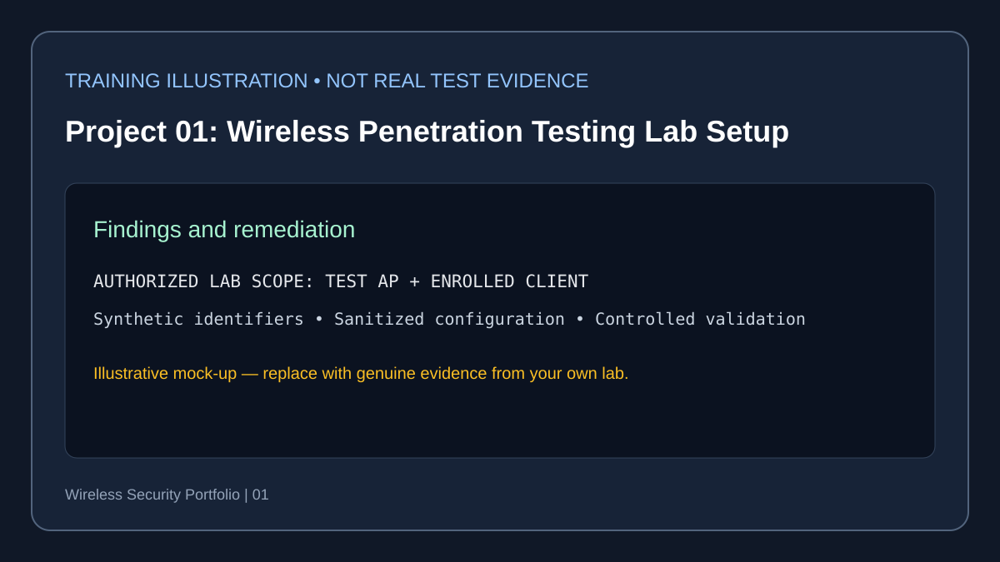

# Project 01: Wireless Penetration Testing Lab Setup

**Level:** Beginner  
**Project type:** Authorized wireless security assessment

## Objective
Build an isolated, permission-based wireless assessment lab and document its boundaries.

## Scope and authorization
One personally owned AP/router, one test client, and a dedicated lab SSID. Exclude neighboring networks, production infrastructure, and devices not explicitly enrolled.

> Perform this exercise only on equipment and networks you own or have explicit written permission to assess. Use synthetic credentials and labels. Stop if activity affects anything outside the approved lab.

## Prerequisites
Kali Linux or another Linux workstation; an AP with current firmware; one test client; admin access to the AP; written scope and rollback plan.

## Methodology and detailed walkthrough
1. Draw a simple topology: tester workstation, lab AP, test client, and any isolated management segment. Record which interfaces and addresses belong to the lab.
2. Update AP firmware using the vendor's supported process. Export the current configuration and record the firmware version before changes.
3. Create a dedicated test SSID using WPA3-Personal where supported, or WPA2-AES as a compatibility fallback. Use a unique synthetic passphrase that is not reused anywhere.
4. Disable WPS and remote administration. Restrict AP management to a trusted management interface or wired admin port. Enable guest/client isolation if the exercise requires it.
5. Connect only the enrolled test client. Confirm it receives the expected network configuration and cannot reach management services unless explicitly allowed.
6. Record the AP model, firmware, SSID label, BSSID from the AP UI, band, channel, security mode, client label, scope exclusions, and cleanup procedure.

## Tools and commands
AP vendor administration UI; `ip -br link`; `iw dev`; `nmcli device status`; network diagram or inventory spreadsheet.

Commands are for local device identification and benign configuration review. Replace placeholders only with the interface or asset you have confirmed belongs to your lab.

## Expected results
A single authorized AP and test client are documented; the AP uses a modern encryption mode; WPS and remote management are disabled; management access is restricted; and the lab boundary is explicit.

## Risk analysis
Weak or reused PSKs, obsolete firmware, exposed management interfaces, and missing guest isolation are common baseline risks. Treat any unexpected association as an investigation item, not as permission to inspect an unknown device.

## Remediation
Use unique credentials, supported firmware, WPA3 or WPA2-AES, disabled WPS, restricted management access, and network segmentation. Re-export the configuration and compare it with the baseline after remediation.

## Validation and retesting
1. Recheck each setting or inventory item identified in the finding.
2. Compare the result with the approved baseline and record the timestamp.
3. Confirm that legitimate lab connectivity still works and that segmentation/management restrictions remain effective.
4. Record residual risk and obtain owner sign-off for any accepted exception.

## Evidence and reporting
Capture (1) a sanitized lab topology/configuration view, (2) the AP security settings, and (3) the authorized client association and validation result. Redact PSKs, serial numbers, public IPs, and personal identifiers.

## Framework mapping
NIST CSF 2.0: Identify / Protect; CIS Controls: Secure Configuration; CWE-1189 where an embedded-device access-control weakness is identified.

## Simulated screenshots
These SVGs are **simulated training illustrations**, not screenshots of a real tool run or proof that a live assessment occurred.

## Deliverables
- Scope and authorization record
- Sanitized asset/configuration inventory
- Findings register with severity, impact, evidence, and remediation
- Retest results and residual-risk statement
- Executive summary suitable for the lab owner
