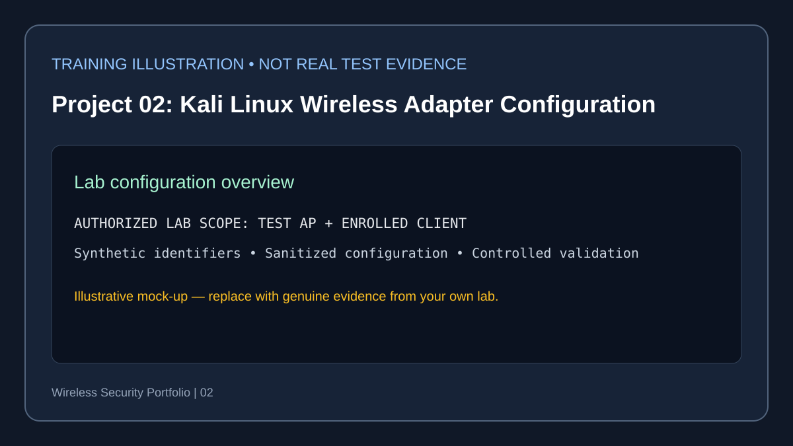
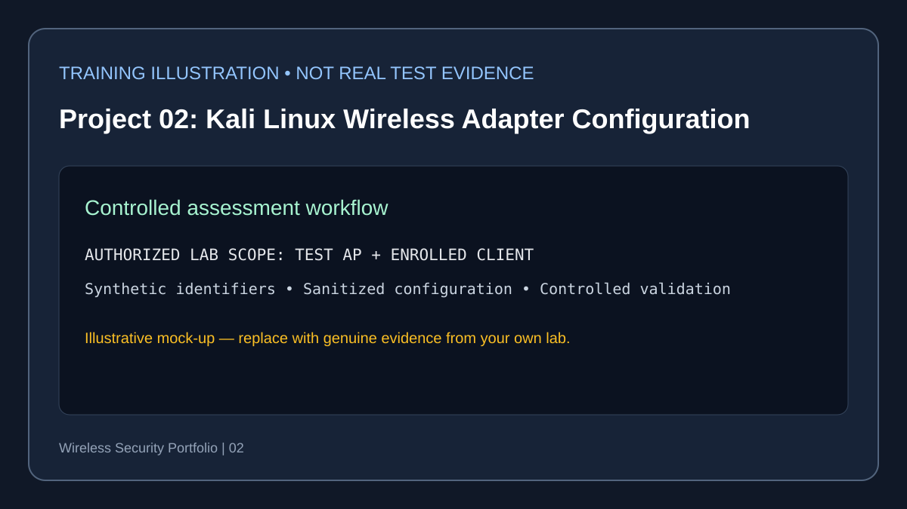

# Project 02: Kali Linux Wireless Adapter Configuration

**Level:** Beginner  
**Project type:** Authorized wireless security assessment

## Objective
Identify a compatible wireless adapter, confirm driver/firmware support, and establish a safe baseline for lab use.

## Scope and authorization
The workstation and the learner's own USB/internal wireless adapter only. No packet injection or testing against third-party networks.

> Perform this exercise only on equipment and networks you own or have explicit written permission to assess. Use synthetic credentials and labels. Stop if activity affects anything outside the approved lab.

## Prerequisites
Kali Linux, supported adapter, local admin privileges, and access to the isolated lab AP.

## Methodology and detailed walkthrough
1. Identify the physical adapter with `lsusb` (USB) or `lspci -nnk` (internal). Record chipset and hardware ID.
2. List interfaces using `ip -br link` and `iw dev`. Do not assume the interface is named `wlan0`; map the interface to the adapter you identified.
3. Review kernel messages with `sudo dmesg | grep -iE 'firmware|wlan|wifi|80211'` and inspect the driver with `ethtool -i <interface>` when supported.
4. Review capabilities using `iw list`, including supported bands and channel widths. Confirm the configured regulatory domain using `iw reg get`; do not set an unlawful region or bypass restrictions.
5. Check NetworkManager state using `nmcli device status`. Resolve conflicting interface ownership using supported NetworkManager settings rather than forcing unsupported modes.
6. Connect normally to the lab SSID and verify address assignment and reachability to the AP's permitted test service. Save the kernel, driver, firmware, and adapter details.

## Tools and commands
`lsusb`, `lspci -nnk`, `ip -br link`, `iw dev`, `iw list`, `iw reg get`, `nmcli`, `dmesg`, `ethtool`.

Commands are for local device identification and benign configuration review. Replace placeholders only with the interface or asset you have confirmed belongs to your lab.

## Expected results
The correct adapter is mapped to a wireless interface, the expected driver and firmware load, supported capabilities are documented, and normal connection to the lab AP succeeds.

## Risk analysis
Typical issues include missing firmware, unsupported chipsets, VirtualBox USB passthrough problems, conflicting host/guest ownership, and choosing the wrong interface.

## Remediation
Install firmware from trusted Kali repositories, update the kernel and packages, configure USB passthrough deliberately, and use a supported adapter. Validate again after reboot.

## Validation and retesting
1. Recheck each setting or inventory item identified in the finding.
2. Compare the result with the approved baseline and record the timestamp.
3. Confirm that legitimate lab connectivity still works and that segmentation/management restrictions remain effective.
4. Record residual risk and obtain owner sign-off for any accepted exception.

## Evidence and reporting
Capture (1) adapter identification, (2) interface/driver capability output, and (3) successful normal lab connectivity. Redact hostnames and hardware serials if publishing.

## Framework mapping
CIS Controls: Inventory and Control of Enterprise Assets; NIST CSF: Identify / Protect.

## Simulated screenshots
These SVGs are **simulated training illustrations**, not screenshots of a real tool run or proof that a live assessment occurred.

## Deliverables
- Scope and authorization record
- Sanitized asset/configuration inventory
- Findings register with severity, impact, evidence, and remediation
- Retest results and residual-risk statement
- Executive summary suitable for the lab owner
