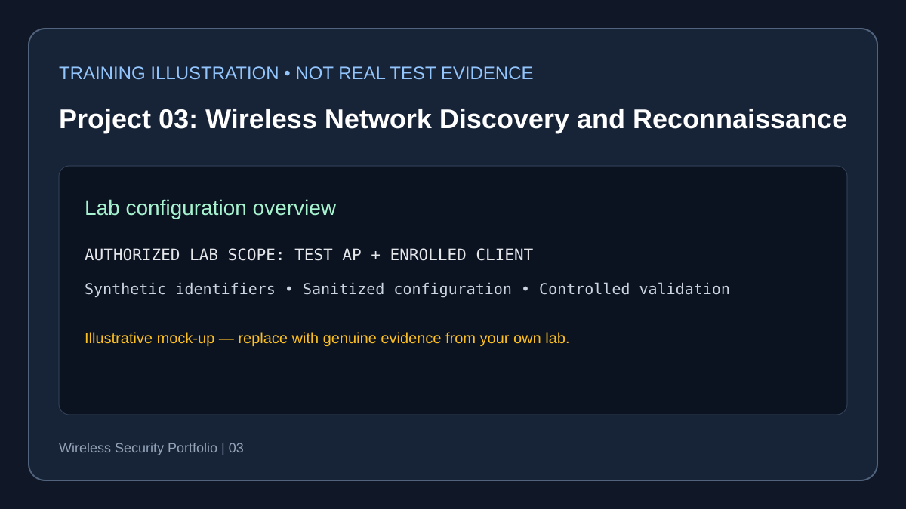
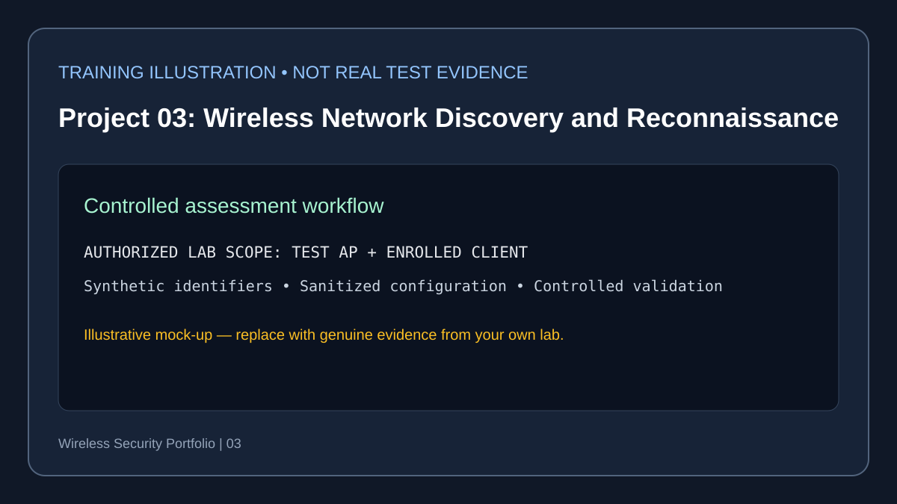
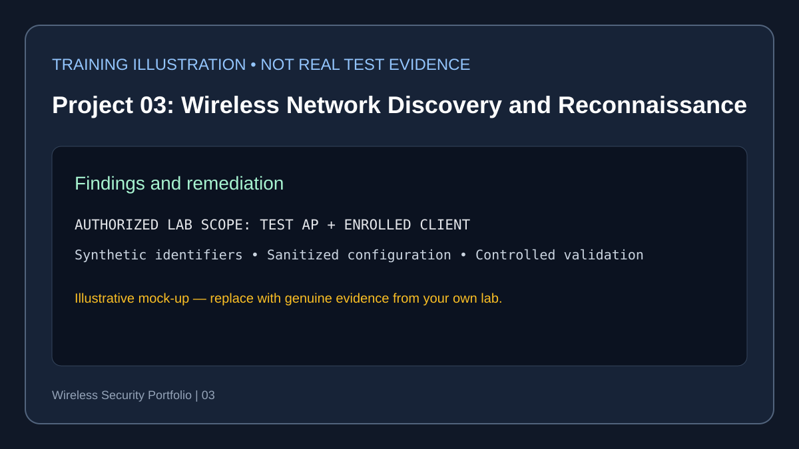

# Project 03: Wireless Network Discovery and Reconnaissance

**Level:** Beginner  
**Project type:** Authorized wireless security assessment

## Objective
Create a scoped inventory of the lab wireless environment using non-disruptive observation and owner-provided configuration.

## Scope and authorization
Only the dedicated test AP and its explicitly authorized SSID/BSSID. Do not inventory nearby networks or collect unrelated client identifiers.

> Perform this exercise only on equipment and networks you own or have explicit written permission to assess. Use synthetic credentials and labels. Stop if activity affects anything outside the approved lab.

## Prerequisites
Completed lab setup, AP administration access, and a sanitized asset inventory.

## Methodology and detailed walkthrough
1. Read the AP's own configuration/controller inventory to identify the authorized SSID, BSSID, radio band, channel, channel width, and security mode.
2. Record the observation time, AP location within the lab, firmware, and the person responsible for the asset.
3. If needed, use ordinary OS wireless scanning solely to confirm the lab AP's advertised properties. Filter evidence to the known lab BSSID; omit all unrelated scan results from saved artifacts.
4. Compare observed SSID, channel, and security capabilities with the AP configuration. Treat mismatches as items to verify with the owner.
5. Record whether the AP advertises WPA2-AES/WPA3, protected management frame capability, and WPS status where these are visible from approved configuration data.
6. Produce a one-page inventory and list any unexplained radio, SSID, or configuration differences for owner review.

## Tools and commands
AP controller/admin interface; `iw dev <interface> scan` for ordinary scoped confirmation; spreadsheet or asset inventory.

Commands are for local device identification and benign configuration review. Replace placeholders only with the interface or asset you have confirmed belongs to your lab.

## Expected results
A concise record describes only the authorized AP and matches the AP's configuration. Unrelated network names and client identifiers are not retained.

## Risk analysis
Undocumented SSIDs, legacy security, inconsistent configuration, and stale asset records can create blind spots. A scan observation alone does not prove ownership or authorization.

## Remediation
Remove unused SSIDs, disable legacy ciphers, standardize channel plans, update firmware, and keep an approved wireless asset inventory. Repeat the scoped observation and compare against the baseline.

## Validation and retesting
1. Recheck each setting or inventory item identified in the finding.
2. Compare the result with the approved baseline and record the timestamp.
3. Confirm that legitimate lab connectivity still works and that segmentation/management restrictions remain effective.
4. Record residual risk and obtain owner sign-off for any accepted exception.

## Evidence and reporting
Capture (1) the authorized asset record, (2) sanitized AP radio/security configuration, and (3) a comparison showing observed versus approved values.

## Framework mapping
NIST CSF 2.0: Identify; CIS Controls: Inventory and Control of Enterprise Assets.

## Simulated screenshots
These SVGs are **simulated training illustrations**, not screenshots of a real tool run or proof that a live assessment occurred.

## Deliverables
- Scope and authorization record
- Sanitized asset/configuration inventory
- Findings register with severity, impact, evidence, and remediation
- Retest results and residual-risk statement
- Executive summary suitable for the lab owner
