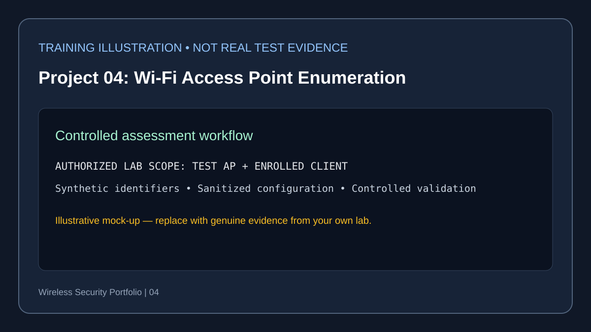
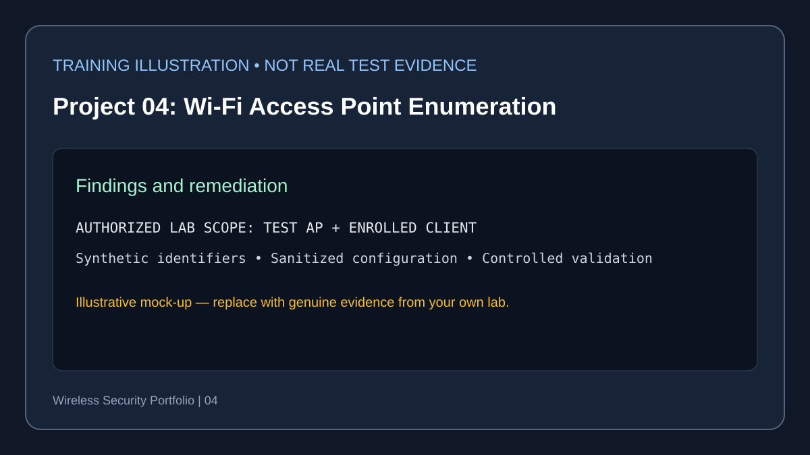

# Project 04: Wi-Fi Access Point Enumeration

**Level:** Beginner  
**Project type:** Authorized wireless security assessment

## Objective
Review the configuration and advertised properties of one authorized AP and identify configuration weaknesses.

## Scope and authorization
One AP owned by the learner or specifically listed in written authorization. No login guessing, exploitation, or access attempts against other APs.

> Perform this exercise only on equipment and networks you own or have explicit written permission to assess. Use synthetic credentials and labels. Stop if activity affects anything outside the approved lab.

## Prerequisites
Lab AP admin access, vendor documentation, and the AP asset record from Project 03.

## Methodology and detailed walkthrough
1. Record vendor, model, hardware revision, firmware version, management address, and support lifecycle from the AP UI and vendor documentation.
2. Inventory each enabled radio, band, channel, channel width, SSID label, and BSSID shown in the controller.
3. Review authentication and encryption settings. Confirm modern WPA2-AES or WPA3 settings; flag open networks, WEP, TKIP, or mixed legacy modes for owner review.
4. Review WPS state, protected management frame policy, remote administration, administrator authentication, and management-plane network restrictions.
5. Review guest SSID configuration, client isolation, VLAN mapping, and whether the AP exposes services that are not required for administration.
6. Compare the advertised wireless capabilities with the configured policy and document each difference with a screenshot and a risk statement.

## Tools and commands
AP vendor UI/controller; vendor security advisories; configuration export; `iw` for scoped capability confirmation.

Commands are for local device identification and benign configuration review. Replace placeholders only with the interface or asset you have confirmed belongs to your lab.

## Expected results
The AP record is complete, advertised security matches configured policy, management access is restricted, WPS is disabled, and unused radios/SSIDs are identified.

## Risk analysis
Outdated firmware, WPS enabled, legacy ciphers, exposed management, weak administrator authentication, and guest-to-internal reachability can materially increase risk.

## Remediation
Apply supported firmware, disable WPS and legacy ciphers, enforce WPA3 or WPA2-AES, use unique administrator credentials and MFA if available, restrict management access, and disable unused services. Recheck the settings.

## Validation and retesting
1. Recheck each setting or inventory item identified in the finding.
2. Compare the result with the approved baseline and record the timestamp.
3. Confirm that legitimate lab connectivity still works and that segmentation/management restrictions remain effective.
4. Record residual risk and obtain owner sign-off for any accepted exception.

## Evidence and reporting
Capture (1) AP identity/firmware, (2) wireless security settings, and (3) management/guest isolation settings. Mask secrets and unique device identifiers.

## Framework mapping
CIS Controls: Secure Configuration; NIST CSF: Protect; CWE-521 where weak password requirements are confirmed.

## Simulated screenshots
These SVGs are **simulated training illustrations**, not screenshots of a real tool run or proof that a live assessment occurred.

## Deliverables
- Scope and authorization record
- Sanitized asset/configuration inventory
- Findings register with severity, impact, evidence, and remediation
- Retest results and residual-risk statement
- Executive summary suitable for the lab owner
