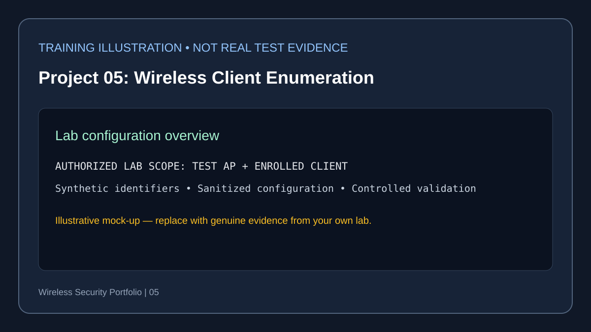

# Project 05: Wireless Client Enumeration

**Level:** Beginner  
**Project type:** Authorized wireless security assessment

## Objective
Inventory only enrolled test clients associated with the lab AP and verify their intended access segment.

## Scope and authorization
The lab AP's own associated-client view and approved test devices only. No tracking, fingerprinting, or interception of public/third-party clients.

> Perform this exercise only on equipment and networks you own or have explicit written permission to assess. Use synthetic credentials and labels. Stop if activity affects anything outside the approved lab.

## Prerequisites
Authorized lab AP, enrolled test devices, and an expected-client register using synthetic labels.

## Methodology and detailed walkthrough
1. Create a client register using labels such as CLIENT-01. Record owner/role, device class, OS version, approved SSID, and intended VLAN; avoid publishing real MAC addresses.
2. Open the AP/controller's associated-client inventory. Match each visible lab association to the approved register using the controller's device details.
3. Confirm each enrolled device uses the intended SSID, authentication method, and network segment. Review client isolation policy for guest/test clients.
4. Check whether the AP supports per-client identity or enterprise authentication. Note if a shared PSK prevents reliable attribution between users.
5. Investigate any association that does not match the approved test register with the lab owner. Do not inspect or attempt to identify an unknown device beyond the AP's administrative inventory.
6. Remove temporary test associations after the exercise and confirm the AP's client list returns to the expected baseline.

## Tools and commands
AP controller/admin UI; approved asset register; DHCP lease view; switch/VLAN configuration where in scope.

Commands are for local device identification and benign configuration review. Replace placeholders only with the interface or asset you have confirmed belongs to your lab.

## Expected results
Every associated lab client maps to an approved synthetic label; each device is on its intended network segment; and the post-test association list matches the expected baseline.

## Risk analysis
Unknown associations, shared PSKs, missing client isolation, and incorrect VLAN assignment can weaken accountability and containment. A MAC address is not proof of a person's identity.

## Remediation
Remove unapproved lab devices, rotate exposed lab credentials, use per-user/per-device authentication for enterprise environments, enforce segmentation, and review association logs. Re-test using enrolled clients only.

## Validation and retesting
1. Recheck each setting or inventory item identified in the finding.
2. Compare the result with the approved baseline and record the timestamp.
3. Confirm that legitimate lab connectivity still works and that segmentation/management restrictions remain effective.
4. Record residual risk and obtain owner sign-off for any accepted exception.

## Evidence and reporting
Capture (1) the synthetic approved-client register, (2) sanitized AP association view, and (3) VLAN/isolation validation. Redact MAC addresses and personal identifiers.

## Framework mapping
NIST CSF: Identify / Protect; CIS Controls: Inventory; data minimization and privacy-by-design.

## Simulated screenshots
These SVGs are **simulated training illustrations**, not screenshots of a real tool run or proof that a live assessment occurred.

## Deliverables
- Scope and authorization record
- Sanitized asset/configuration inventory
- Findings register with severity, impact, evidence, and remediation
- Retest results and residual-risk statement
- Executive summary suitable for the lab owner
