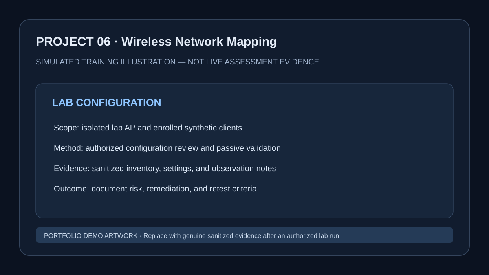
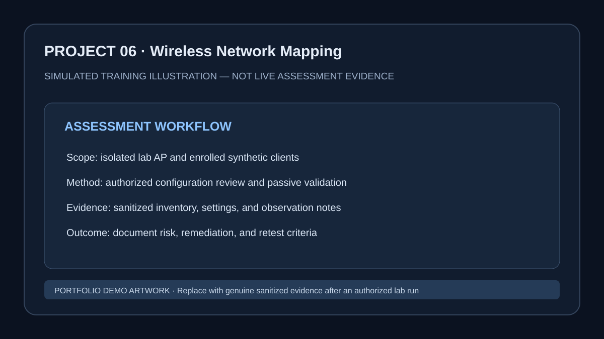

# Project 06: Wireless Network Mapping

**Level:** Beginner  
**Project type:** Authorized wireless security assessment

## Objective
Map authorized lab APs, SSIDs, uplinks, VLANs, management plane, and enrolled test clients.

## Scope and authorization
Restricted to an isolated wireless lab, the named AP/controller, and enrolled synthetic test clients. Obtain written permission and define the permitted location, SSID/BSSID identifiers, time window, methods, and evidence handling. Do not inspect or interact with third-party networks or users.

## Prerequisites
- Kali Linux or another approved analysis workstation
- Lab AP/router with administrative access
- Enrolled synthetic test client(s)
- Current AP configuration export and approved security baseline
- Tools listed below and a restricted evidence folder

## Methodology and detailed walkthrough
1. Confirm written scope and exclusions.
2. Export AP/controller inventory and configuration.
3. Record synthetic AP/client labels, radio settings, management segment, uplink, VLAN, DHCP scope, gateway, and approved flows.
4. Compare the controller inventory with the approved network diagram.
5. Draw a logical topology with trust boundaries and management paths.
6. Flag unknown links for owner review instead of probing them.
7. Sanitize identifiers and obtain owner sign-off.

## Tools and commands
AP/controller inventory, switch and firewall configuration, asset register, diagrams.net or Mermaid.

Read-only local inventory checks (replace the interface only after confirming it belongs to your lab):

```bash
ip -br link
iw dev
iw reg get
```

For packet-analysis exercises, use the Wireshark display filters documented above. These examples do not authorize capture outside the approved lab.

## Expected results
A reviewed topology maps each in-scope AP and SSID to its uplink, VLAN, management plane, and approved client segment.

## Findings and risk analysis
A management interface reachable from a guest/client segment or an unintended SSID-to-internal-VLAN mapping may expose privileged control or internal resources.

Rate findings using the organization's risk method. Record asset, condition, evidence, impact, likelihood, severity, owner, and due date. Do not assign a CVE unless tied to a verified vulnerable product/version.

## Remediation
Move management to a dedicated admin network, restrict it to approved admin hosts, correct SSID/VLAN mappings, and document permitted inter-segment flows.

## Validation and retesting
1. Recheck the relevant AP/controller setting or approved lab observation.
2. Repeat the same scoped measurement under comparable conditions and record timestamp/tool version.
3. Confirm intended client connectivity and segmentation still work.
4. Record residual risk, exceptions, and owner sign-off.

## Evidence and reporting
Retain a sanitized scope record, configuration excerpt, observation notes, and before/after validation. Redact real SSIDs, BSSIDs, MAC addresses, usernames, public IPs, and location details. Never present simulated illustrations as actual evidence.

## Framework mapping
- **NIST CSF 2.0:** Identify, Protect, Detect
- **CIS Controls v8:** Inventory and Control of Enterprise Assets; Secure Configuration
- **MITRE ATT&CK:** Map only validated observations to a documented technique; do not force a mapping for routine configuration review.

## Simulated screenshots
These SVGs are **simulated training illustrations**, not screenshots of a real tool run or proof that a live assessment occurred.






## Deliverables
- Signed scope and authorization record
- Sanitized asset/configuration inventory
- Findings register with severity, impact, evidence, and remediation
- Retest results and residual-risk statement
- Concise report for the lab owner
