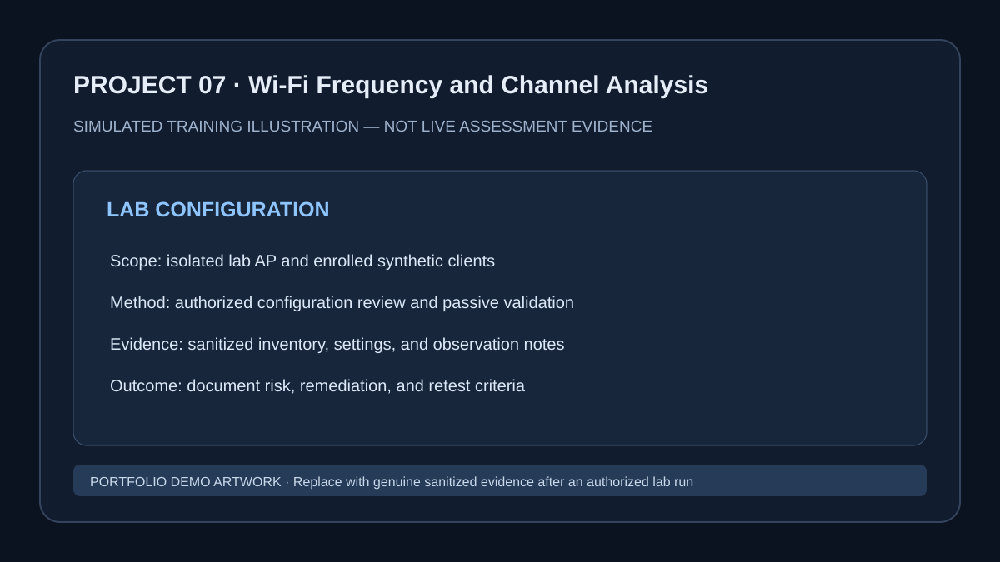
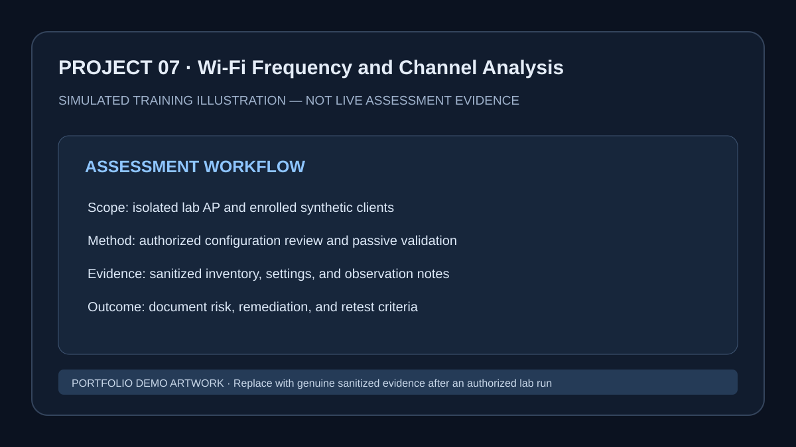

# Project 07: Wi-Fi Frequency and Channel Analysis

**Level:** Beginner  
**Project type:** Authorized wireless security assessment

## Objective
Assess channel plan, band use, channel width, and RF utilization in an authorized lab.

## Scope and authorization
Restricted to an isolated wireless lab, the named AP/controller, and enrolled synthetic test clients. Obtain written permission and define the permitted location, SSID/BSSID identifiers, time window, methods, and evidence handling. Do not inspect or interact with third-party networks or users.

## Prerequisites
- Kali Linux or another approved analysis workstation
- Lab AP/router with administrative access
- Enrolled synthetic test client(s)
- Current AP configuration export and approved security baseline
- Tools listed below and a restricted evidence folder

## Methodology and detailed walkthrough
1. Define the survey boundary and approved APs; use passive observation only.
2. Record each lab radio's band, channel, width, power setting, and regulatory domain from the controller.
3. At fixed lab points, record timestamp, channel, signal level, and utilization where available.
4. Compare settings with local regulatory rules and supported client capabilities.
5. Identify co-channel overlap and distinguish RF utilization from internet throughput.
6. Recommend a conservative channel plan and validate changes only during an approved maintenance window.

## Tools and commands
AP/controller radio status, passive Wi-Fi survey utility, spectrum analyzer if available, vendor documentation, local regulatory guidance.

Read-only local inventory checks (replace the interface only after confirming it belongs to your lab):

```bash
ip -br link
iw dev
iw reg get
```

For packet-analysis exercises, use the Wireshark display filters documented above. These examples do not authorize capture outside the approved lab.

## Expected results
A channel inventory records band, channel, width, location, and measurement conditions; recommendations comply with local rules and client capabilities.

## Findings and risk analysis
Overlapping wide channels or poor channel reuse can increase contention and reduce reliability; a channel number alone does not prove interference.

Rate findings using the organization's risk method. Record asset, condition, evidence, impact, likelihood, severity, owner, and due date. Do not assign a CVE unless tied to a verified vulnerable product/version.

## Remediation
Use a documented channel plan, widths appropriate to client density, correct regulatory settings, and periodic reassessment after environmental changes.

## Validation and retesting
1. Recheck the relevant AP/controller setting or approved lab observation.
2. Repeat the same scoped measurement under comparable conditions and record timestamp/tool version.
3. Confirm intended client connectivity and segmentation still work.
4. Record residual risk, exceptions, and owner sign-off.

## Evidence and reporting
Retain a sanitized scope record, configuration excerpt, observation notes, and before/after validation. Redact real SSIDs, BSSIDs, MAC addresses, usernames, public IPs, and location details. Never present simulated illustrations as actual evidence.

## Framework mapping
- **NIST CSF 2.0:** Identify, Protect, Detect
- **CIS Controls v8:** Inventory and Control of Enterprise Assets; Secure Configuration
- **MITRE ATT&CK:** Map only validated observations to a documented technique; do not force a mapping for routine configuration review.

## Simulated screenshots
These SVGs are **simulated training illustrations**, not screenshots of a real tool run or proof that a live assessment occurred.






## Deliverables
- Signed scope and authorization record
- Sanitized asset/configuration inventory
- Findings register with severity, impact, evidence, and remediation
- Retest results and residual-risk statement
- Concise report for the lab owner
