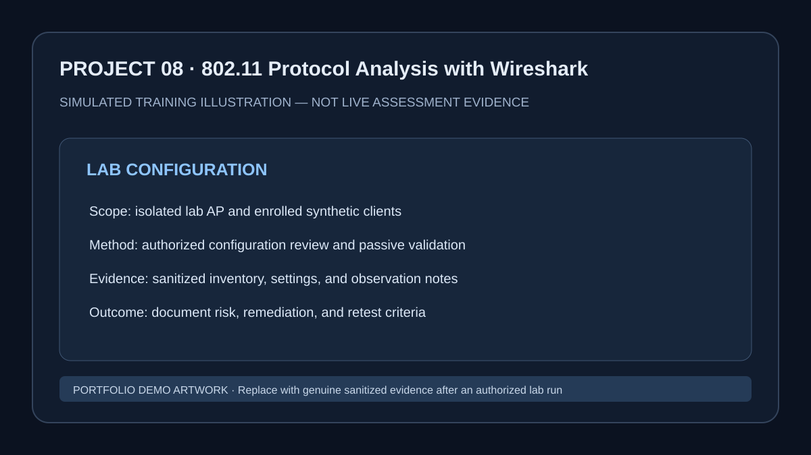
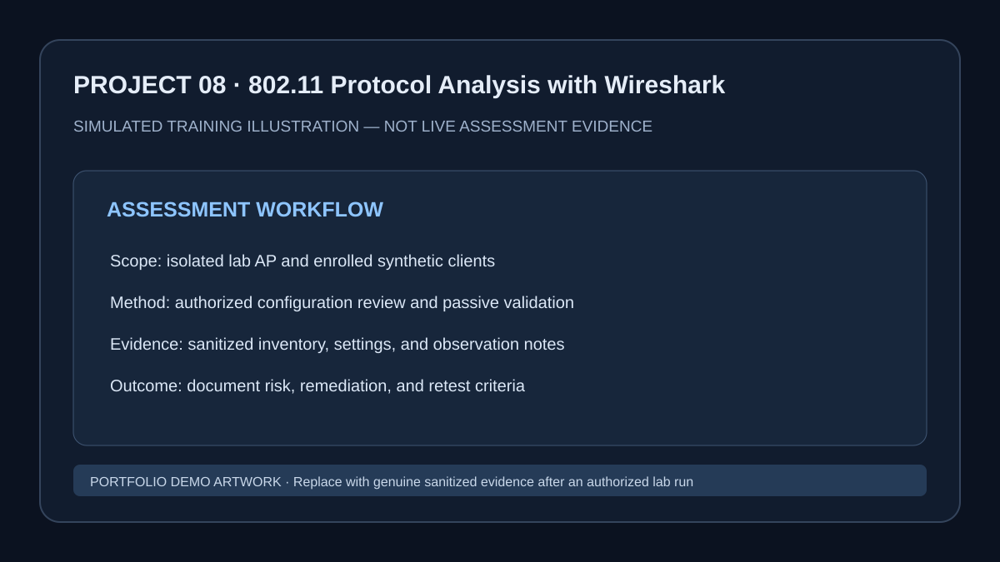

# Project 08: 802.11 Protocol Analysis with Wireshark

**Level:** Beginner  
**Project type:** Authorized wireless security assessment

## Objective
Interpret sanitized 802.11 management metadata from a lab capture to understand association and advertised security.

## Scope and authorization
Restricted to an isolated wireless lab, the named AP/controller, and enrolled synthetic test clients. Obtain written permission and define the permitted location, SSID/BSSID identifiers, time window, methods, and evidence handling. Do not inspect or interact with third-party networks or users.

## Prerequisites
- Kali Linux or another approved analysis workstation
- Lab AP/router with administrative access
- Enrolled synthetic test client(s)
- Current AP configuration export and approved security baseline
- Tools listed below and a restricted evidence folder

## Methodology and detailed walkthrough
1. Create a lab-only capture plan for the AP and synthetic clients.
2. Configure a supported adapter and confirm the intended channel.
3. Capture a short controlled client connection cycle, then stop and restrict access to the original file.
4. In Wireshark, use `wlan.fc.type == 0` for management frames and `wlan.fc.type_subtype == 0x08` for beacons.
5. Review SSID, supported rates, RSN information elements, advertised authentication/cipher suites, and PMF capability.
6. Cross-check observations against the AP configuration; advertisement alone does not prove enforcement.
7. Sanitize all identifiers before publication.

## Tools and commands
Wireshark, supported monitor-mode adapter, isolated lab AP, synthetic client, AP configuration export.

Read-only local inventory checks (replace the interface only after confirming it belongs to your lab):

```bash
ip -br link
iw dev
iw reg get
```

For packet-analysis exercises, use the Wireshark display filters documented above. These examples do not authorize capture outside the approved lab.

## Expected results
A reproducible, short lab capture is sanitized and protocol observations are cross-checked against the AP configuration.

## Findings and risk analysis
A mismatch between advertised RSN capabilities and documented policy, or an enabled legacy security mode, warrants configuration review.

Rate findings using the organization's risk method. Record asset, condition, evidence, impact, likelihood, severity, owner, and due date. Do not assign a CVE unless tied to a verified vulnerable product/version.

## Remediation
Disable obsolete security modes, align AP/client policy, enable modern protected management features where supported, and validate with a fresh controlled capture.

## Validation and retesting
1. Recheck the relevant AP/controller setting or approved lab observation.
2. Repeat the same scoped measurement under comparable conditions and record timestamp/tool version.
3. Confirm intended client connectivity and segmentation still work.
4. Record residual risk, exceptions, and owner sign-off.

## Evidence and reporting
Retain a sanitized scope record, configuration excerpt, observation notes, and before/after validation. Redact real SSIDs, BSSIDs, MAC addresses, usernames, public IPs, and location details. Never present simulated illustrations as actual evidence.

## Framework mapping
- **NIST CSF 2.0:** Identify, Protect, Detect
- **CIS Controls v8:** Inventory and Control of Enterprise Assets; Secure Configuration
- **MITRE ATT&CK:** Map only validated observations to a documented technique; do not force a mapping for routine configuration review.

## Simulated screenshots
These SVGs are **simulated training illustrations**, not screenshots of a real tool run or proof that a live assessment occurred.






## Deliverables
- Signed scope and authorization record
- Sanitized asset/configuration inventory
- Findings register with severity, impact, evidence, and remediation
- Retest results and residual-risk statement
- Concise report for the lab owner
