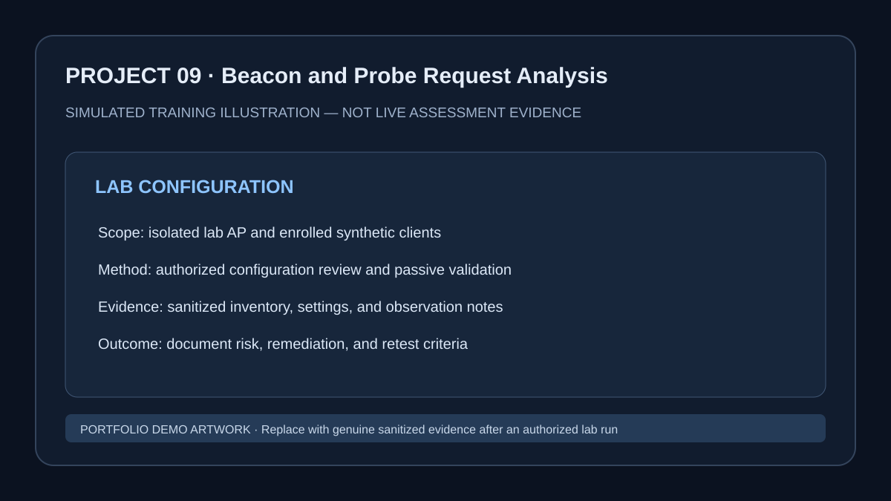
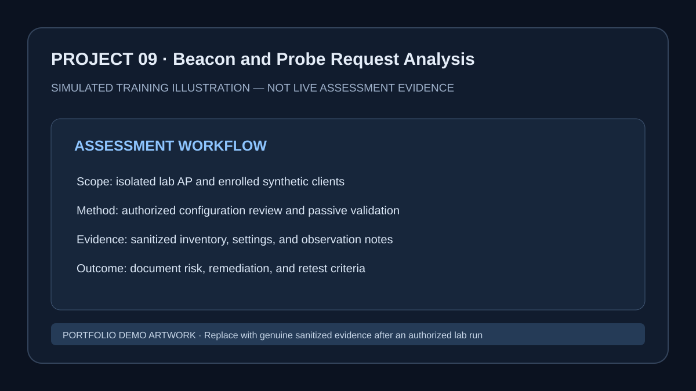

# Project 09: Beacon and Probe Request Analysis

**Level:** Beginner  
**Project type:** Authorized wireless security assessment

## Objective
Review beacon and probe-request behavior with a controlled AP and synthetic client while protecting privacy.

## Scope and authorization
Restricted to an isolated wireless lab, the named AP/controller, and enrolled synthetic test clients. Obtain written permission and define the permitted location, SSID/BSSID identifiers, time window, methods, and evidence handling. Do not inspect or interact with third-party networks or users.

## Prerequisites
- Kali Linux or another approved analysis workstation
- Lab AP/router with administrative access
- Enrolled synthetic test client(s)
- Current AP configuration export and approved security baseline
- Tools listed below and a restricted evidence folder

## Methodology and detailed walkthrough
1. Obtain approval for a short passive capture limited to the lab.
2. Record the AP's configured SSID broadcast, beacon interval, security advertisement, and supported rates.
3. Capture only during a planned synthetic-client discovery/connection sequence; do not solicit probes or collect bystander identifiers.
4. In Wireshark, inspect beacons with `wlan.fc.type_subtype == 0x08` and probe requests with `wlan.fc.type_subtype == 0x04`.
5. Compare beacon information elements with controller configuration.
6. Check only the test client's directed-probe behavior, redact names, minimize retention, and delete incidental out-of-scope data under the evidence policy.

## Tools and commands
Wireshark, isolated AP, synthetic client, controller configuration export, evidence-handling checklist.

Read-only local inventory checks (replace the interface only after confirming it belongs to your lab):

```bash
ip -br link
iw dev
iw reg get
```

For packet-analysis exercises, use the Wireshark display filters documented above. These examples do not authorize capture outside the approved lab.

## Expected results
The report distinguishes AP beacon advertisements from client probe behavior and contains only sanitized lab observations.

## Findings and risk analysis
Directed probes may disclose remembered network names in some client configurations; this is a privacy exposure, not proof of compromise.

Rate findings using the organization's risk method. Record asset, condition, evidence, impact, likelihood, severity, owner, and due date. Do not assign a CVE unless tied to a verified vulnerable product/version.

## Remediation
Keep client OS/drivers current, review endpoint privacy settings, minimize saved networks, and apply short retention to wireless captures.

## Validation and retesting
1. Recheck the relevant AP/controller setting or approved lab observation.
2. Repeat the same scoped measurement under comparable conditions and record timestamp/tool version.
3. Confirm intended client connectivity and segmentation still work.
4. Record residual risk, exceptions, and owner sign-off.

## Evidence and reporting
Retain a sanitized scope record, configuration excerpt, observation notes, and before/after validation. Redact real SSIDs, BSSIDs, MAC addresses, usernames, public IPs, and location details. Never present simulated illustrations as actual evidence.

## Framework mapping
- **NIST CSF 2.0:** Identify, Protect, Detect
- **CIS Controls v8:** Inventory and Control of Enterprise Assets; Secure Configuration
- **MITRE ATT&CK:** Map only validated observations to a documented technique; do not force a mapping for routine configuration review.

## Simulated screenshots
These SVGs are **simulated training illustrations**, not screenshots of a real tool run or proof that a live assessment occurred.






## Deliverables
- Signed scope and authorization record
- Sanitized asset/configuration inventory
- Findings register with severity, impact, evidence, and remediation
- Retest results and residual-risk statement
- Concise report for the lab owner
