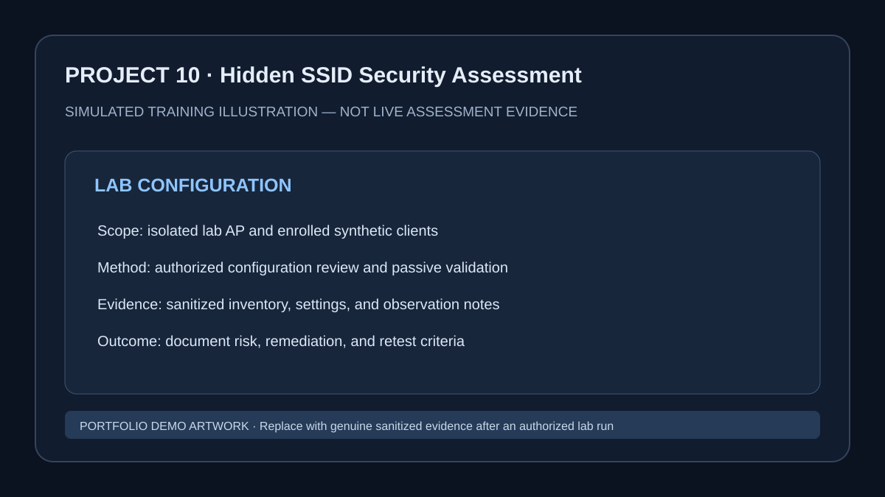
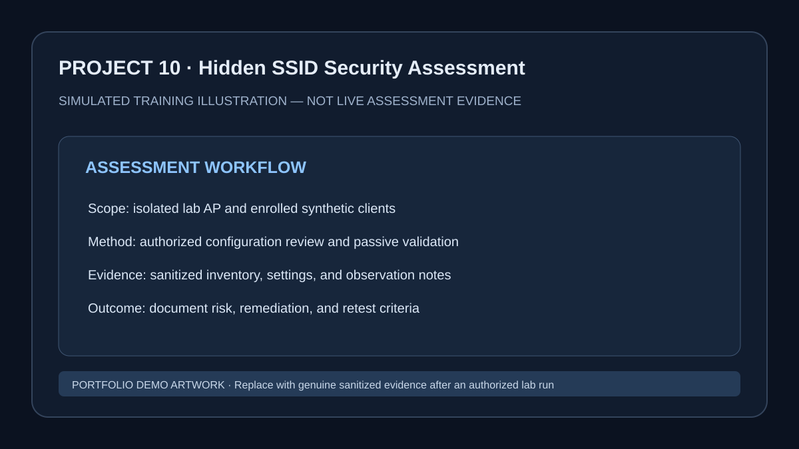

# Project 10: Hidden SSID Security Assessment

**Level:** Beginner  
**Project type:** Authorized wireless security assessment

## Objective
Determine whether disabling SSID broadcast provides meaningful security and assess operational/privacy trade-offs.

## Scope and authorization
Restricted to an isolated wireless lab, the named AP/controller, and enrolled synthetic test clients. Obtain written permission and define the permitted location, SSID/BSSID identifiers, time window, methods, and evidence handling. Do not inspect or interact with third-party networks or users.

## Prerequisites
- Kali Linux or another approved analysis workstation
- Lab AP/router with administrative access
- Enrolled synthetic test client(s)
- Current AP configuration export and approved security baseline
- Tools listed below and a restricted evidence folder

## Methodology and detailed walkthrough
1. Confirm the AP and test client are owned lab assets and record the test SSID.
2. Export the baseline setting; vendors may call it hidden, non-broadcast, or closed network.
3. Connect the synthetic client using its approved profile and verify normal authentication.
4. Use the controller and a short lab-only passive capture to observe AP advertisements; do not induce reconnects or capture unrelated probes.
5. Explain that concealment is not authentication or encryption.
6. Evaluate usability and the possibility that configured clients reveal network names.
7. Restore the approved setting, validate connectivity, and record the risk decision.

## Tools and commands
AP/controller configuration, synthetic client, Wireshark passive lab capture, wireless security baseline.

Read-only local inventory checks (replace the interface only after confirming it belongs to your lab):

```bash
ip -br link
iw dev
iw reg get
```

For packet-analysis exercises, use the Wireshark display filters documented above. These examples do not authorize capture outside the approved lab.

## Expected results
The assessment records whether the SSID is advertised and clearly explains that concealment does not provide access control or encryption.

## Findings and risk analysis
Relying on a hidden SSID creates false assurance and may increase client-side disclosure in some configurations.

Rate findings using the organization's risk method. Record asset, condition, evidence, impact, likelihood, severity, owner, and due date. Do not assign a CVE unless tied to a verified vulnerable product/version.

## Remediation
Use WPA3-Personal or WPA2-AES where appropriate, unique strong credentials or enterprise 802.1X, PMF where supported, and segmentation.

## Validation and retesting
1. Recheck the relevant AP/controller setting or approved lab observation.
2. Repeat the same scoped measurement under comparable conditions and record timestamp/tool version.
3. Confirm intended client connectivity and segmentation still work.
4. Record residual risk, exceptions, and owner sign-off.

## Evidence and reporting
Retain a sanitized scope record, configuration excerpt, observation notes, and before/after validation. Redact real SSIDs, BSSIDs, MAC addresses, usernames, public IPs, and location details. Never present simulated illustrations as actual evidence.

## Framework mapping
- **NIST CSF 2.0:** Identify, Protect, Detect
- **CIS Controls v8:** Inventory and Control of Enterprise Assets; Secure Configuration
- **MITRE ATT&CK:** Map only validated observations to a documented technique; do not force a mapping for routine configuration review.

## Simulated screenshots
These SVGs are **simulated training illustrations**, not screenshots of a real tool run or proof that a live assessment occurred.






## Deliverables
- Signed scope and authorization record
- Sanitized asset/configuration inventory
- Findings register with severity, impact, evidence, and remediation
- Retest results and residual-risk statement
- Concise report for the lab owner
