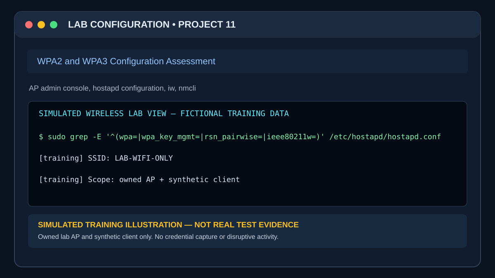
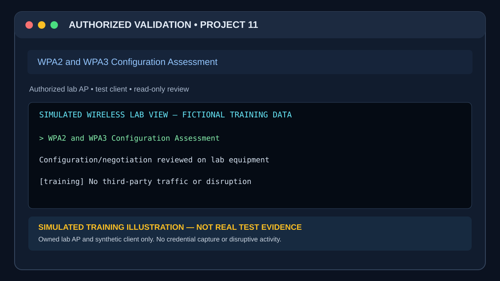

# Project 11 — WPA2 and WPA3 Configuration Assessment

**Level:** Beginner | **Estimated time:** 2–3 hours

> **Authorized lab only.** Assess only APs, SSIDs, clients, and infrastructure you own or have explicit written permission to test. Use an isolated lab AP and synthetic identities. Do not capture third-party traffic, attempt credential recovery, impersonate networks, or disrupt users.

## Objective

Review the lab access point's security mode, transition settings, cipher suites, and client compatibility against an approved baseline.

## Scope and prerequisites

- One owned lab AP/router and one authorized test client.
- Isolated SSID and synthetic account; no production or guest users.
- **Tools:** AP admin console, hostapd configuration, iw, nmcli.
- Record AP model/firmware, SSID/BSSID, country/channel plan, test client, date, and authorization.
- Define exclusions, maintenance window, and stop conditions before any radio activity.

## Step 1 — Establish the lab baseline

Export the AP configuration and record the current security profile. Confirm that the test client is connected only to the lab SSID. Keep administrative access on a trusted wired or management interface.

```bash
ip -br link
 iw dev
nmcli -f DEVICE,TYPE,STATE,CONNECTION device status
```

## Step 2 — Perform the assessment

1. Export the AP configuration for the lab SSID and record firmware/version.
2. Identify WPA2-Personal, WPA3-SAE, or transition mode and document cipher suites.
3. Verify PMF/802.11w settings and whether legacy compatibility is unnecessarily enabled.
4. Connect only the authorized test client and confirm negotiated security in client/AP status.
5. Compare the configuration with vendor and current Wi-Fi Alliance guidance; record deviations.

Example read-only review command:

```bash
sudo grep -E '^(wpa=|wpa_key_mgmt=|rsn_pairwise=|ieee80211w=)' /etc/hostapd/hostapd.conf
```

Adapt paths and interface names to your lab. Avoid active probing, packet injection, credential collection, or tests outside the approved scope.

## Step 3 — Expected observations

A per-SSID configuration matrix showing security mode, ciphers, PMF, transition behavior, and client compatibility.

## Step 4 — Risk analysis

Legacy modes, weak ciphers, or insecure transition settings may reduce wireless confidentiality and authentication strength. Separate configuration weaknesses from demonstrated impact. Record evidence source, confidence, affected SSID/AP, prerequisites, business context, and any test limitations. Do not label an unverified observation as a confirmed vulnerability.

## Step 5 — Remediation and validation

Prefer WPA3-SAE where supported, use AES/CCMP or approved modern ciphers, require PMF where feasible, and retire legacy modes.

Apply changes during an approved maintenance window. Re-export the configuration, reconnect the authorized test client, verify the expected security mode, and document before/after behavior and rollback readiness.

## Simulated training illustrations

> These project-specific SVGs are fictional training illustrations, not actual AP captures, live wireless traffic, or evidence of a real assessment.






## Evidence and deliverables

- Authorization, exact SSID/BSSID scope, location, test window, and exclusions.
- AP model/firmware, sanitized config export, client model/OS, and tool versions.
- Commands/actions, timestamps, configuration diffs, and relevant sanitized logs.
- Finding register with evidence, risk rationale, remediation owner, and retest result.
- No passwords, PSKs, private keys, user identifiers, or third-party traffic in Git.

## Framework references

- Wi-Fi Alliance WPA3; NIST SP 800-153; vendor AP security guidance
- [NIST SP 800-153 — Guidelines for Securing Wireless LANs](https://csrc.nist.gov/pubs/sp/800/153/final)
- [OWASP Wireless Security Testing Guide](https://owasp.org/www-project-web-security-testing-guide/)

## Completion checklist

- [ ] Written authorization and scope confirmed
- [ ] Lab AP/client isolated and identified
- [ ] Assessment limited to approved read-only/configuration checks
- [ ] Evidence sanitized and labeled
- [ ] Risk and remediation documented
- [ ] Configuration retest and rollback readiness verified
