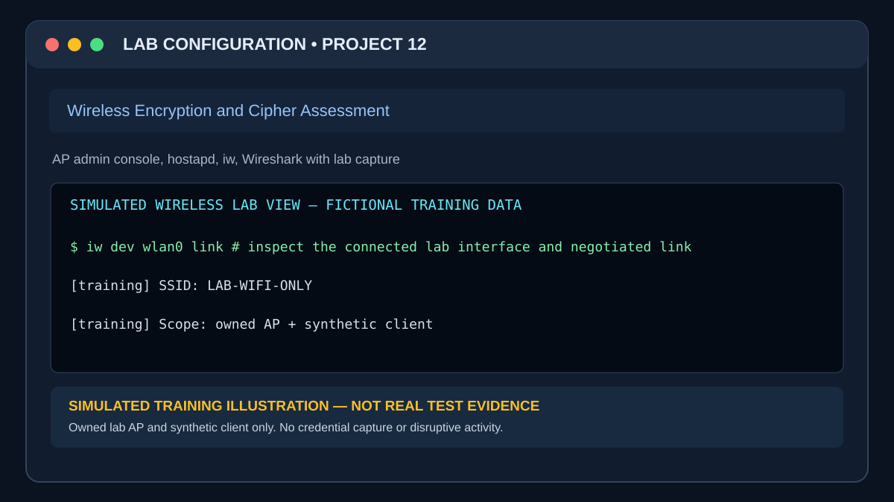
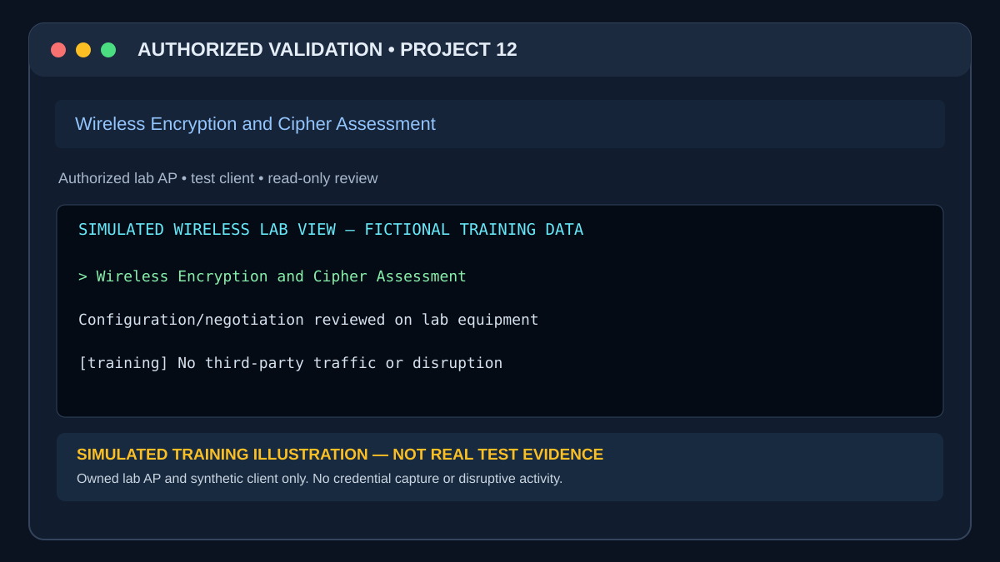

# Project 12 — Wireless Encryption and Cipher Assessment

**Level:** Beginner | **Estimated time:** 2–3 hours

> **Authorized lab only.** Assess only APs, SSIDs, clients, and infrastructure you own or have explicit written permission to test. Use an isolated lab AP and synthetic identities. Do not capture third-party traffic, attempt credential recovery, impersonate networks, or disrupt users.

## Objective

Verify that the lab WLAN negotiates approved encryption and does not permit deprecated or weak cipher suites.

## Scope and prerequisites

- One owned lab AP/router and one authorized test client.
- Isolated SSID and synthetic account; no production or guest users.
- **Tools:** AP admin console, hostapd, iw, Wireshark with lab capture.
- Record AP model/firmware, SSID/BSSID, country/channel plan, test client, date, and authorization.
- Define exclusions, maintenance window, and stop conditions before any radio activity.

## Step 1 — Establish the lab baseline

Export the AP configuration and record the current security profile. Confirm that the test client is connected only to the lab SSID. Keep administrative access on a trusted wired or management interface.

```bash
ip -br link
 iw dev
nmcli -f DEVICE,TYPE,STATE,CONNECTION device status
```

## Step 2 — Perform the assessment

1. Document the approved cipher baseline for the lab SSID.
2. Review AP configuration for CCMP/GCMP and identify any TKIP/WEP compatibility settings.
3. Connect an authorized client and record the negotiated security suite from AP/client status.
4. Inspect a short capture from the lab AP to confirm advertised RSN information elements.
5. Validate that deprecated ciphers are disabled and legacy clients fail safely.

Example read-only review command:

```bash
iw dev wlan0 link  # inspect the connected lab interface and negotiated link
```

Adapt paths and interface names to your lab. Avoid active probing, packet injection, credential collection, or tests outside the approved scope.

## Step 3 — Expected observations

A cipher inventory mapping advertised and negotiated suites to the approved baseline.

## Step 4 — Risk analysis

Weak or deprecated ciphers can reduce confidentiality and enable downgrade or compatibility weaknesses. Separate configuration weaknesses from demonstrated impact. Record evidence source, confidence, affected SSID/AP, prerequisites, business context, and any test limitations. Do not label an unverified observation as a confirmed vulnerability.

## Step 5 — Remediation and validation

Disable WEP/TKIP and obsolete modes, enforce modern AES-based suites, and update unsupported clients.

Apply changes during an approved maintenance window. Re-export the configuration, reconnect the authorized test client, verify the expected security mode, and document before/after behavior and rollback readiness.

## Simulated training illustrations

> These project-specific SVGs are fictional training illustrations, not actual AP captures, live wireless traffic, or evidence of a real assessment.






## Evidence and deliverables

- Authorization, exact SSID/BSSID scope, location, test window, and exclusions.
- AP model/firmware, sanitized config export, client model/OS, and tool versions.
- Commands/actions, timestamps, configuration diffs, and relevant sanitized logs.
- Finding register with evidence, risk rationale, remediation owner, and retest result.
- No passwords, PSKs, private keys, user identifiers, or third-party traffic in Git.

## Framework references

- NIST SP 800-153; IEEE 802.11 RSN; vendor wireless security baseline
- [NIST SP 800-153 — Guidelines for Securing Wireless LANs](https://csrc.nist.gov/pubs/sp/800/153/final)
- [OWASP Wireless Security Testing Guide](https://owasp.org/www-project-web-security-testing-guide/)

## Completion checklist

- [ ] Written authorization and scope confirmed
- [ ] Lab AP/client isolated and identified
- [ ] Assessment limited to approved read-only/configuration checks
- [ ] Evidence sanitized and labeled
- [ ] Risk and remediation documented
- [ ] Configuration retest and rollback readiness verified
