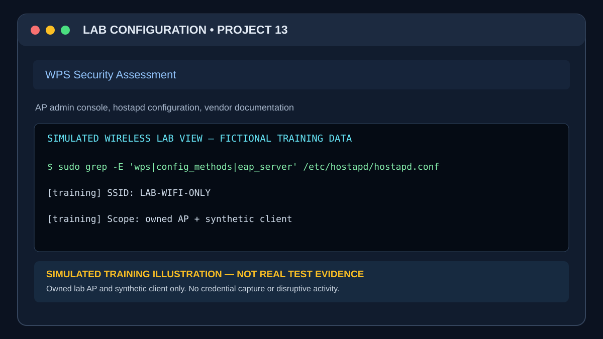
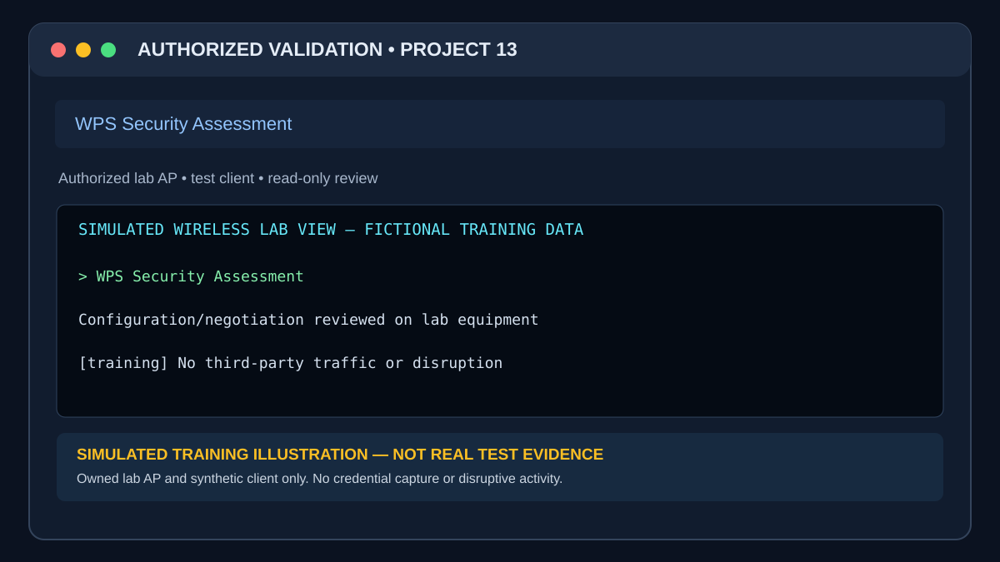

# Project 13 — WPS Security Assessment

**Level:** Beginner | **Estimated time:** 2–3 hours

> **Authorized lab only.** Assess only APs, SSIDs, clients, and infrastructure you own or have explicit written permission to test. Use an isolated lab AP and synthetic identities. Do not capture third-party traffic, attempt credential recovery, impersonate networks, or disrupt users.

## Objective

Review Wi-Fi Protected Setup exposure and determine whether WPS is enabled, required, and appropriately governed on the lab AP.

## Scope and prerequisites

- One owned lab AP/router and one authorized test client.
- Isolated SSID and synthetic account; no production or guest users.
- **Tools:** AP admin console, hostapd configuration, vendor documentation.
- Record AP model/firmware, SSID/BSSID, country/channel plan, test client, date, and authorization.
- Define exclusions, maintenance window, and stop conditions before any radio activity.

## Step 1 — Establish the lab baseline

Export the AP configuration and record the current security profile. Confirm that the test client is connected only to the lab SSID. Keep administrative access on a trusted wired or management interface.

```bash
ip -br link
 iw dev
nmcli -f DEVICE,TYPE,STATE,CONNECTION device status
```

## Step 2 — Perform the assessment

1. Check the AP configuration and management UI for WPS enablement and supported enrollment methods.
2. Identify whether PIN, push-button, or other enrollment modes are configured.
3. Review firmware version, vendor advisories, enrollment logs, and physical access requirements.
4. Confirm whether WPS can be disabled without disrupting required onboarding.
5. Document the residual risk and validate the disabled state using configuration and AP status only.

Example read-only review command:

```bash
sudo grep -E 'wps|config_methods|eap_server' /etc/hostapd/hostapd.conf
```

Adapt paths and interface names to your lab. Avoid active probing, packet injection, credential collection, or tests outside the approved scope.

## Step 3 — Expected observations

A WPS status record with enabled methods, firmware context, enrollment controls, and disablement validation.

## Step 4 — Risk analysis

WPS can introduce weaker enrollment paths and expand the attack surface when left enabled unnecessarily. Separate configuration weaknesses from demonstrated impact. Record evidence source, confidence, affected SSID/AP, prerequisites, business context, and any test limitations. Do not label an unverified observation as a confirmed vulnerability.

## Step 5 — Remediation and validation

Disable WPS when not required, keep AP firmware current, restrict physical access, and use a managed onboarding process.

Apply changes during an approved maintenance window. Re-export the configuration, reconnect the authorized test client, verify the expected security mode, and document before/after behavior and rollback readiness.

## Simulated training illustrations

> These project-specific SVGs are fictional training illustrations, not actual AP captures, live wireless traffic, or evidence of a real assessment.






## Evidence and deliverables

- Authorization, exact SSID/BSSID scope, location, test window, and exclusions.
- AP model/firmware, sanitized config export, client model/OS, and tool versions.
- Commands/actions, timestamps, configuration diffs, and relevant sanitized logs.
- Finding register with evidence, risk rationale, remediation owner, and retest result.
- No passwords, PSKs, private keys, user identifiers, or third-party traffic in Git.

## Framework references

- NIST SP 800-153; vendor WPS security guidance
- [NIST SP 800-153 — Guidelines for Securing Wireless LANs](https://csrc.nist.gov/pubs/sp/800/153/final)
- [OWASP Wireless Security Testing Guide](https://owasp.org/www-project-web-security-testing-guide/)

## Completion checklist

- [ ] Written authorization and scope confirmed
- [ ] Lab AP/client isolated and identified
- [ ] Assessment limited to approved read-only/configuration checks
- [ ] Evidence sanitized and labeled
- [ ] Risk and remediation documented
- [ ] Configuration retest and rollback readiness verified
