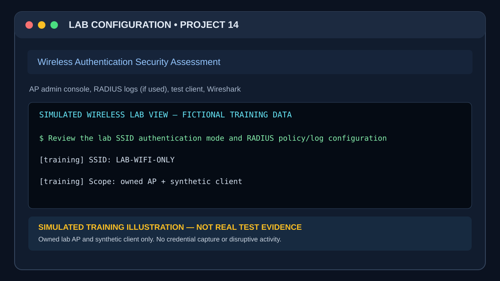
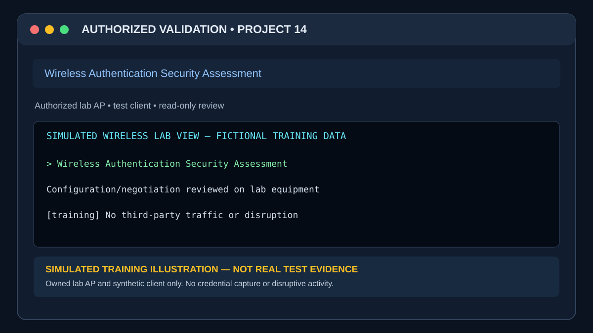

# Project 14 — Wireless Authentication Security Assessment

**Level:** Beginner | **Estimated time:** 2–3 hours

> **Authorized lab only.** Assess only APs, SSIDs, clients, and infrastructure you own or have explicit written permission to test. Use an isolated lab AP and synthetic identities. Do not capture third-party traffic, attempt credential recovery, impersonate networks, or disrupt users.

## Objective

Assess WLAN authentication design, credential policy, identity lifecycle, and account lockout/monitoring for the authorized lab SSID.

## Scope and prerequisites

- One owned lab AP/router and one authorized test client.
- Isolated SSID and synthetic account; no production or guest users.
- **Tools:** AP admin console, RADIUS logs (if used), test client, Wireshark.
- Record AP model/firmware, SSID/BSSID, country/channel plan, test client, date, and authorization.
- Define exclusions, maintenance window, and stop conditions before any radio activity.

## Step 1 — Establish the lab baseline

Export the AP configuration and record the current security profile. Confirm that the test client is connected only to the lab SSID. Keep administrative access on a trusted wired or management interface.

```bash
ip -br link
 iw dev
nmcli -f DEVICE,TYPE,STATE,CONNECTION device status
```

## Step 2 — Perform the assessment

1. Document the authentication architecture: Personal, Enterprise 802.1X, or guest portal.
2. Use synthetic test identities and review password/certificate policy and lifecycle.
3. Check whether authentication failures are logged and monitored without exposing secrets.
4. Validate deprovisioning by disabling a test identity and confirming it can no longer authenticate.
5. Review shared-secret rotation, account ownership, and guest access expiry.

Example read-only review command:

```bash
Review the lab SSID authentication mode and RADIUS policy/log configuration
```

Adapt paths and interface names to your lab. Avoid active probing, packet injection, credential collection, or tests outside the approved scope.

## Step 3 — Expected observations

An authentication control matrix covering identity type, credential/certificate lifecycle, logging, and deprovisioning.

## Step 4 — Risk analysis

Shared credentials, weak identity lifecycle, or missing monitoring can enable unauthorized WLAN access. Separate configuration weaknesses from demonstrated impact. Record evidence source, confidence, affected SSID/AP, prerequisites, business context, and any test limitations. Do not label an unverified observation as a confirmed vulnerability.

## Step 5 — Remediation and validation

Prefer per-user or certificate-based authentication, rotate shared secrets, promptly revoke access, and monitor authentication anomalies.

Apply changes during an approved maintenance window. Re-export the configuration, reconnect the authorized test client, verify the expected security mode, and document before/after behavior and rollback readiness.

## Simulated training illustrations

> These project-specific SVGs are fictional training illustrations, not actual AP captures, live wireless traffic, or evidence of a real assessment.






## Evidence and deliverables

- Authorization, exact SSID/BSSID scope, location, test window, and exclusions.
- AP model/firmware, sanitized config export, client model/OS, and tool versions.
- Commands/actions, timestamps, configuration diffs, and relevant sanitized logs.
- Finding register with evidence, risk rationale, remediation owner, and retest result.
- No passwords, PSKs, private keys, user identifiers, or third-party traffic in Git.

## Framework references

- NIST SP 800-153; NIST SP 800-63B; vendor RADIUS guidance
- [NIST SP 800-153 — Guidelines for Securing Wireless LANs](https://csrc.nist.gov/pubs/sp/800/153/final)
- [OWASP Wireless Security Testing Guide](https://owasp.org/www-project-web-security-testing-guide/)

## Completion checklist

- [ ] Written authorization and scope confirmed
- [ ] Lab AP/client isolated and identified
- [ ] Assessment limited to approved read-only/configuration checks
- [ ] Evidence sanitized and labeled
- [ ] Risk and remediation documented
- [ ] Configuration retest and rollback readiness verified
