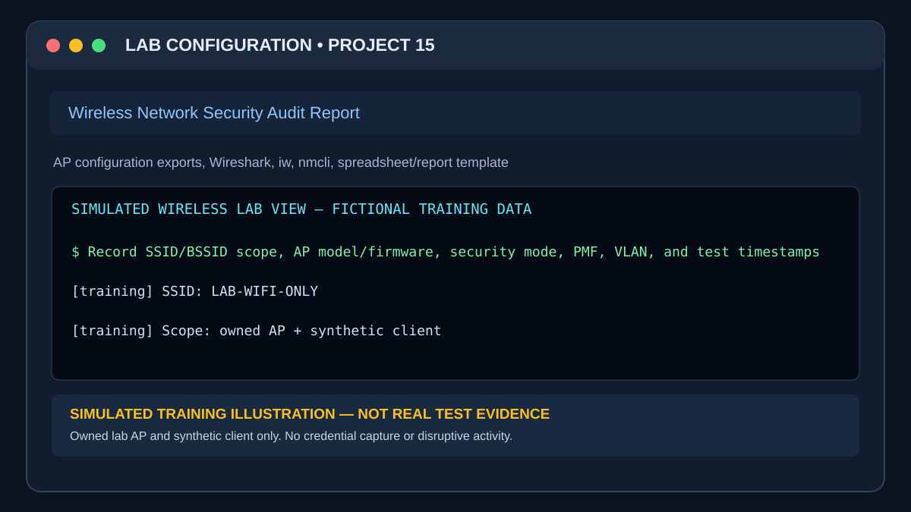
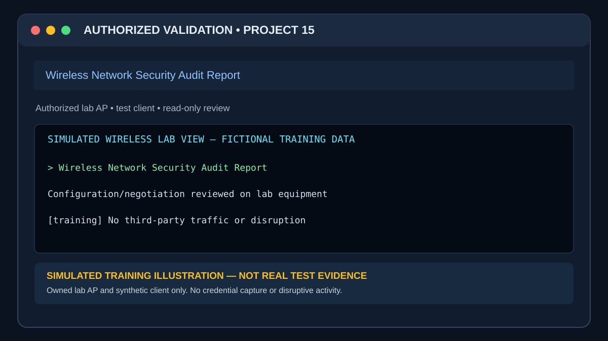

# Project 15 — Wireless Network Security Audit Report

**Level:** Beginner | **Estimated time:** 2–3 hours

> **Authorized lab only.** Assess only APs, SSIDs, clients, and infrastructure you own or have explicit written permission to test. Use an isolated lab AP and synthetic identities. Do not capture third-party traffic, attempt credential recovery, impersonate networks, or disrupt users.

## Objective

Consolidate a scoped wireless review into an evidence-based report with configuration findings, risk priorities, remediation owners, and retest criteria.

## Scope and prerequisites

- One owned lab AP/router and one authorized test client.
- Isolated SSID and synthetic account; no production or guest users.
- **Tools:** AP configuration exports, Wireshark, iw, nmcli, spreadsheet/report template.
- Record AP model/firmware, SSID/BSSID, country/channel plan, test client, date, and authorization.
- Define exclusions, maintenance window, and stop conditions before any radio activity.

## Step 1 — Establish the lab baseline

Export the AP configuration and record the current security profile. Confirm that the test client is connected only to the lab SSID. Keep administrative access on a trusted wired or management interface.

```bash
ip -br link
 iw dev
nmcli -f DEVICE,TYPE,STATE,CONNECTION device status
```

## Step 2 — Perform the assessment

1. Confirm written scope, authorized SSIDs/BSSIDs, physical location, test clients, and permitted methods.
2. Collect AP configuration, firmware, authentication, encryption, segmentation, and monitoring evidence.
3. Validate each observation with a second source and classify it as confirmed, not observed, or inconclusive.
4. Prioritize findings using exposure, business impact, exploitability, and asset criticality.
5. Assign remediation owners and define repeatable configuration and client retest steps.

Example read-only review command:

```bash
Record SSID/BSSID scope, AP model/firmware, security mode, PMF, VLAN, and test timestamps
```

Adapt paths and interface names to your lab. Avoid active probing, packet injection, credential collection, or tests outside the approved scope.

## Step 3 — Expected observations

An executive summary, scope, methodology, evidence index, finding register, remediation plan, and residual-risk statement.

## Step 4 — Risk analysis

Incomplete evidence or unclear scope can lead to incorrect conclusions and untracked wireless exposure. Separate configuration weaknesses from demonstrated impact. Record evidence source, confidence, affected SSID/AP, prerequisites, business context, and any test limitations. Do not label an unverified observation as a confirmed vulnerability.

## Step 5 — Remediation and validation

Use a repeatable audit checklist, preserve sanitized evidence, assign owners/dates, and retest configuration changes.

Apply changes during an approved maintenance window. Re-export the configuration, reconnect the authorized test client, verify the expected security mode, and document before/after behavior and rollback readiness.

## Simulated training illustrations

> These project-specific SVGs are fictional training illustrations, not actual AP captures, live wireless traffic, or evidence of a real assessment.






## Evidence and deliverables

- Authorization, exact SSID/BSSID scope, location, test window, and exclusions.
- AP model/firmware, sanitized config export, client model/OS, and tool versions.
- Commands/actions, timestamps, configuration diffs, and relevant sanitized logs.
- Finding register with evidence, risk rationale, remediation owner, and retest result.
- No passwords, PSKs, private keys, user identifiers, or third-party traffic in Git.

## Framework references

- NIST SP 800-115; NIST SP 800-153; CIS Controls
- [NIST SP 800-153 — Guidelines for Securing Wireless LANs](https://csrc.nist.gov/pubs/sp/800/153/final)
- [OWASP Wireless Security Testing Guide](https://owasp.org/www-project-web-security-testing-guide/)

## Completion checklist

- [ ] Written authorization and scope confirmed
- [ ] Lab AP/client isolated and identified
- [ ] Assessment limited to approved read-only/configuration checks
- [ ] Evidence sanitized and labeled
- [ ] Risk and remediation documented
- [ ] Configuration retest and rollback readiness verified
