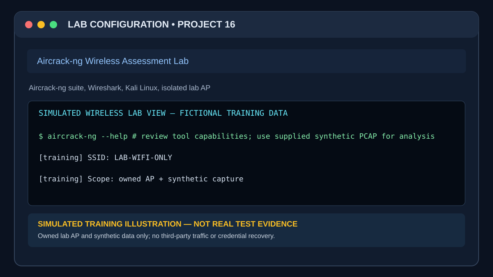
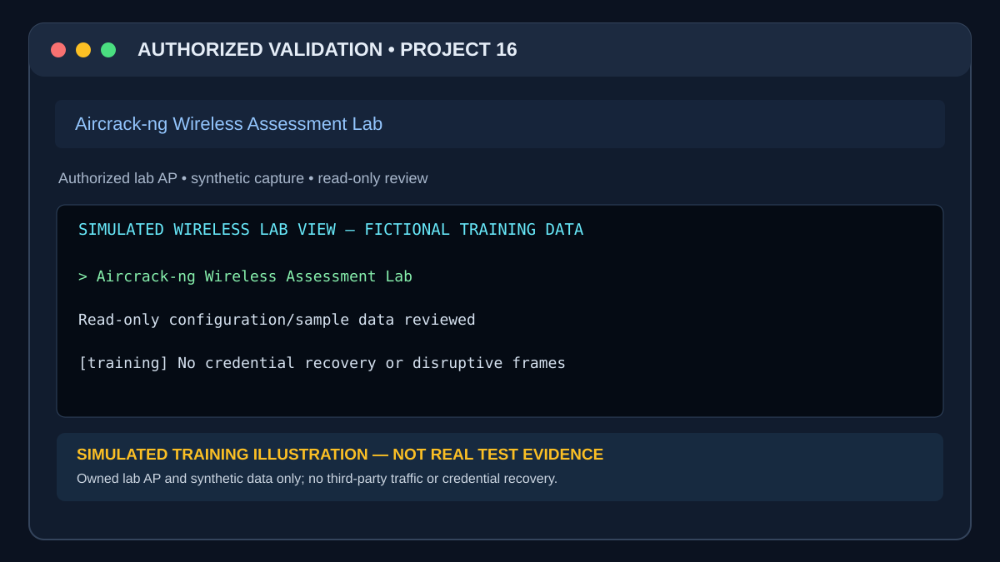

# Project 16 — Aircrack-ng Wireless Assessment Lab

**Level:** Intermediate | **Estimated time:** 3–4 hours

> **Authorized lab only.** This project is limited to owned APs, synthetic captures, and explicitly authorized test clients. No third-party capture, credential cracking, deauthentication, frame injection, impersonation, or disruptive testing is included.

## Objective

Set up the Aircrack-ng toolset and use it to inspect synthetic training captures and document authorized wireless assessment workflow.

## Scope and prerequisites

- Owned lab AP/router, authorized test client, and isolated SSID.
- Synthetic PCAPs or sanitized configuration exports; no production traffic or credentials.
- **Tools:** Aircrack-ng suite, Wireshark, Kali Linux, isolated lab AP.
- Record authorization, AP model/firmware, SSID/BSSID, test client, tool versions, and time window.
- Define exclusions and stop conditions. Use a trusted management interface for AP configuration.

## Step 1 — Establish the baseline

Export the AP configuration and document current security mode, cipher, PMF, authentication method, and firmware. Confirm that any capture file is synthetic or was generated from your own lab with consent.

```bash
ip -br link
 iw dev
nmcli -f DEVICE,TYPE,STATE,CONNECTION device status
```

## Step 2 — Assessment workflow

1. Install the suite and record package version; verify the wireless adapter and regulatory domain.
2. Use a supplied synthetic capture or a capture generated from your own lab AP with consent.
3. Inspect metadata and supported analysis options; do not collect third-party traffic or attempt password recovery.
4. Correlate the capture with the AP's exported security configuration.
5. Document what the tools can and cannot establish from the available evidence.

Read-only example:

```bash
aircrack-ng --help  # review tool capabilities; use supplied synthetic PCAP for analysis
```

Do not run active injection, deauthentication, credential capture/recovery, or password-cracking operations. Where a tool supports disruptive features, limit use to reading its help/documentation.

## Step 3 — Expected observations

A lab inventory, tool/version record, synthetic capture metadata, and assessment notes tied to the owned AP configuration.

## Step 4 — Risk analysis

Misuse of wireless auditing tools can expose third-party traffic or disrupt networks; capture contents alone may not prove a weakness. Identify the evidence source, confidence, prerequisites, affected SSID/AP, and limitations. A synthetic capture or tool alert is not proof of a live compromise.

## Step 5 — Remediation and validation

Restrict work to owned lab captures, remove unnecessary capture capability from production workflows, and keep configuration and client security baselines current.

Apply approved changes during a maintenance window. Verify the AP configuration export and authorized client behavior; retain before/after evidence and a rollback plan.

## Simulated training illustrations

> Fictional training SVGs only—not actual wireless captures, credential material, live traffic, or proof of testing.






## Evidence and deliverables

- Authorization, exact SSID/BSSID scope, exclusions, and stop conditions.
- Sanitized AP config, firmware, test client, and tool versions.
- Synthetic capture metadata or read-only command output, timestamps, and configuration diffs.
- Finding register, risk rationale, remediation owner, and retest status.
- Never commit PSKs, passwords, private keys, real client identifiers, or third-party traffic.

## Framework references

- Aircrack-ng documentation; NIST SP 800-153
- [NIST SP 800-153](https://csrc.nist.gov/pubs/sp/800/153/final)
- [IEEE 802.11 standards](https://standards.ieee.org/)

## Completion checklist

- [ ] Written authorization and lab scope confirmed
- [ ] Synthetic/owned data verified
- [ ] Non-disruptive assessment completed
- [ ] Evidence sanitized and limitations stated
- [ ] Remediation and validation documented
- [ ] No credential recovery or third-party activity performed
