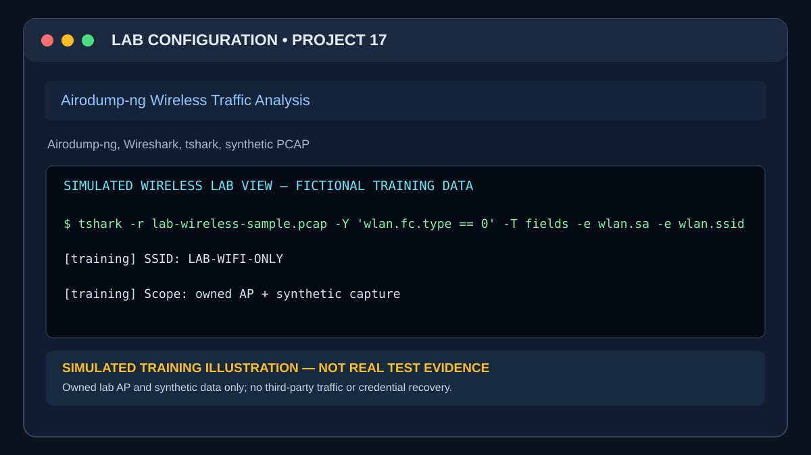
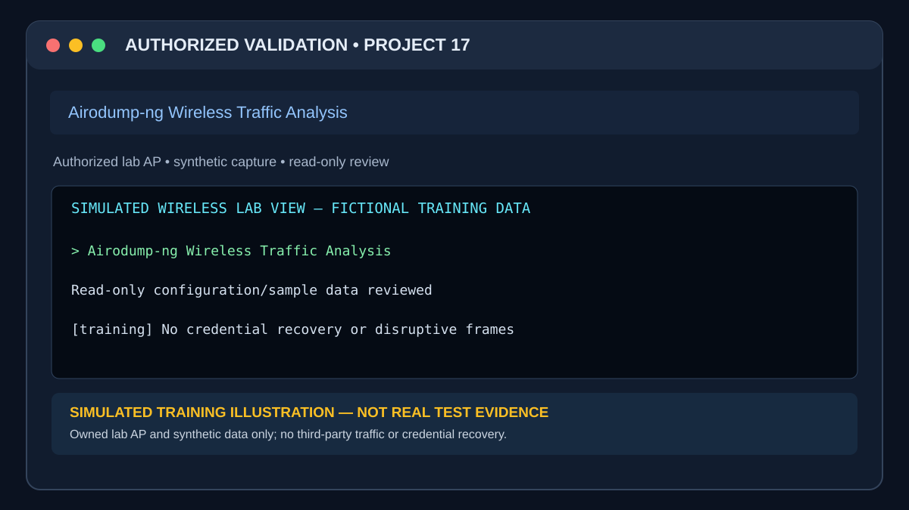

# Project 17 — Airodump-ng Wireless Traffic Analysis

**Level:** Intermediate | **Estimated time:** 3–4 hours

> **Authorized lab only.** This project is limited to owned APs, synthetic captures, and explicitly authorized test clients. No third-party capture, credential cracking, deauthentication, frame injection, impersonation, or disruptive testing is included.

## Objective

Analyze a synthetic or explicitly authorized lab capture to understand 802.11 management metadata and document privacy considerations.

## Scope and prerequisites

- Owned lab AP/router, authorized test client, and isolated SSID.
- Synthetic PCAPs or sanitized configuration exports; no production traffic or credentials.
- **Tools:** Airodump-ng, Wireshark, tshark, synthetic PCAP.
- Record authorization, AP model/firmware, SSID/BSSID, test client, tool versions, and time window.
- Define exclusions and stop conditions. Use a trusted management interface for AP configuration.

## Step 1 — Establish the baseline

Export the AP configuration and document current security mode, cipher, PMF, authentication method, and firmware. Confirm that any capture file is synthetic or was generated from your own lab with consent.

```bash
ip -br link
 iw dev
nmcli -f DEVICE,TYPE,STATE,CONNECTION device status
```

## Step 2 — Assessment workflow

1. Obtain the provided synthetic PCAP or approved capture from your own AP/client.
2. Verify file hash, capture time, interface, channel, and authorization context.
3. Use Wireshark/tshark to summarize beacon, probe, and association metadata from the sample.
4. Avoid collecting payloads or identifying real users; use anonymized MAC addresses in the report.
5. Compare advertised SSID/security metadata with the AP configuration export.

Read-only example:

```bash
tshark -r lab-wireless-sample.pcap -Y 'wlan.fc.type == 0' -T fields -e wlan.sa -e wlan.ssid
```

Do not run active injection, deauthentication, credential capture/recovery, or password-cracking operations. Where a tool supports disruptive features, limit use to reading its help/documentation.

## Step 3 — Expected observations

A sanitized management-frame summary with SSID, channel, security advertisement, and capture limitations.

## Step 4 — Risk analysis

Wireless metadata may expose device identifiers and network naming information; captures can include unintended personal data. Identify the evidence source, confidence, prerequisites, affected SSID/AP, and limitations. A synthetic capture or tool alert is not proof of a live compromise.

## Step 5 — Remediation and validation

Minimize collection, anonymize identifiers, limit retention, disable unnecessary SSID disclosure where appropriate, and apply secure WLAN configuration.

Apply approved changes during a maintenance window. Verify the AP configuration export and authorized client behavior; retain before/after evidence and a rollback plan.

## Simulated training illustrations

> Fictional training SVGs only—not actual wireless captures, credential material, live traffic, or proof of testing.






## Evidence and deliverables

- Authorization, exact SSID/BSSID scope, exclusions, and stop conditions.
- Sanitized AP config, firmware, test client, and tool versions.
- Synthetic capture metadata or read-only command output, timestamps, and configuration diffs.
- Finding register, risk rationale, remediation owner, and retest status.
- Never commit PSKs, passwords, private keys, real client identifiers, or third-party traffic.

## Framework references

- Wireshark WLAN display filters; NIST SP 800-153
- [NIST SP 800-153](https://csrc.nist.gov/pubs/sp/800/153/final)
- [IEEE 802.11 standards](https://standards.ieee.org/)

## Completion checklist

- [ ] Written authorization and lab scope confirmed
- [ ] Synthetic/owned data verified
- [ ] Non-disruptive assessment completed
- [ ] Evidence sanitized and limitations stated
- [ ] Remediation and validation documented
- [ ] No credential recovery or third-party activity performed
