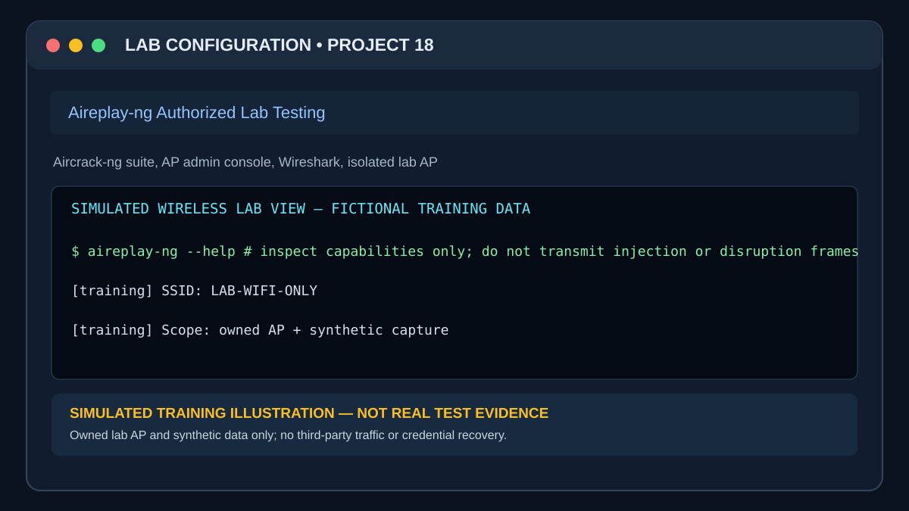
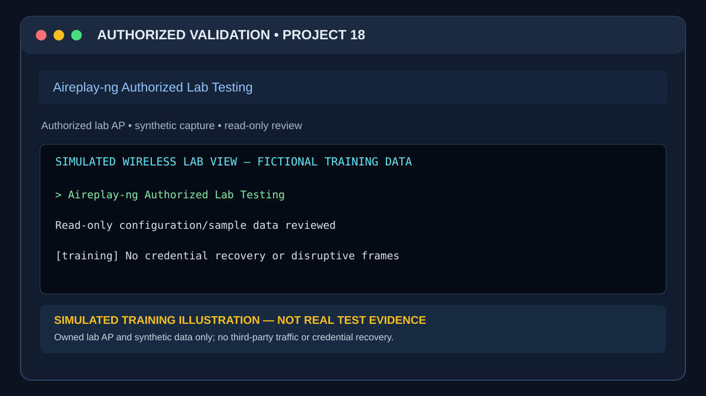

# Project 18 — Aireplay-ng Authorized Lab Testing

**Level:** Intermediate | **Estimated time:** 3–4 hours

> **Authorized lab only.** This project is limited to owned APs, synthetic captures, and explicitly authorized test clients. No third-party capture, credential cracking, deauthentication, frame injection, impersonation, or disruptive testing is included.

## Objective

Understand the purpose and risk of aireplay-ng while validating defensive protections through configuration review and non-disruptive lab evidence.

## Scope and prerequisites

- Owned lab AP/router, authorized test client, and isolated SSID.
- Synthetic PCAPs or sanitized configuration exports; no production traffic or credentials.
- **Tools:** Aircrack-ng suite, AP admin console, Wireshark, isolated lab AP.
- Record authorization, AP model/firmware, SSID/BSSID, test client, tool versions, and time window.
- Define exclusions and stop conditions. Use a trusted management interface for AP configuration.

## Step 1 — Establish the baseline

Export the AP configuration and document current security mode, cipher, PMF, authentication method, and firmware. Confirm that any capture file is synthetic or was generated from your own lab with consent.

```bash
ip -br link
 iw dev
nmcli -f DEVICE,TYPE,STATE,CONNECTION device status
```

## Step 2 — Assessment workflow

1. Review tool documentation and identify functions that can inject or disrupt wireless traffic.
2. Do not execute deauthentication, replay, injection, or disruption options.
3. Inspect the lab AP configuration for PMF/802.11w and related management-frame protections.
4. Review AP/controller logs and a synthetic test record for management-frame protection status.
5. Document approved defensive validation methods and explicit prohibited operations.

Read-only example:

```bash
aireplay-ng --help  # inspect capabilities only; do not transmit injection or disruption frames
```

Do not run active injection, deauthentication, credential capture/recovery, or password-cracking operations. Where a tool supports disruptive features, limit use to reading its help/documentation.

## Step 3 — Expected observations

A defensive test plan recording management-frame protections, configuration evidence, log visibility, and prohibited disruptive methods.

## Step 4 — Risk analysis

Frame injection or deauthentication can disconnect users and disrupt availability, even when performed briefly. Identify the evidence source, confidence, prerequisites, affected SSID/AP, and limitations. A synthetic capture or tool alert is not proof of a live compromise.

## Step 5 — Remediation and validation

Enable PMF where supported, monitor management-frame anomalies, maintain incident procedures, and restrict radio testing to approved isolated labs.

Apply approved changes during a maintenance window. Verify the AP configuration export and authorized client behavior; retain before/after evidence and a rollback plan.

## Simulated training illustrations

> Fictional training SVGs only—not actual wireless captures, credential material, live traffic, or proof of testing.






## Evidence and deliverables

- Authorization, exact SSID/BSSID scope, exclusions, and stop conditions.
- Sanitized AP config, firmware, test client, and tool versions.
- Synthetic capture metadata or read-only command output, timestamps, and configuration diffs.
- Finding register, risk rationale, remediation owner, and retest status.
- Never commit PSKs, passwords, private keys, real client identifiers, or third-party traffic.

## Framework references

- IEEE 802.11w/PMF; NIST SP 800-153; Aircrack-ng documentation
- [NIST SP 800-153](https://csrc.nist.gov/pubs/sp/800/153/final)
- [IEEE 802.11 standards](https://standards.ieee.org/)

## Completion checklist

- [ ] Written authorization and lab scope confirmed
- [ ] Synthetic/owned data verified
- [ ] Non-disruptive assessment completed
- [ ] Evidence sanitized and limitations stated
- [ ] Remediation and validation documented
- [ ] No credential recovery or third-party activity performed
