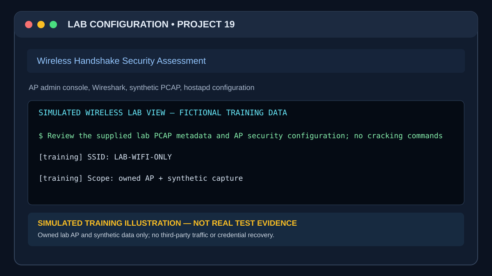
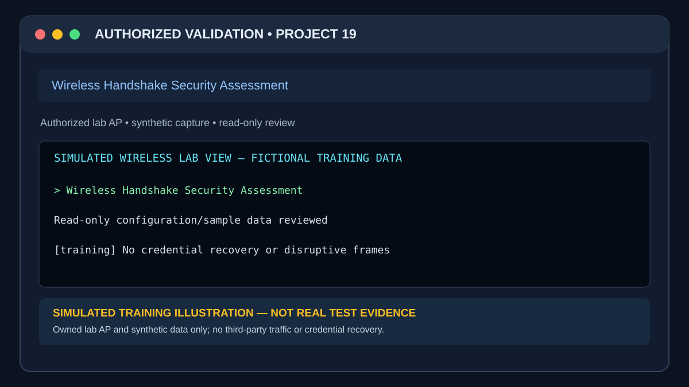

# Project 19 — Wireless Handshake Security Assessment

**Level:** Intermediate | **Estimated time:** 3–4 hours

> **Authorized lab only.** This project is limited to owned APs, synthetic captures, and explicitly authorized test clients. No third-party capture, credential cracking, deauthentication, frame injection, impersonation, or disruptive testing is included.

## Objective

Review WPA2/WPA3 authentication design using synthetic training material and AP configuration, without capturing real handshakes or attempting credential cracking.

## Scope and prerequisites

- Owned lab AP/router, authorized test client, and isolated SSID.
- Synthetic PCAPs or sanitized configuration exports; no production traffic or credentials.
- **Tools:** AP admin console, Wireshark, synthetic PCAP, hostapd configuration.
- Record authorization, AP model/firmware, SSID/BSSID, test client, tool versions, and time window.
- Define exclusions and stop conditions. Use a trusted management interface for AP configuration.

## Step 1 — Establish the baseline

Export the AP configuration and document current security mode, cipher, PMF, authentication method, and firmware. Confirm that any capture file is synthetic or was generated from your own lab with consent.

```bash
ip -br link
 iw dev
nmcli -f DEVICE,TYPE,STATE,CONNECTION device status
```

## Step 2 — Assessment workflow

1. Use only a supplied synthetic PCAP with fictional identities and no usable credentials.
2. Verify capture provenance and confirm the file contains no real client identifiers or production data.
3. Review authentication exchange metadata and the AP's negotiated security mode at a high level.
4. Assess password policy and authentication architecture from configuration, not from attempts to recover secrets.
5. Document why the sample cannot establish password strength or prove a live network is vulnerable.

Read-only example:

```bash
Review the supplied lab PCAP metadata and AP security configuration; no cracking commands
```

Do not run active injection, deauthentication, credential capture/recovery, or password-cracking operations. Where a tool supports disruptive features, limit use to reading its help/documentation.

## Step 3 — Expected observations

A safe authentication assessment note with synthetic capture metadata, protocol mode, configuration context, and explicit limitations.

## Step 4 — Risk analysis

Handshake capture and password recovery can expose credentials; a capture alone does not prove compromise. Identify the evidence source, confidence, prerequisites, affected SSID/AP, and limitations. A synthetic capture or tool alert is not proof of a live compromise.

## Step 5 — Remediation and validation

Prefer WPA3-SAE or enterprise certificate-based authentication, use strong unique credentials, and disable legacy modes.

Apply approved changes during a maintenance window. Verify the AP configuration export and authorized client behavior; retain before/after evidence and a rollback plan.

## Simulated training illustrations

> Fictional training SVGs only—not actual wireless captures, credential material, live traffic, or proof of testing.






## Evidence and deliverables

- Authorization, exact SSID/BSSID scope, exclusions, and stop conditions.
- Sanitized AP config, firmware, test client, and tool versions.
- Synthetic capture metadata or read-only command output, timestamps, and configuration diffs.
- Finding register, risk rationale, remediation owner, and retest status.
- Never commit PSKs, passwords, private keys, real client identifiers, or third-party traffic.

## Framework references

- Wi-Fi Alliance WPA3; NIST SP 800-153
- [NIST SP 800-153](https://csrc.nist.gov/pubs/sp/800/153/final)
- [IEEE 802.11 standards](https://standards.ieee.org/)

## Completion checklist

- [ ] Written authorization and lab scope confirmed
- [ ] Synthetic/owned data verified
- [ ] Non-disruptive assessment completed
- [ ] Evidence sanitized and limitations stated
- [ ] Remediation and validation documented
- [ ] No credential recovery or third-party activity performed
