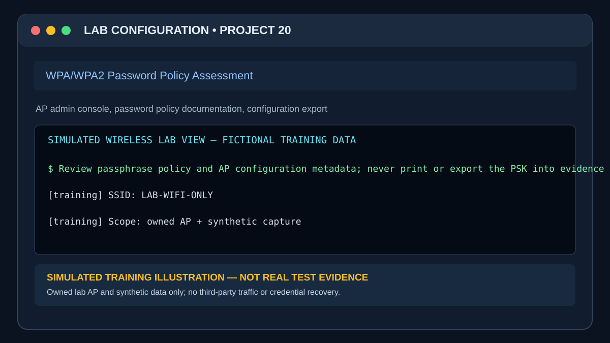
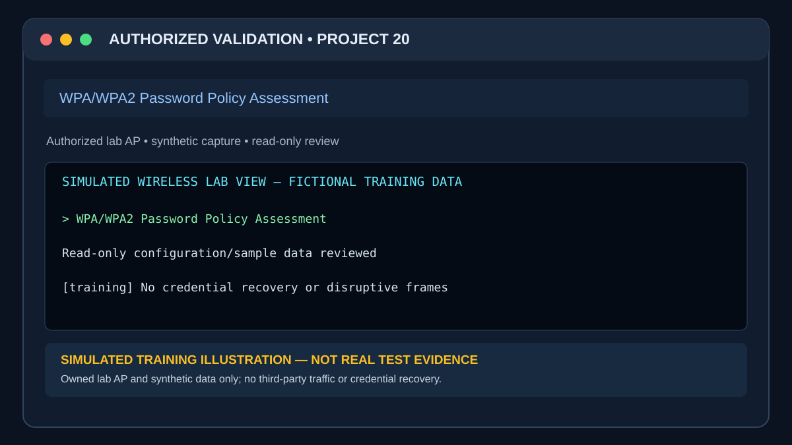

# Project 20 — WPA/WPA2 Password Policy Assessment

**Level:** Intermediate | **Estimated time:** 3–4 hours

> **Authorized lab only.** This project is limited to owned APs, synthetic captures, and explicitly authorized test clients. No third-party capture, credential cracking, deauthentication, frame injection, impersonation, or disruptive testing is included.

## Objective

Evaluate the policy and governance of a lab WLAN passphrase without collecting, cracking, or publishing credentials.

## Scope and prerequisites

- Owned lab AP/router, authorized test client, and isolated SSID.
- Synthetic PCAPs or sanitized configuration exports; no production traffic or credentials.
- **Tools:** AP admin console, password policy documentation, configuration export.
- Record authorization, AP model/firmware, SSID/BSSID, test client, tool versions, and time window.
- Define exclusions and stop conditions. Use a trusted management interface for AP configuration.

## Step 1 — Establish the baseline

Export the AP configuration and document current security mode, cipher, PMF, authentication method, and firmware. Confirm that any capture file is synthetic or was generated from your own lab with consent.

```bash
ip -br link
 iw dev
nmcli -f DEVICE,TYPE,STATE,CONNECTION device status
```

## Step 2 — Assessment workflow

1. Confirm the SSID and AP are owned by the lab and identify the credential owner.
2. Review the written passphrase length, uniqueness, rotation, sharing, and revocation policy.
3. Verify the AP uses an approved WPA2/WPA3 mode and modern cipher configuration.
4. Review how guest/contractor access is issued and revoked; confirm test access uses a synthetic credential.
5. Document policy gaps without storing or disclosing the actual passphrase.

Read-only example:

```bash
Review passphrase policy and AP configuration metadata; never print or export the PSK into evidence
```

Do not run active injection, deauthentication, credential capture/recovery, or password-cracking operations. Where a tool supports disruptive features, limit use to reading its help/documentation.

## Step 3 — Expected observations

A passphrase governance review covering uniqueness, length policy, distribution, rotation, revocation, and SSID security mode.

## Step 4 — Risk analysis

Shared or reused WLAN credentials can persist after personnel changes and make attribution difficult. Identify the evidence source, confidence, prerequisites, affected SSID/AP, and limitations. A synthetic capture or tool alert is not proof of a live compromise.

## Step 5 — Remediation and validation

Use unique high-entropy credentials, per-user enterprise authentication where feasible, secure distribution, and prompt revocation.

Apply approved changes during a maintenance window. Verify the AP configuration export and authorized client behavior; retain before/after evidence and a rollback plan.

## Simulated training illustrations

> Fictional training SVGs only—not actual wireless captures, credential material, live traffic, or proof of testing.






## Evidence and deliverables

- Authorization, exact SSID/BSSID scope, exclusions, and stop conditions.
- Sanitized AP config, firmware, test client, and tool versions.
- Synthetic capture metadata or read-only command output, timestamps, and configuration diffs.
- Finding register, risk rationale, remediation owner, and retest status.
- Never commit PSKs, passwords, private keys, real client identifiers, or third-party traffic.

## Framework references

- NIST SP 800-63B; NIST SP 800-153; Wi-Fi Alliance WPA guidance
- [NIST SP 800-153](https://csrc.nist.gov/pubs/sp/800/153/final)
- [IEEE 802.11 standards](https://standards.ieee.org/)

## Completion checklist

- [ ] Written authorization and lab scope confirmed
- [ ] Synthetic/owned data verified
- [ ] Non-disruptive assessment completed
- [ ] Evidence sanitized and limitations stated
- [ ] Remediation and validation documented
- [ ] No credential recovery or third-party activity performed
