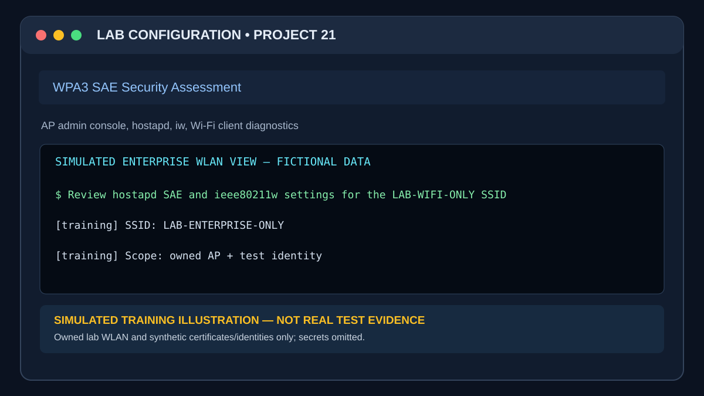
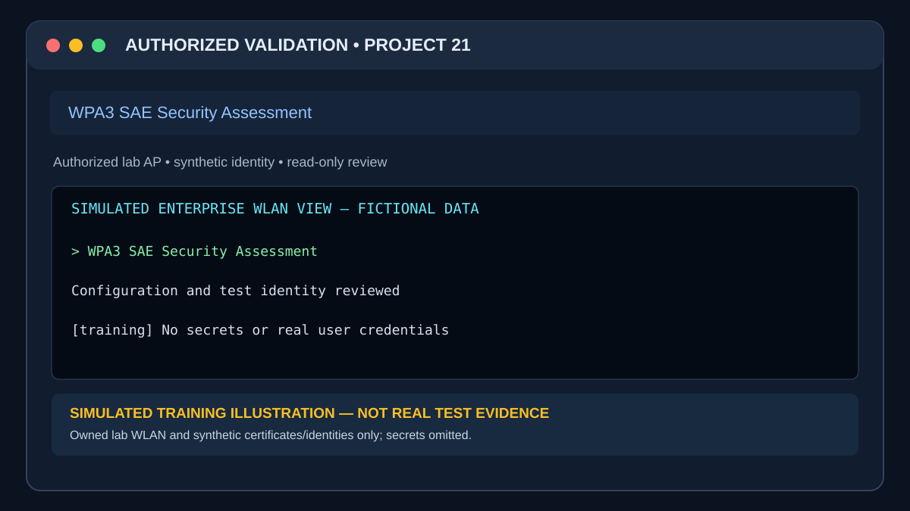

# Project 21 — WPA3 SAE Security Assessment

**Level:** Intermediate | **Estimated time:** 3–4 hours

> **Authorized lab only.** Use an owned enterprise-style test AP/controller, synthetic identities, and a dedicated RADIUS/PKI lab. Do not capture real credentials or test third-party WLAN infrastructure.

## Objective

Review WPA3-Personal SAE configuration, transition mode, PMF requirements, and client interoperability on the owned lab WLAN.

## Scope and prerequisites

- Owned lab AP/controller and isolated SSID.
- Synthetic test users/devices and disposable certificates where applicable.
- **Tools:** AP admin console, hostapd, iw, Wi-Fi client diagnostics.
- Record AP/controller firmware, RADIUS/PKI versions, SSID/BSSID, client OS, test window, and authorization.
- Define permitted methods, exclusions, change window, and rollback plan.

## Step 1 — Map the authentication architecture

Document client → AP/controller → RADIUS/identity/PKI flow. Export sanitized configuration and record the current policy. Do not export passwords, shared secrets, private keys, or production certificates.

## Step 2 — Perform the assessment

1. Export the AP profile and verify WPA3-SAE enablement and supported cipher suite.
2. Check whether transition mode is enabled and document legacy compatibility requirements.
3. Verify PMF is required for the WPA3-only profile and inspect client association status.
4. Connect an authorized WPA3-capable client and record negotiated mode without collecting authentication secrets.
5. Test configuration changes during a maintenance window and validate legacy-client handling.

Read-only review example:

```bash
Review hostapd SAE and ieee80211w settings for the LAB-WIFI-ONLY SSID
```

Adapt to your lab. Never display or commit secret values. Use synthetic test identities and verify the target SSID before testing.

## Step 3 — Expected observations

A WPA3 configuration matrix showing SAE mode, transition behavior, PMF, cipher, firmware, and client compatibility.

## Step 4 — Risk analysis

Incorrect transition or PMF configuration can weaken security or cause clients to fall back to legacy modes. Record evidence source, confidence, affected policy, client compatibility, and any operational limitations. Do not infer a vulnerability from a configuration label alone.

## Step 5 — Remediation and validation

Prefer WPA3-only where feasible, require PMF, disable unnecessary transition compatibility, and keep client/AP firmware current.

Apply changes through approved change control. Validate trusted test-client success, untrusted/disabled identity denial, logging, and recovery/rollback behavior.

## Simulated training illustrations

> Fictional training illustrations only—not actual RADIUS logs, certificate material, client captures, or proof of assessment.






## Evidence and deliverables

- Authorization, architecture diagram, exact SSID/BSSID scope, and change window.
- Sanitized AP/controller/RADIUS/PKI configuration, firmware, and tool versions.
- Synthetic test identity results, timestamps, relevant logs, and configuration diffs.
- Finding register, risk rationale, remediation owner, and retest outcome.
- Never commit passwords, RADIUS shared secrets, private keys, or real user certificates.

## Framework references

- Wi-Fi Alliance WPA3; NIST SP 800-153
- [NIST SP 800-153](https://csrc.nist.gov/pubs/sp/800/153/final)
- [IEEE 802.1X](https://standards.ieee.org/)

## Completion checklist

- [ ] Written authorization and lab scope confirmed
- [ ] Synthetic identities and certificates prepared
- [ ] Configuration and validation completed safely
- [ ] Evidence sanitized and secrets excluded
- [ ] Remediation and retest documented
- [ ] Rollback and client compatibility verified
