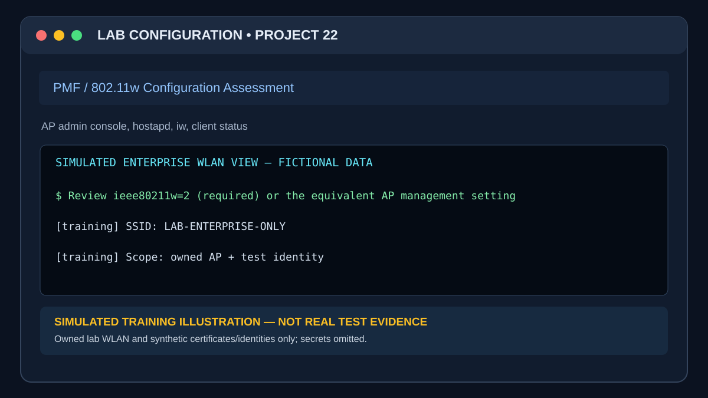
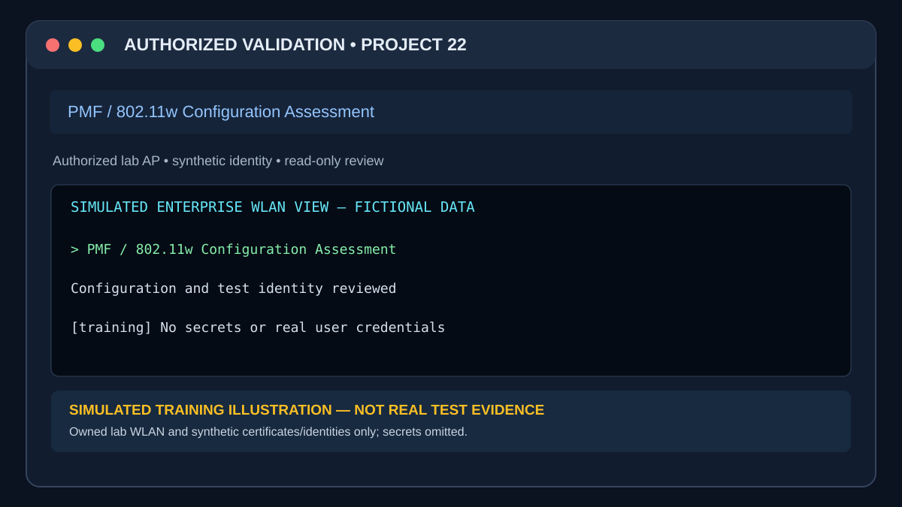

# Project 22 — PMF / 802.11w Configuration Assessment

**Level:** Intermediate | **Estimated time:** 3–4 hours

> **Authorized lab only.** Use an owned enterprise-style test AP/controller, synthetic identities, and a dedicated RADIUS/PKI lab. Do not capture real credentials or test third-party WLAN infrastructure.

## Objective

Verify Protected Management Frames settings and client behavior for the lab SSID using configuration and status evidence.

## Scope and prerequisites

- Owned lab AP/controller and isolated SSID.
- Synthetic test users/devices and disposable certificates where applicable.
- **Tools:** AP admin console, hostapd, iw, client status.
- Record AP/controller firmware, RADIUS/PKI versions, SSID/BSSID, client OS, test window, and authorization.
- Define permitted methods, exclusions, change window, and rollback plan.

## Step 1 — Map the authentication architecture

Document client → AP/controller → RADIUS/identity/PKI flow. Export sanitized configuration and record the current policy. Do not export passwords, shared secrets, private keys, or production certificates.

## Step 2 — Perform the assessment

1. Record PMF capability and requirement settings for each in-scope SSID.
2. Compare AP configuration with client support and the intended security profile.
3. Connect an authorized test client and confirm negotiated PMF status from AP/client diagnostics.
4. Review AP logs for management-frame protection status and client compatibility errors.
5. Do not send deauthentication or other disruptive management frames; validate protection non-disruptively.

Read-only review example:

```bash
Review ieee80211w=2 (required) or the equivalent AP management setting
```

Adapt to your lab. Never display or commit secret values. Use synthetic test identities and verify the target SSID before testing.

## Step 3 — Expected observations

A PMF matrix showing capable/required status, client support, negotiation, and any compatibility exceptions.

## Step 4 — Risk analysis

Optional or disabled PMF can leave management frames less protected on supported networks. Record evidence source, confidence, affected policy, client compatibility, and any operational limitations. Do not infer a vulnerability from a configuration label alone.

## Step 5 — Remediation and validation

Require PMF for WPA3 and where supported for WPA2 enterprise/personal; document exceptions and retire incompatible clients.

Apply changes through approved change control. Validate trusted test-client success, untrusted/disabled identity denial, logging, and recovery/rollback behavior.

## Simulated training illustrations

> Fictional training illustrations only—not actual RADIUS logs, certificate material, client captures, or proof of assessment.






## Evidence and deliverables

- Authorization, architecture diagram, exact SSID/BSSID scope, and change window.
- Sanitized AP/controller/RADIUS/PKI configuration, firmware, and tool versions.
- Synthetic test identity results, timestamps, relevant logs, and configuration diffs.
- Finding register, risk rationale, remediation owner, and retest outcome.
- Never commit passwords, RADIUS shared secrets, private keys, or real user certificates.

## Framework references

- IEEE 802.11w; Wi-Fi Alliance WPA3; NIST SP 800-153
- [NIST SP 800-153](https://csrc.nist.gov/pubs/sp/800/153/final)
- [IEEE 802.1X](https://standards.ieee.org/)

## Completion checklist

- [ ] Written authorization and lab scope confirmed
- [ ] Synthetic identities and certificates prepared
- [ ] Configuration and validation completed safely
- [ ] Evidence sanitized and secrets excluded
- [ ] Remediation and retest documented
- [ ] Rollback and client compatibility verified
