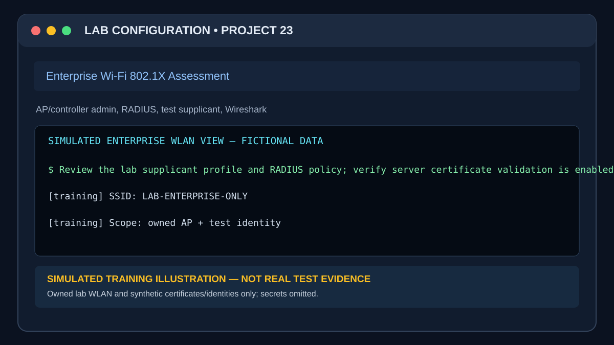
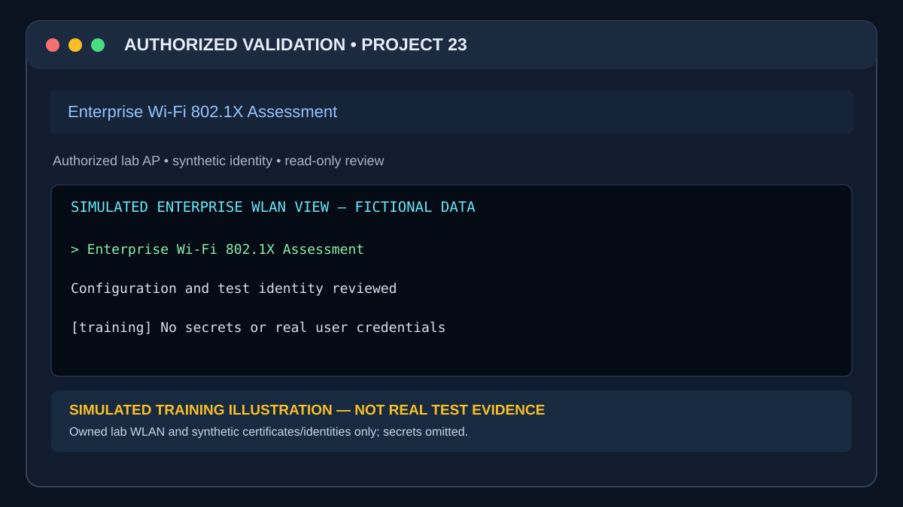

# Project 23 — Enterprise Wi-Fi 802.1X Assessment

**Level:** Intermediate | **Estimated time:** 3–4 hours

> **Authorized lab only.** Use an owned enterprise-style test AP/controller, synthetic identities, and a dedicated RADIUS/PKI lab. Do not capture real credentials or test third-party WLAN infrastructure.

## Objective

Assess the enterprise WLAN 802.1X architecture, identity source, EAP method, certificate validation, and role assignment using synthetic test identities.

## Scope and prerequisites

- Owned lab AP/controller and isolated SSID.
- Synthetic test users/devices and disposable certificates where applicable.
- **Tools:** AP/controller admin, RADIUS, test supplicant, Wireshark.
- Record AP/controller firmware, RADIUS/PKI versions, SSID/BSSID, client OS, test window, and authorization.
- Define permitted methods, exclusions, change window, and rollback plan.

## Step 1 — Map the authentication architecture

Document client → AP/controller → RADIUS/identity/PKI flow. Export sanitized configuration and record the current policy. Do not export passwords, shared secrets, private keys, or production certificates.

## Step 2 — Perform the assessment

1. Map SSID, controller, RADIUS server, identity store, certificate authority, and VLAN/role assignment.
2. Review the selected EAP method and client trust settings; require server certificate validation.
3. Use synthetic user/device identities and a dedicated test certificate.
4. Validate successful authentication, invalid certificate rejection, disabled-account denial, and deprovisioning.
5. Review RADIUS logs for useful events without logging passwords or private key material.

Read-only review example:

```bash
Review the lab supplicant profile and RADIUS policy; verify server certificate validation is enabled
```

Adapt to your lab. Never display or commit secret values. Use synthetic test identities and verify the target SSID before testing.

## Step 3 — Expected observations

An 802.1X flow diagram and test matrix for trusted/untrusted certificates, identity lifecycle, and role assignment.

## Step 4 — Risk analysis

Weak EAP configuration or missing certificate validation can expose credentials or permit rogue authentication infrastructure. Record evidence source, confidence, affected policy, client compatibility, and any operational limitations. Do not infer a vulnerability from a configuration label alone.

## Step 5 — Remediation and validation

Use certificate-based EAP-TLS where practical, validate server identity, manage trust anchors, and enforce least-privilege network roles.

Apply changes through approved change control. Validate trusted test-client success, untrusted/disabled identity denial, logging, and recovery/rollback behavior.

## Simulated training illustrations

> Fictional training illustrations only—not actual RADIUS logs, certificate material, client captures, or proof of assessment.






## Evidence and deliverables

- Authorization, architecture diagram, exact SSID/BSSID scope, and change window.
- Sanitized AP/controller/RADIUS/PKI configuration, firmware, and tool versions.
- Synthetic test identity results, timestamps, relevant logs, and configuration diffs.
- Finding register, risk rationale, remediation owner, and retest outcome.
- Never commit passwords, RADIUS shared secrets, private keys, or real user certificates.

## Framework references

- NIST SP 800-153; RFC 9190; vendor 802.1X guidance
- [NIST SP 800-153](https://csrc.nist.gov/pubs/sp/800/153/final)
- [IEEE 802.1X](https://standards.ieee.org/)

## Completion checklist

- [ ] Written authorization and lab scope confirmed
- [ ] Synthetic identities and certificates prepared
- [ ] Configuration and validation completed safely
- [ ] Evidence sanitized and secrets excluded
- [ ] Remediation and retest documented
- [ ] Rollback and client compatibility verified
