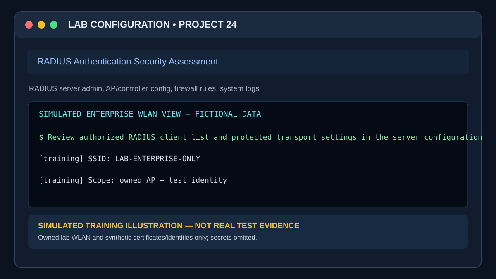
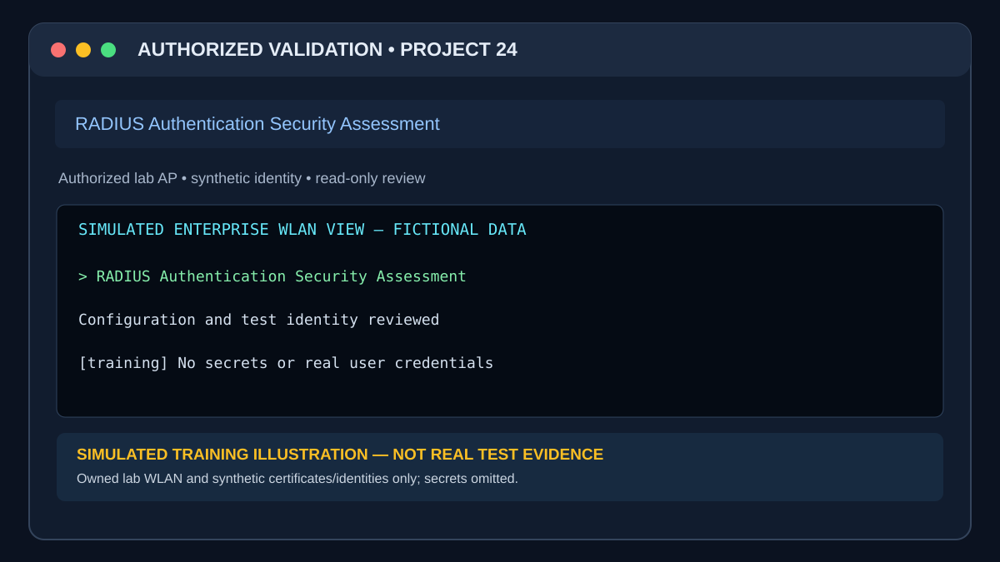

# Project 24 — RADIUS Authentication Security Assessment

**Level:** Intermediate | **Estimated time:** 3–4 hours

> **Authorized lab only.** Use an owned enterprise-style test AP/controller, synthetic identities, and a dedicated RADIUS/PKI lab. Do not capture real credentials or test third-party WLAN infrastructure.

## Objective

Review RADIUS deployment security, shared-secret handling, transport protections, client allowlists, logging, and failover behavior.

## Scope and prerequisites

- Owned lab AP/controller and isolated SSID.
- Synthetic test users/devices and disposable certificates where applicable.
- **Tools:** RADIUS server admin, AP/controller config, firewall rules, system logs.
- Record AP/controller firmware, RADIUS/PKI versions, SSID/BSSID, client OS, test window, and authorization.
- Define permitted methods, exclusions, change window, and rollback plan.

## Step 1 — Map the authentication architecture

Document client → AP/controller → RADIUS/identity/PKI flow. Export sanitized configuration and record the current policy. Do not export passwords, shared secrets, private keys, or production certificates.

## Step 2 — Perform the assessment

1. Inventory RADIUS servers, clients, ports, network paths, and authentication/accounting roles.
2. Review shared-secret length, uniqueness, storage, rotation, and access permissions without displaying secret values.
3. Verify RADIUS clients are allowlisted and management traffic is restricted to approved network segments.
4. Review use of RadSec or protected transport where supported and required by the architecture.
5. Validate test-user success/failure, server failover, logging, and account revocation.

Read-only review example:

```bash
Review authorized RADIUS client list and protected transport settings in the server configuration
```

Adapt to your lab. Never display or commit secret values. Use synthetic test identities and verify the target SSID before testing.

## Step 3 — Expected observations

A RADIUS architecture and control matrix with client trust, transport, secret lifecycle, logging, and availability controls.

## Step 4 — Risk analysis

Weak shared-secret management or exposed RADIUS traffic can undermine WLAN authentication and accountability. Record evidence source, confidence, affected policy, client compatibility, and any operational limitations. Do not infer a vulnerability from a configuration label alone.

## Step 5 — Remediation and validation

Use unique high-entropy secrets, restrict clients/network paths, protect transport, rotate secrets, and monitor authentication events.

Apply changes through approved change control. Validate trusted test-client success, untrusted/disabled identity denial, logging, and recovery/rollback behavior.

## Simulated training illustrations

> Fictional training illustrations only—not actual RADIUS logs, certificate material, client captures, or proof of assessment.






## Evidence and deliverables

- Authorization, architecture diagram, exact SSID/BSSID scope, and change window.
- Sanitized AP/controller/RADIUS/PKI configuration, firmware, and tool versions.
- Synthetic test identity results, timestamps, relevant logs, and configuration diffs.
- Finding register, risk rationale, remediation owner, and retest outcome.
- Never commit passwords, RADIUS shared secrets, private keys, or real user certificates.

## Framework references

- RFC 2865; RFC 6614 (RadSec); NIST SP 800-153
- [NIST SP 800-153](https://csrc.nist.gov/pubs/sp/800/153/final)
- [IEEE 802.1X](https://standards.ieee.org/)

## Completion checklist

- [ ] Written authorization and lab scope confirmed
- [ ] Synthetic identities and certificates prepared
- [ ] Configuration and validation completed safely
- [ ] Evidence sanitized and secrets excluded
- [ ] Remediation and retest documented
- [ ] Rollback and client compatibility verified
