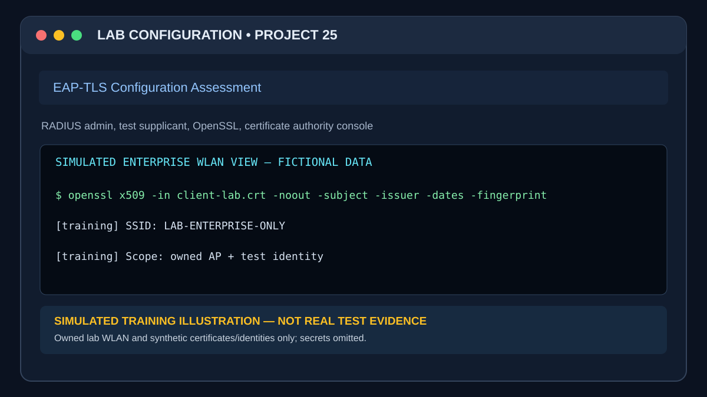
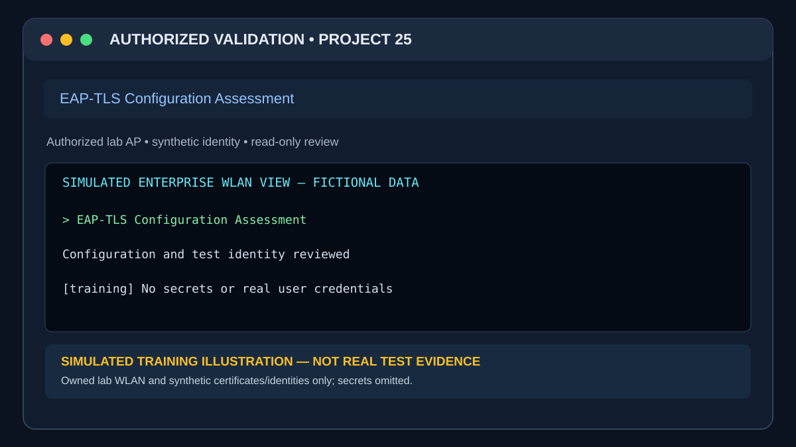

# Project 25 — EAP-TLS Configuration Assessment

**Level:** Intermediate | **Estimated time:** 3–4 hours

> **Authorized lab only.** Use an owned enterprise-style test AP/controller, synthetic identities, and a dedicated RADIUS/PKI lab. Do not capture real credentials or test third-party WLAN infrastructure.

## Objective

Validate EAP-TLS certificate provisioning, trust, identity mapping, revocation, and renewal for the lab WLAN.

## Scope and prerequisites

- Owned lab AP/controller and isolated SSID.
- Synthetic test users/devices and disposable certificates where applicable.
- **Tools:** RADIUS admin, test supplicant, OpenSSL, certificate authority console.
- Record AP/controller firmware, RADIUS/PKI versions, SSID/BSSID, client OS, test window, and authorization.
- Define permitted methods, exclusions, change window, and rollback plan.

## Step 1 — Map the authentication architecture

Document client → AP/controller → RADIUS/identity/PKI flow. Export sanitized configuration and record the current policy. Do not export passwords, shared secrets, private keys, or production certificates.

## Step 2 — Perform the assessment

1. Document CA hierarchy, RADIUS server certificate, client certificate profile, and trust distribution.
2. Inspect EKU, SAN/identity mapping, validity dates, key usage, and supported algorithms.
3. Use synthetic test certificates to validate trusted-client success and untrusted/expired/revoked certificate denial.
4. Review renewal, revocation, device loss, and certificate replacement procedures.
5. Confirm private keys are protected and never export them into repository evidence.

Read-only review example:

```bash
openssl x509 -in client-lab.crt -noout -subject -issuer -dates -fingerprint
```

Adapt to your lab. Never display or commit secret values. Use synthetic test identities and verify the target SSID before testing.

## Step 3 — Expected observations

A certificate lifecycle matrix covering issuance, trust, identity mapping, validation, revocation, and renewal.

## Step 4 — Risk analysis

Weak certificate validation or poor lifecycle management can allow unauthorized clients or cause service outages. Record evidence source, confidence, affected policy, client compatibility, and any operational limitations. Do not infer a vulnerability from a configuration label alone.

## Step 5 — Remediation and validation

Use managed PKI, strict server/client certificate validation, protected private keys, short appropriate validity, and tested revocation/renewal.

Apply changes through approved change control. Validate trusted test-client success, untrusted/disabled identity denial, logging, and recovery/rollback behavior.

## Simulated training illustrations

> Fictional training illustrations only—not actual RADIUS logs, certificate material, client captures, or proof of assessment.






## Evidence and deliverables

- Authorization, architecture diagram, exact SSID/BSSID scope, and change window.
- Sanitized AP/controller/RADIUS/PKI configuration, firmware, and tool versions.
- Synthetic test identity results, timestamps, relevant logs, and configuration diffs.
- Finding register, risk rationale, remediation owner, and retest outcome.
- Never commit passwords, RADIUS shared secrets, private keys, or real user certificates.

## Framework references

- RFC 9190; NIST SP 800-153; vendor EAP-TLS guidance
- [NIST SP 800-153](https://csrc.nist.gov/pubs/sp/800/153/final)
- [IEEE 802.1X](https://standards.ieee.org/)

## Completion checklist

- [ ] Written authorization and lab scope confirmed
- [ ] Synthetic identities and certificates prepared
- [ ] Configuration and validation completed safely
- [ ] Evidence sanitized and secrets excluded
- [ ] Remediation and retest documented
- [ ] Rollback and client compatibility verified
