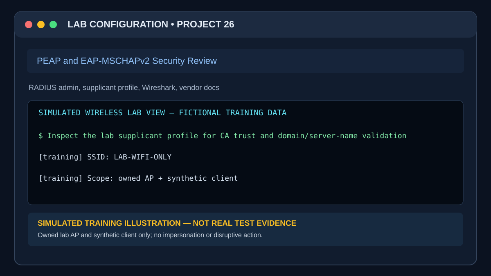
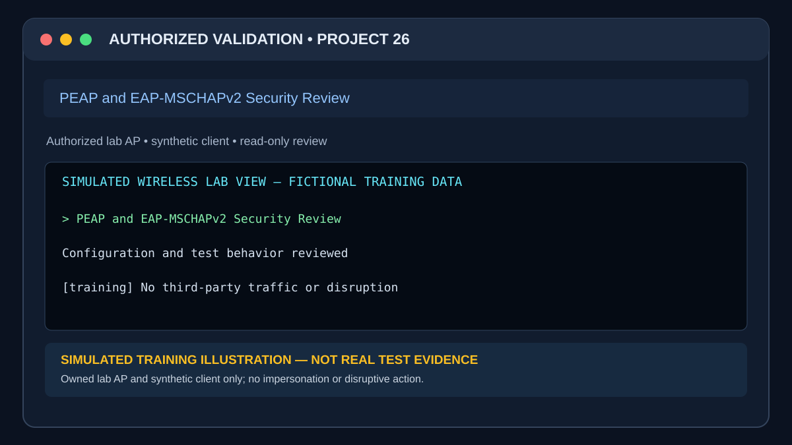

# Project 26 — PEAP and EAP-MSCHAPv2 Security Review

**Level:** Intermediate | **Estimated time:** 3–4 hours

> **Authorized lab only.** Use owned AP/controller infrastructure, synthetic identities, and dedicated test clients. Do not impersonate third-party networks, collect credentials, or disrupt users.

## Objective

Review PEAP inner-method selection, server certificate validation, credential protection, and migration considerations in the lab WLAN.

## Scope and prerequisites

- Owned AP/controller, isolated SSID, and authorized test client(s).
- Synthetic identities and lab VLANs; no production user traffic.
- **Tools:** RADIUS admin, supplicant profile, Wireshark, vendor docs.
- Record authorization, AP/controller firmware, SSID/BSSID, VLANs, client OS, and test window.
- Define exclusions, change window, and stop conditions before testing.

## Step 1 — Establish baseline and policy

Export sanitized WLAN/controller policy and document intended network behavior. Confirm the test client is attached only to the lab SSID. Keep management access on a trusted interface.

```bash
ip -br address
ip route
nmcli -f DEVICE,TYPE,STATE,CONNECTION device status
```

## Step 2 — Assessment workflow

1. Record PEAP outer method, inner authentication method, server certificate, and trusted CA configuration.
2. Verify clients validate the RADIUS server identity and do not prompt users to accept arbitrary certificates.
3. Use synthetic test identities to validate trusted server success and untrusted certificate rejection.
4. Review account lockout, password lifecycle, and migration plan toward certificate-based authentication.
5. Document compatibility constraints and ensure no real credentials appear in captures or logs.

Read-only review example:

```bash
Inspect the lab supplicant profile for CA trust and domain/server-name validation
```

Adapt to your own lab. Do not scan unrelated networks, collect third-party traffic, or take disruptive actions.

## Step 3 — Expected observations

A PEAP/EAP-MSCHAPv2 client/server configuration matrix with certificate validation and migration risks.

## Step 4 — Risk analysis

Missing server validation can expose credentials to rogue authentication infrastructure; legacy inner methods may increase credential risk. Record evidence source, confidence, affected SSID/VLAN/device, prerequisites, and limitations. A controller alert or configuration line alone is not a confirmed finding.

## Step 5 — Remediation and validation

Enforce server certificate validation and trusted server names, strengthen identity controls, and plan migration to EAP-TLS.

Apply approved changes through change control. Validate expected access for authorized test clients, denied access for disabled/unknown test identities, and alert/log behavior. Keep a rollback plan.

## Simulated training illustrations

> Fictional training SVGs only—not actual controller alerts, live captures, or evidence of a real assessment.






## Evidence and deliverables

- Authorization, exact SSID/BSSID/VLAN scope, exclusions, and stop conditions.
- Sanitized controller/AP/firewall/RADIUS policy, firmware, and tool versions.
- Synthetic client test results, timestamps, logs, and configuration diffs.
- Finding register, risk rationale, remediation owner, and retest status.
- No passwords, PSKs, private keys, real client identifiers, or third-party traffic in Git.

## Framework references

- RFC 9190; NIST SP 800-153; vendor EAP guidance
- [NIST SP 800-153](https://csrc.nist.gov/pubs/sp/800/153/final)
- [CIS Controls](https://www.cisecurity.org/controls)

## Completion checklist

- [ ] Written authorization and lab scope confirmed
- [ ] Synthetic identities/devices prepared
- [ ] Assessment completed without disruption
- [ ] Evidence sanitized and limitations stated
- [ ] Remediation and validation documented
- [ ] Rollback and false-positive handling recorded
