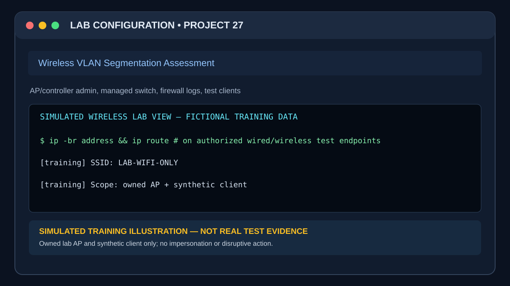
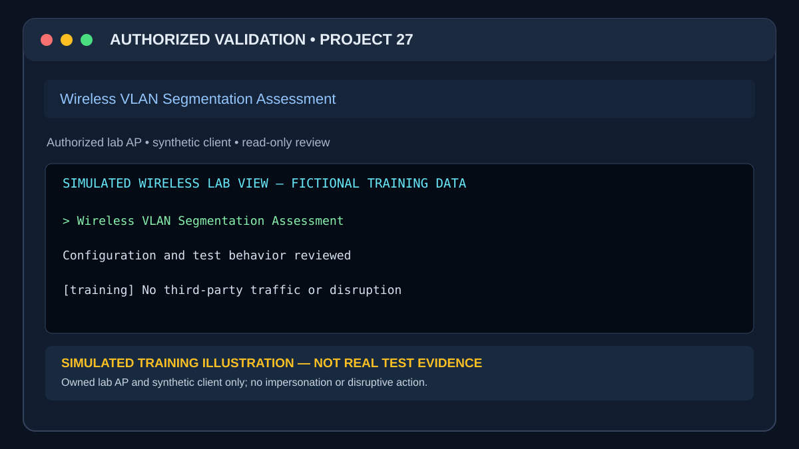

# Project 27 — Wireless VLAN Segmentation Assessment

**Level:** Intermediate | **Estimated time:** 3–4 hours

> **Authorized lab only.** Use owned AP/controller infrastructure, synthetic identities, and dedicated test clients. Do not impersonate third-party networks, collect credentials, or disrupt users.

## Objective

Validate that wireless SSIDs map to intended VLANs and that inter-segment access follows documented least-privilege policy.

## Scope and prerequisites

- Owned AP/controller, isolated SSID, and authorized test client(s).
- Synthetic identities and lab VLANs; no production user traffic.
- **Tools:** AP/controller admin, managed switch, firewall logs, test clients.
- Record authorization, AP/controller firmware, SSID/BSSID, VLANs, client OS, and test window.
- Define exclusions, change window, and stop conditions before testing.

## Step 1 — Establish baseline and policy

Export sanitized WLAN/controller policy and document intended network behavior. Confirm the test client is attached only to the lab SSID. Keep management access on a trusted interface.

```bash
ip -br address
ip route
nmcli -f DEVICE,TYPE,STATE,CONNECTION device status
```

## Step 2 — Assessment workflow

1. Map SSID-to-VLAN assignments and document intended network zones.
2. Connect authorized test clients to each lab SSID and record DHCP, gateway, DNS, and VLAN identity.
3. Use approved test endpoints to validate only documented allow/deny flows between segments.
4. Review switch trunk/native VLAN settings and firewall ACLs for unintended broad access.
5. Compare observed reachability with the segmentation matrix; do not scan outside listed lab hosts.

Read-only review example:

```bash
ip -br address && ip route  # on authorized wired/wireless test endpoints
```

Adapt to your own lab. Do not scan unrelated networks, collect third-party traffic, or take disruptive actions.

## Step 3 — Expected observations

A segmentation matrix showing SSID, VLAN, subnet, gateway, allowed services, denied paths, and validation evidence.

## Step 4 — Risk analysis

Incorrect VLAN mapping or broad inter-VLAN rules can expose internal services to guest or lower-trust wireless users. Record evidence source, confidence, affected SSID/VLAN/device, prerequisites, and limitations. A controller alert or configuration line alone is not a confirmed finding.

## Step 5 — Remediation and validation

Use dedicated VLANs per trust level, restrict trunks, enforce firewall allowlists, and continuously validate network policy.

Apply approved changes through change control. Validate expected access for authorized test clients, denied access for disabled/unknown test identities, and alert/log behavior. Keep a rollback plan.

## Simulated training illustrations

> Fictional training SVGs only—not actual controller alerts, live captures, or evidence of a real assessment.






## Evidence and deliverables

- Authorization, exact SSID/BSSID/VLAN scope, exclusions, and stop conditions.
- Sanitized controller/AP/firewall/RADIUS policy, firmware, and tool versions.
- Synthetic client test results, timestamps, logs, and configuration diffs.
- Finding register, risk rationale, remediation owner, and retest status.
- No passwords, PSKs, private keys, real client identifiers, or third-party traffic in Git.

## Framework references

- NIST SP 800-153; CIS Controls; vendor WLAN segmentation guidance
- [NIST SP 800-153](https://csrc.nist.gov/pubs/sp/800/153/final)
- [CIS Controls](https://www.cisecurity.org/controls)

## Completion checklist

- [ ] Written authorization and lab scope confirmed
- [ ] Synthetic identities/devices prepared
- [ ] Assessment completed without disruption
- [ ] Evidence sanitized and limitations stated
- [ ] Remediation and validation documented
- [ ] Rollback and false-positive handling recorded
