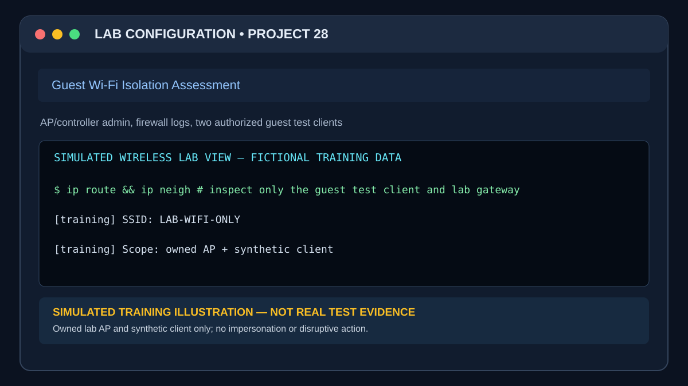
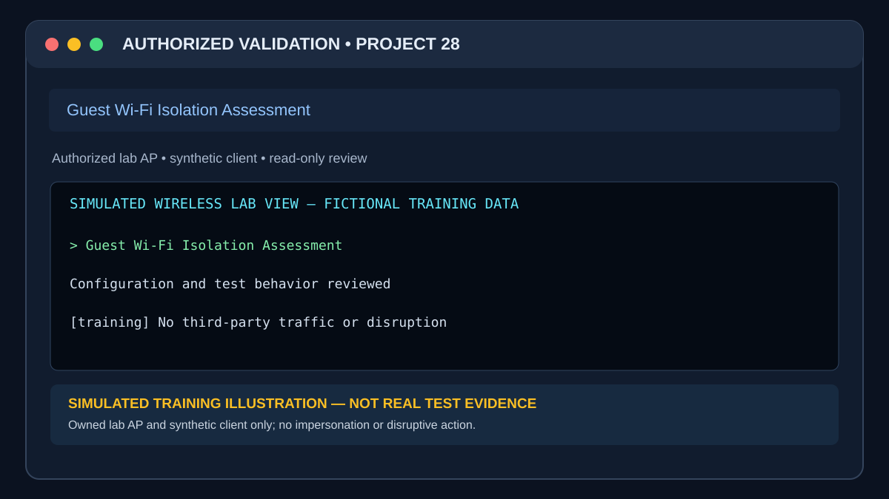

# Project 28 — Guest Wi-Fi Isolation Assessment

**Level:** Intermediate | **Estimated time:** 3–4 hours

> **Authorized lab only.** Use owned AP/controller infrastructure, synthetic identities, and dedicated test clients. Do not impersonate third-party networks, collect credentials, or disrupt users.

## Objective

Verify guest SSID internet access, client isolation, internal network restrictions, DNS policy, and captive portal boundaries.

## Scope and prerequisites

- Owned AP/controller, isolated SSID, and authorized test client(s).
- Synthetic identities and lab VLANs; no production user traffic.
- **Tools:** AP/controller admin, firewall logs, two authorized guest test clients.
- Record authorization, AP/controller firmware, SSID/BSSID, VLANs, client OS, and test window.
- Define exclusions, change window, and stop conditions before testing.

## Step 1 — Establish baseline and policy

Export sanitized WLAN/controller policy and document intended network behavior. Confirm the test client is attached only to the lab SSID. Keep management access on a trusted interface.

```bash
ip -br address
ip route
nmcli -f DEVICE,TYPE,STATE,CONNECTION device status
```

## Step 2 — Assessment workflow

1. Export guest SSID policy, VLAN, DHCP, DNS, and client-isolation configuration.
2. Connect two synthetic guest clients and verify each receives the expected isolated network settings.
3. Test only documented lab gateway and approved test services to confirm internal networks are blocked.
4. Review firewall logs for guest-to-internal deny events and verify internet access follows policy.
5. Check portal terms/session expiry and ensure guest access is revoked when the test account expires.

Read-only review example:

```bash
ip route && ip neigh  # inspect only the guest test client and lab gateway
```

Adapt to your own lab. Do not scan unrelated networks, collect third-party traffic, or take disruptive actions.

## Step 3 — Expected observations

A guest WLAN test matrix for client isolation, internal reachability, DNS, portal, and session lifecycle.

## Step 4 — Risk analysis

Guest networks with weak isolation can expose internal resources or other guest devices. Record evidence source, confidence, affected SSID/VLAN/device, prerequisites, and limitations. A controller alert or configuration line alone is not a confirmed finding.

## Step 5 — Remediation and validation

Use a dedicated guest VLAN, client isolation, deny-by-default internal ACLs, secure DNS, and expiring access credentials.

Apply approved changes through change control. Validate expected access for authorized test clients, denied access for disabled/unknown test identities, and alert/log behavior. Keep a rollback plan.

## Simulated training illustrations

> Fictional training SVGs only—not actual controller alerts, live captures, or evidence of a real assessment.






## Evidence and deliverables

- Authorization, exact SSID/BSSID/VLAN scope, exclusions, and stop conditions.
- Sanitized controller/AP/firewall/RADIUS policy, firmware, and tool versions.
- Synthetic client test results, timestamps, logs, and configuration diffs.
- Finding register, risk rationale, remediation owner, and retest status.
- No passwords, PSKs, private keys, real client identifiers, or third-party traffic in Git.

## Framework references

- NIST SP 800-153; CIS Controls; vendor guest WLAN guidance
- [NIST SP 800-153](https://csrc.nist.gov/pubs/sp/800/153/final)
- [CIS Controls](https://www.cisecurity.org/controls)

## Completion checklist

- [ ] Written authorization and lab scope confirmed
- [ ] Synthetic identities/devices prepared
- [ ] Assessment completed without disruption
- [ ] Evidence sanitized and limitations stated
- [ ] Remediation and validation documented
- [ ] Rollback and false-positive handling recorded
