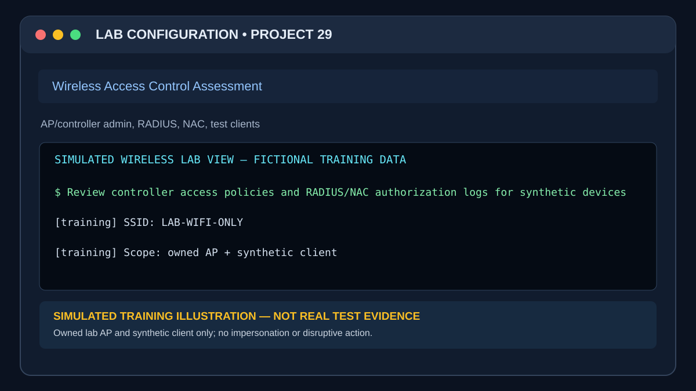
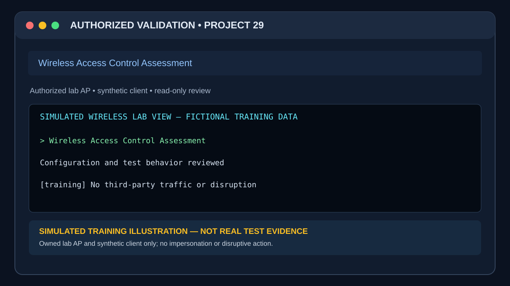

# Project 29 — Wireless Access Control Assessment

**Level:** Intermediate | **Estimated time:** 3–4 hours

> **Authorized lab only.** Use owned AP/controller infrastructure, synthetic identities, and dedicated test clients. Do not impersonate third-party networks, collect credentials, or disrupt users.

## Objective

Review WLAN access control design including identity, device onboarding, role assignment, MAC filtering limitations, and deprovisioning.

## Scope and prerequisites

- Owned AP/controller, isolated SSID, and authorized test client(s).
- Synthetic identities and lab VLANs; no production user traffic.
- **Tools:** AP/controller admin, RADIUS, NAC, test clients.
- Record authorization, AP/controller firmware, SSID/BSSID, VLANs, client OS, and test window.
- Define exclusions, change window, and stop conditions before testing.

## Step 1 — Establish baseline and policy

Export sanitized WLAN/controller policy and document intended network behavior. Confirm the test client is attached only to the lab SSID. Keep management access on a trusted interface.

```bash
ip -br address
ip route
nmcli -f DEVICE,TYPE,STATE,CONNECTION device status
```

## Step 2 — Assessment workflow

1. Inventory access methods and map each SSID to its identity and authorization policy.
2. Review device onboarding, certificate/credential issuance, role mapping, and exception handling.
3. Use synthetic test devices to validate approved, disabled, and unknown device outcomes.
4. Review MAC filtering as a supplemental control only; do not treat a MAC address as strong identity.
5. Verify lost-device revocation and access removal are propagated to AP/controller and RADIUS.

Read-only review example:

```bash
Review controller access policies and RADIUS/NAC authorization logs for synthetic devices
```

Adapt to your own lab. Do not scan unrelated networks, collect third-party traffic, or take disruptive actions.

## Step 3 — Expected observations

An access-control matrix showing identity source, onboarding, device posture, role assignment, exceptions, and revocation.

## Step 4 — Risk analysis

Weak identity controls and stale device access can allow unauthorized connections or excessive network privileges. Record evidence source, confidence, affected SSID/VLAN/device, prerequisites, and limitations. A controller alert or configuration line alone is not a confirmed finding.

## Step 5 — Remediation and validation

Prefer per-user/device certificates or enterprise identity, apply NAC roles, promptly revoke lost devices, and audit exceptions.

Apply approved changes through change control. Validate expected access for authorized test clients, denied access for disabled/unknown test identities, and alert/log behavior. Keep a rollback plan.

## Simulated training illustrations

> Fictional training SVGs only—not actual controller alerts, live captures, or evidence of a real assessment.






## Evidence and deliverables

- Authorization, exact SSID/BSSID/VLAN scope, exclusions, and stop conditions.
- Sanitized controller/AP/firewall/RADIUS policy, firmware, and tool versions.
- Synthetic client test results, timestamps, logs, and configuration diffs.
- Finding register, risk rationale, remediation owner, and retest status.
- No passwords, PSKs, private keys, real client identifiers, or third-party traffic in Git.

## Framework references

- NIST SP 800-153; NIST SP 800-63; vendor NAC guidance
- [NIST SP 800-153](https://csrc.nist.gov/pubs/sp/800/153/final)
- [CIS Controls](https://www.cisecurity.org/controls)

## Completion checklist

- [ ] Written authorization and lab scope confirmed
- [ ] Synthetic identities/devices prepared
- [ ] Assessment completed without disruption
- [ ] Evidence sanitized and limitations stated
- [ ] Remediation and validation documented
- [ ] Rollback and false-positive handling recorded
