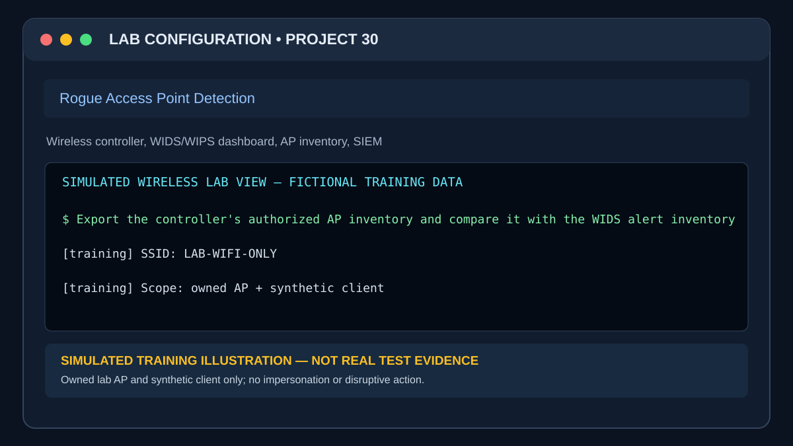
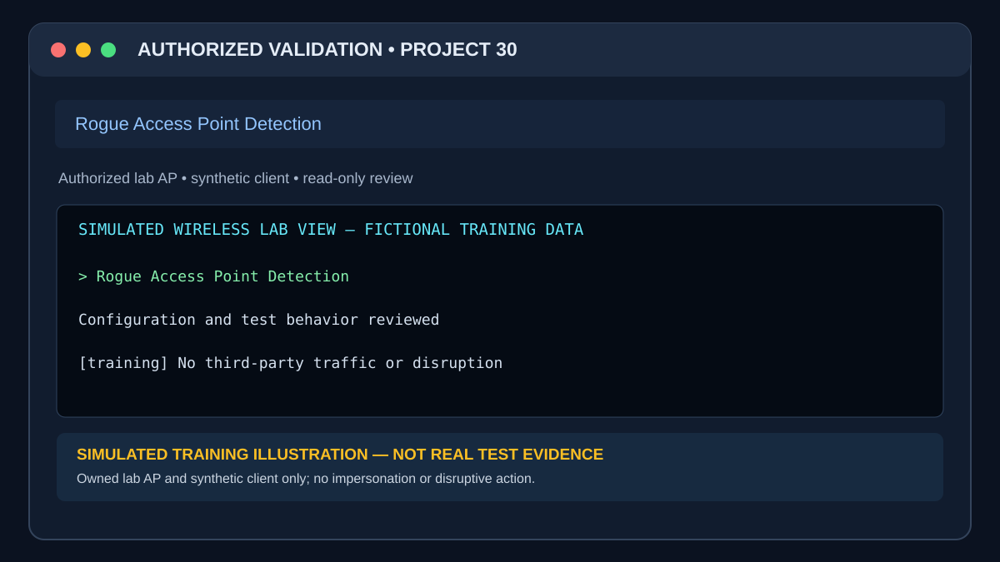

# Project 30 — Rogue Access Point Detection

**Level:** Intermediate | **Estimated time:** 3–4 hours

> **Authorized lab only.** Use owned AP/controller infrastructure, synthetic identities, and dedicated test clients. Do not impersonate third-party networks, collect credentials, or disrupt users.

## Objective

Assess defensive rogue AP detection and response using controller/WIDS inventory, authorized lab devices, and known test configurations.

## Scope and prerequisites

- Owned AP/controller, isolated SSID, and authorized test client(s).
- Synthetic identities and lab VLANs; no production user traffic.
- **Tools:** Wireless controller, WIDS/WIPS dashboard, AP inventory, SIEM.
- Record authorization, AP/controller firmware, SSID/BSSID, VLANs, client OS, and test window.
- Define exclusions, change window, and stop conditions before testing.

## Step 1 — Establish baseline and policy

Export sanitized WLAN/controller policy and document intended network behavior. Confirm the test client is attached only to the lab SSID. Keep management access on a trusted interface.

```bash
ip -br address
ip route
nmcli -f DEVICE,TYPE,STATE,CONNECTION device status
```

## Step 2 — Assessment workflow

1. Create an approved AP inventory with BSSID, model, serial, location, owner, and management status.
2. Review WIDS/controller classification logic for authorized, neighboring, and unknown APs.
3. Use a spare lab AP with a clearly documented test SSID in a controlled RF area to validate alert workflow.
4. Verify alert context, analyst triage, containment approval, and evidence retention without impersonating a production SSID.
5. Document false-positive handling for neighboring networks and authorized guest devices.

Read-only review example:

```bash
Export the controller's authorized AP inventory and compare it with the WIDS alert inventory
```

Adapt to your own lab. Do not scan unrelated networks, collect third-party traffic, or take disruptive actions.

## Step 3 — Expected observations

A rogue AP detection test record with inventory match, alert quality, triage owner, response approval, and false-positive notes.

## Step 4 — Risk analysis

Undetected unauthorized APs may create unmanaged network paths; incorrect containment can disrupt legitimate neighboring networks. Record evidence source, confidence, affected SSID/VLAN/device, prerequisites, and limitations. A controller alert or configuration line alone is not a confirmed finding.

## Step 5 — Remediation and validation

Maintain accurate AP inventory, tune WIDS classification, use change control for containment, and train analysts on false positives.

Apply approved changes through change control. Validate expected access for authorized test clients, denied access for disabled/unknown test identities, and alert/log behavior. Keep a rollback plan.

## Simulated training illustrations

> Fictional training SVGs only—not actual controller alerts, live captures, or evidence of a real assessment.






## Evidence and deliverables

- Authorization, exact SSID/BSSID/VLAN scope, exclusions, and stop conditions.
- Sanitized controller/AP/firewall/RADIUS policy, firmware, and tool versions.
- Synthetic client test results, timestamps, logs, and configuration diffs.
- Finding register, risk rationale, remediation owner, and retest status.
- No passwords, PSKs, private keys, real client identifiers, or third-party traffic in Git.

## Framework references

- NIST SP 800-153; vendor WIDS/WIPS guidance
- [NIST SP 800-153](https://csrc.nist.gov/pubs/sp/800/153/final)
- [CIS Controls](https://www.cisecurity.org/controls)

## Completion checklist

- [ ] Written authorization and lab scope confirmed
- [ ] Synthetic identities/devices prepared
- [ ] Assessment completed without disruption
- [ ] Evidence sanitized and limitations stated
- [ ] Remediation and validation documented
- [ ] Rollback and false-positive handling recorded
