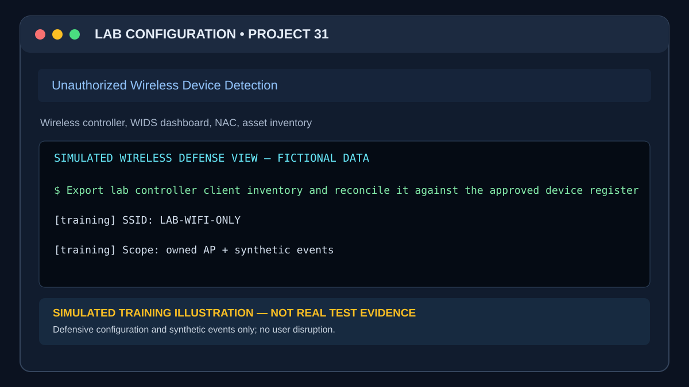
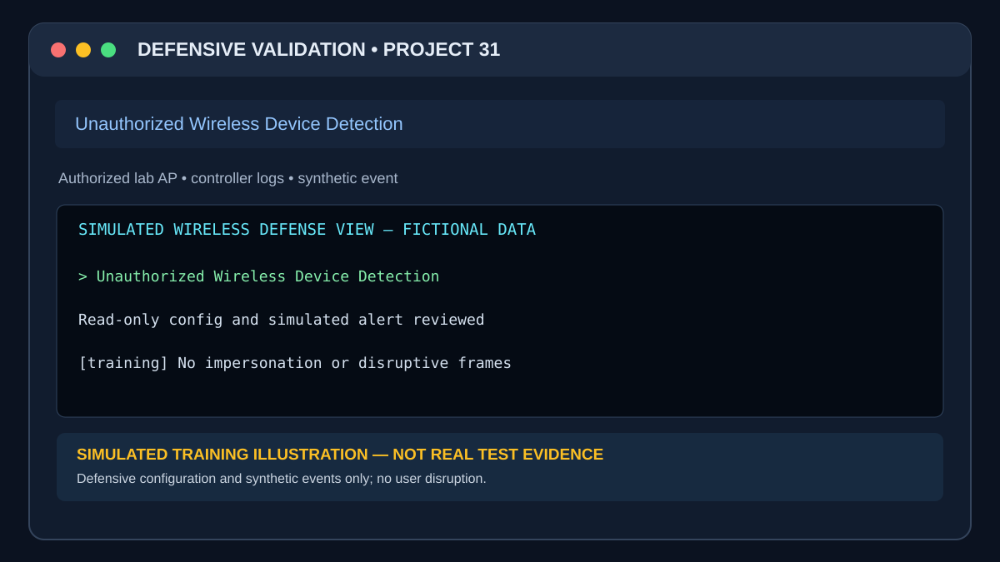

# Project 31 — Unauthorized Wireless Device Detection

**Level:** Intermediate | **Estimated time:** 3–4 hours

> **Defensive, authorized lab only.** This project uses owned AP/controller configuration, synthetic event records, and authorized test clients. It does not include rogue AP deployment, SSID impersonation, credential harvesting, deauthentication, or disruptive frame injection.

## Objective

Review device inventory and wireless monitoring controls to identify unknown or unapproved client/AP associations in the owned lab.

## Scope and prerequisites

- Owned AP/controller and isolated lab SSID.
- Synthetic clients, controller logs, and vendor-provided simulator/historical sanitized events.
- **Tools:** Wireless controller, WIDS dashboard, NAC, asset inventory.
- Record authorization, SSID/BSSID scope, AP/controller firmware, sensor coverage, test window, and stop conditions.
- Do not transmit disruptive frames or interact with third-party networks/users.

## Step 1 — Establish the defensive baseline

Export AP/controller configuration, approved device inventory, alert rules, and relevant log sources. Confirm time synchronization and management-plane access controls.

```bash
ip -br link
 iw dev
nmcli -f DEVICE,TYPE,STATE,CONNECTION device status
```

## Step 2 — Defensive assessment workflow

1. Build an approved device register using synthetic identifiers, owner, device type, and expected SSID.
2. Review controller association logs and WIDS/NAC inventory for unknown or stale devices.
3. Use only a designated lab test client to validate onboarding and alert workflows.
4. Verify deprovisioned synthetic devices are denied and produce an auditable event.
5. Document false positives such as randomized MAC addresses and neighboring networks.

Read-only review example:

```bash
Export lab controller client inventory and reconcile it against the approved device register
```

Use synthetic events or vendor simulation for validation. Do not deploy an impersonating AP, collect third-party traffic, or disrupt clients.

## Step 3 — Expected observations

A device reconciliation report with known/unknown status, owner, SSID, first/last seen, and response workflow.

## Step 4 — Risk analysis

Unknown or stale wireless devices can create unmanaged access paths and complicate incident response. Document evidence source, confidence, affected SSID/AP, operational impact, false positives, and monitoring gaps. A simulated event is not evidence of a live incident.

## Step 5 — Remediation and validation

Use certificate/NAC-based onboarding, maintain device inventory, enforce expiry/revocation, and monitor unknown associations.

Validate with a controlled synthetic event or approved lab client, confirm alert routing and analyst ownership, and record closure evidence. Preserve a rollback plan for configuration changes.

## Simulated training illustrations

> Fictional defensive training illustrations only—not actual controller alerts, live wireless traffic, or evidence of a real assessment.






## Evidence and deliverables

- Authorization, exact SSID/BSSID scope, exclusions, and stop conditions.
- Sanitized AP/controller/WIDS configuration, firmware, and tool versions.
- Synthetic event details, timestamps, alert routing, triage notes, and configuration diffs.
- Finding register, false-positive notes, remediation owner, and retest status.
- No PSKs, passwords, private keys, real client identifiers, or third-party traffic in Git.

## Framework references

- NIST SP 800-153; vendor NAC/WIDS guidance
- [NIST SP 800-153](https://csrc.nist.gov/pubs/sp/800/153/final)
- [NIST SP 800-92 — Guide to Computer Security Log Management](https://csrc.nist.gov/pubs/sp/800/92/final)

## Completion checklist

- [ ] Written authorization and lab scope confirmed
- [ ] Defensive controls and telemetry baseline recorded
- [ ] Synthetic validation completed without disruption
- [ ] Evidence sanitized and limitations stated
- [ ] Response and remediation documented
- [ ] Alert workflow retested and owner assigned
