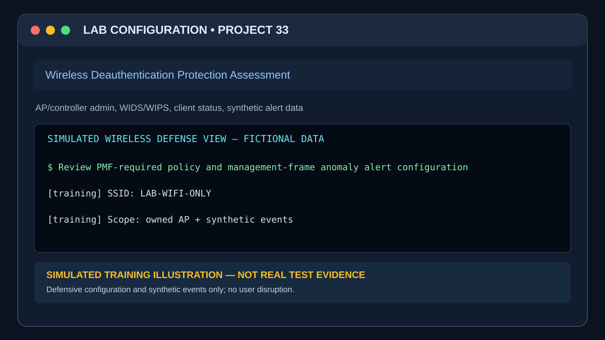
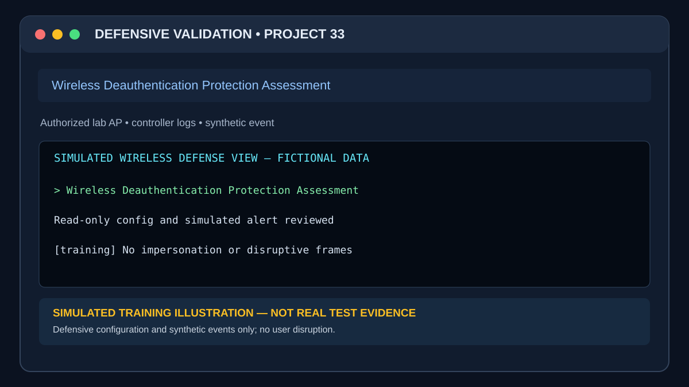

# Project 33 — Wireless Deauthentication Protection Assessment

**Level:** Intermediate | **Estimated time:** 3–4 hours

> **Defensive, authorized lab only.** This project uses owned AP/controller configuration, synthetic event records, and authorized test clients. It does not include rogue AP deployment, SSID impersonation, credential harvesting, deauthentication, or disruptive frame injection.

## Objective

Validate PMF settings, controller monitoring, and response readiness for deauthentication-related availability threats without transmitting disruptive frames.

## Scope and prerequisites

- Owned AP/controller and isolated lab SSID.
- Synthetic clients, controller logs, and vendor-provided simulator/historical sanitized events.
- **Tools:** AP/controller admin, WIDS/WIPS, client status, synthetic alert data.
- Record authorization, SSID/BSSID scope, AP/controller firmware, sensor coverage, test window, and stop conditions.
- Do not transmit disruptive frames or interact with third-party networks/users.

## Step 1 — Establish the defensive baseline

Export AP/controller configuration, approved device inventory, alert rules, and relevant log sources. Confirm time synchronization and management-plane access controls.

```bash
ip -br link
 iw dev
nmcli -f DEVICE,TYPE,STATE,CONNECTION device status
```

## Step 2 — Defensive assessment workflow

1. Identify SSIDs and clients expected to support PMF; document any legacy exception.
2. Review AP/controller configuration to confirm PMF is required where supported.
3. Use synthetic WIDS alert events or vendor simulator to verify detection and analyst workflow.
4. Review logs for management-frame protection status and client disconnect reason codes.
5. Document containment/escalation steps; do not send deauthentication frames or test against live users.

Read-only review example:

```bash
Review PMF-required policy and management-frame anomaly alert configuration
```

Use synthetic events or vendor simulation for validation. Do not deploy an impersonating AP, collect third-party traffic, or disrupt clients.

## Step 3 — Expected observations

A defensive readiness record showing PMF coverage, unsupported-client exceptions, alert routing, and incident response.

## Step 4 — Risk analysis

Networks without PMF may be more exposed to management-frame disruption; disruptive validation can itself affect availability. Document evidence source, confidence, affected SSID/AP, operational impact, false positives, and monitoring gaps. A simulated event is not evidence of a live incident.

## Step 5 — Remediation and validation

Require PMF, retire unsupported clients, monitor disconnect anomalies, and rehearse response with synthetic events.

Validate with a controlled synthetic event or approved lab client, confirm alert routing and analyst ownership, and record closure evidence. Preserve a rollback plan for configuration changes.

## Simulated training illustrations

> Fictional defensive training illustrations only—not actual controller alerts, live wireless traffic, or evidence of a real assessment.






## Evidence and deliverables

- Authorization, exact SSID/BSSID scope, exclusions, and stop conditions.
- Sanitized AP/controller/WIDS configuration, firmware, and tool versions.
- Synthetic event details, timestamps, alert routing, triage notes, and configuration diffs.
- Finding register, false-positive notes, remediation owner, and retest status.
- No PSKs, passwords, private keys, real client identifiers, or third-party traffic in Git.

## Framework references

- IEEE 802.11w; Wi-Fi Alliance WPA3; NIST SP 800-153
- [NIST SP 800-153](https://csrc.nist.gov/pubs/sp/800/153/final)
- [NIST SP 800-92 — Guide to Computer Security Log Management](https://csrc.nist.gov/pubs/sp/800/92/final)

## Completion checklist

- [ ] Written authorization and lab scope confirmed
- [ ] Defensive controls and telemetry baseline recorded
- [ ] Synthetic validation completed without disruption
- [ ] Evidence sanitized and limitations stated
- [ ] Response and remediation documented
- [ ] Alert workflow retested and owner assigned
