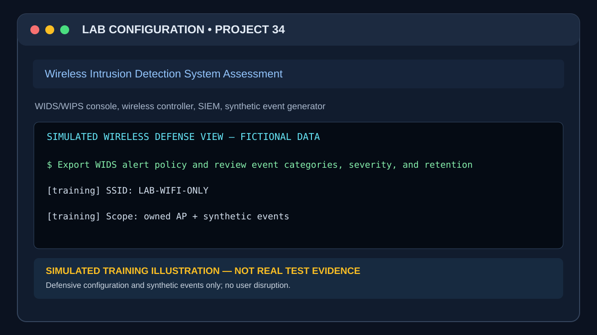
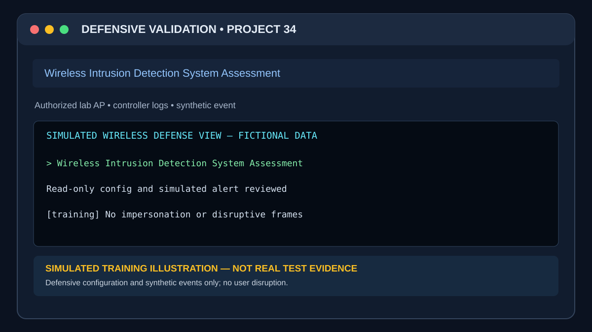

# Project 34 — Wireless Intrusion Detection System Assessment

**Level:** Intermediate | **Estimated time:** 3–4 hours

> **Defensive, authorized lab only.** This project uses owned AP/controller configuration, synthetic event records, and authorized test clients. It does not include rogue AP deployment, SSID impersonation, credential harvesting, deauthentication, or disruptive frame injection.

## Objective

Evaluate WIDS coverage, detection rules, alert quality, retention, and analyst workflow using controller data and synthetic events.

## Scope and prerequisites

- Owned AP/controller and isolated lab SSID.
- Synthetic clients, controller logs, and vendor-provided simulator/historical sanitized events.
- **Tools:** WIDS/WIPS console, wireless controller, SIEM, synthetic event generator.
- Record authorization, SSID/BSSID scope, AP/controller firmware, sensor coverage, test window, and stop conditions.
- Do not transmit disruptive frames or interact with third-party networks/users.

## Step 1 — Establish the defensive baseline

Export AP/controller configuration, approved device inventory, alert rules, and relevant log sources. Confirm time synchronization and management-plane access controls.

```bash
ip -br link
 iw dev
nmcli -f DEVICE,TYPE,STATE,CONNECTION device status
```

## Step 2 — Defensive assessment workflow

1. Inventory monitored APs, sensors, channels, locations, and blind spots.
2. Review enabled detections for rogue APs, configuration drift, suspicious association patterns, and management-frame anomalies.
3. Generate only vendor-provided synthetic events or use historical sanitized events to validate alert routing.
4. Check event enrichment, timestamp synchronization, owner assignment, escalation, and closure evidence.
5. Measure false positives and document tuning decisions without suppressing meaningful detections.

Read-only review example:

```bash
Export WIDS alert policy and review event categories, severity, and retention
```

Use synthetic events or vendor simulation for validation. Do not deploy an impersonating AP, collect third-party traffic, or disrupt clients.

## Step 3 — Expected observations

A WIDS coverage and alert validation report with use cases, evidence, owners, response times, and tuning notes.

## Step 4 — Risk analysis

Blind spots or noisy alerts can allow wireless threats to go unnoticed or overwhelm analysts. Document evidence source, confidence, affected SSID/AP, operational impact, false positives, and monitoring gaps. A simulated event is not evidence of a live incident.

## Step 5 — Remediation and validation

Tune detections, maintain sensor coverage, integrate controller context, synchronize clocks, and test alert workflows regularly.

Validate with a controlled synthetic event or approved lab client, confirm alert routing and analyst ownership, and record closure evidence. Preserve a rollback plan for configuration changes.

## Simulated training illustrations

> Fictional defensive training illustrations only—not actual controller alerts, live wireless traffic, or evidence of a real assessment.






## Evidence and deliverables

- Authorization, exact SSID/BSSID scope, exclusions, and stop conditions.
- Sanitized AP/controller/WIDS configuration, firmware, and tool versions.
- Synthetic event details, timestamps, alert routing, triage notes, and configuration diffs.
- Finding register, false-positive notes, remediation owner, and retest status.
- No PSKs, passwords, private keys, real client identifiers, or third-party traffic in Git.

## Framework references

- NIST SP 800-153; MITRE ATT&CK Enterprise — Network; vendor WIDS documentation
- [NIST SP 800-153](https://csrc.nist.gov/pubs/sp/800/153/final)
- [NIST SP 800-92 — Guide to Computer Security Log Management](https://csrc.nist.gov/pubs/sp/800/92/final)

## Completion checklist

- [ ] Written authorization and lab scope confirmed
- [ ] Defensive controls and telemetry baseline recorded
- [ ] Synthetic validation completed without disruption
- [ ] Evidence sanitized and limitations stated
- [ ] Response and remediation documented
- [ ] Alert workflow retested and owner assigned
