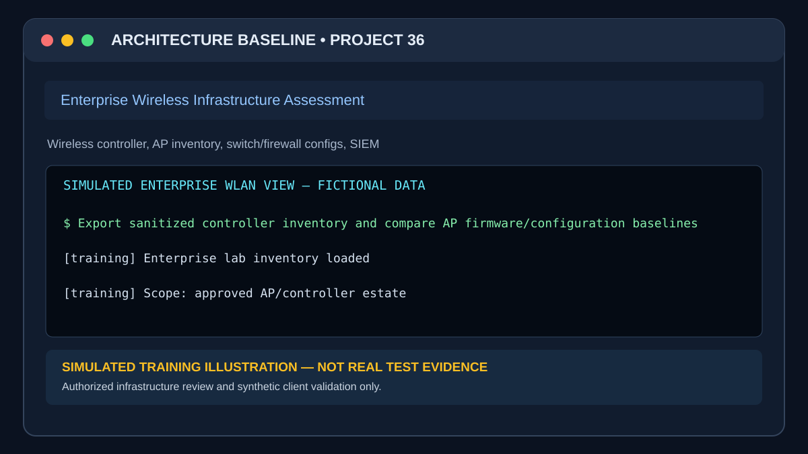
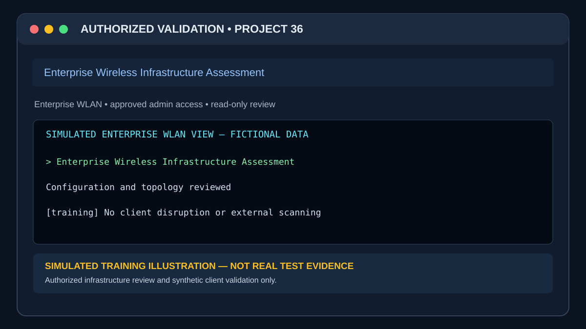

# Project 36 — Enterprise Wireless Infrastructure Assessment

**Level:** Advanced | **Estimated time:** 4–6 hours

> **Authorized enterprise lab only.** Review only infrastructure you own or are explicitly authorized to assess. Use sanitized configuration exports and approved test clients; do not disrupt production wireless services.

## Objective

Review enterprise WLAN architecture, AP placement, management plane, controller redundancy, segmentation, and operational security controls.

## Scope and prerequisites

- Approved AP/controller/mesh estate and named management interfaces.
- Sanitized configuration exports, asset inventory, and authorized test clients.
- **Tools:** Wireless controller, AP inventory, switch/firewall configs, SIEM.
- Record authorization, sites, SSIDs/BSSIDs, AP models/firmware, controller versions, client types, and maintenance windows.
- Define exclusions, change approvals, rollback, and emergency contacts.

## Step 1 — Establish architecture and baseline

Document topology, management plane, SSID profiles, identity services, VLANs, firmware, and operational dependencies. Confirm that all collected exports are sanitized and approved for use.

```bash
ip -br link
 iw dev
nmcli -f DEVICE,TYPE,STATE,CONNECTION device status
```

## Step 2 — Assessment workflow

1. Map controller, AP groups, management VLANs, RADIUS/PKI dependencies, and internet/branch connectivity.
2. Review admin access, MFA, role separation, management protocols, firmware lifecycle, and backup/restore.
3. Compare SSID security profiles and segmentation against approved enterprise baselines.
4. Review AP placement, RF coverage planning, guest isolation, and physical security records.
5. Validate redundancy/failover using approved maintenance procedures and synthetic monitoring events.

Read-only review example:

```bash
Export sanitized controller inventory and compare AP firmware/configuration baselines
```

Adapt to the vendor platform. Do not perform disruptive RF tests or change production settings outside approved change control.

## Step 3 — Expected observations

An enterprise WLAN architecture and control assessment with topology, firmware, management access, segmentation, resilience, and evidence gaps.

## Step 4 — Risk analysis

Weak management-plane controls, outdated firmware, or broad trust zones can expose multiple sites and business networks. Record affected site/AP group, evidence source, confidence, business impact, dependencies, and limitations. Distinguish a documented configuration deviation from a validated security impact.

## Step 5 — Remediation and validation

Harden controller access, segment management, patch firmware, enforce consistent templates, protect backups, and test resilience.

Implement through approved change control. Validate using configuration diffs, controller status, synthetic clients, and approved failover procedures. Keep a tested rollback path.

## Simulated training illustrations

> Fictional enterprise WLAN training illustrations only—not genuine controller screenshots, live RF captures, or evidence of an actual assessment.






## Evidence and deliverables

- Authorization, site/AP/SSID scope, exclusions, and approved change windows.
- Sanitized topology, configuration exports, firmware inventory, and tool versions.
- Validation results, configuration diffs, timestamps, and synthetic client observations.
- Risk-ranked finding register, remediation owners, dependencies, rollback, and retest status.
- No credentials, private keys, real client identifiers, or sensitive production topology in Git.

## Framework references

- NIST SP 800-153; CIS Controls; vendor enterprise WLAN hardening guides
- [NIST SP 800-153](https://csrc.nist.gov/pubs/sp/800/153/final)
- [CIS Controls](https://www.cisecurity.org/controls)

## Completion checklist

- [ ] Authorization and enterprise scope confirmed
- [ ] Architecture and baseline documented
- [ ] Configuration reviewed safely
- [ ] Evidence sanitized and limitations stated
- [ ] Remediation, owners, and rollback recorded
- [ ] Retest and operational sign-off completed
