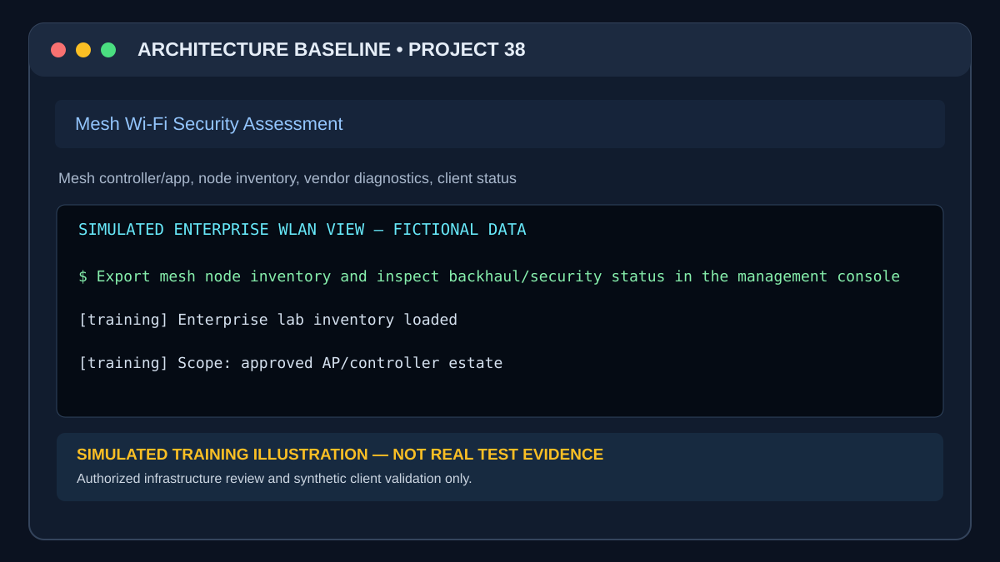
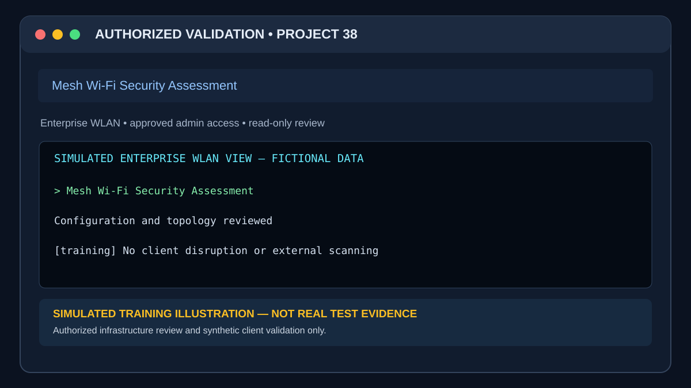

# Project 38 — Mesh Wi-Fi Security Assessment

**Level:** Advanced | **Estimated time:** 4–6 hours

> **Authorized enterprise lab only.** Review only infrastructure you own or are explicitly authorized to assess. Use sanitized configuration exports and approved test clients; do not disrupt production wireless services.

## Objective

Review mesh node onboarding, backhaul encryption, topology, roaming, firmware consistency, and management security.

## Scope and prerequisites

- Approved AP/controller/mesh estate and named management interfaces.
- Sanitized configuration exports, asset inventory, and authorized test clients.
- **Tools:** Mesh controller/app, node inventory, vendor diagnostics, client status.
- Record authorization, sites, SSIDs/BSSIDs, AP models/firmware, controller versions, client types, and maintenance windows.
- Define exclusions, change approvals, rollback, and emergency contacts.

## Step 1 — Establish architecture and baseline

Document topology, management plane, SSID profiles, identity services, VLANs, firmware, and operational dependencies. Confirm that all collected exports are sanitized and approved for use.

```bash
ip -br link
 iw dev
nmcli -f DEVICE,TYPE,STATE,CONNECTION device status
```

## Step 2 — Assessment workflow

1. Inventory mesh nodes, model/firmware, location, parent/child links, and owner.
2. Review node onboarding and removal, admin identity, MFA, and cloud management permissions.
3. Verify backhaul encryption and whether wired/wireless backhaul follows the approved trust model.
4. Review roaming, guest network propagation, and node replacement/reset procedures.
5. Validate node loss/rejoin and firmware update behavior using a spare lab node.

Read-only review example:

```bash
Export mesh node inventory and inspect backhaul/security status in the management console
```

Adapt to the vendor platform. Do not perform disruptive RF tests or change production settings outside approved change control.

## Step 3 — Expected observations

A mesh topology and security matrix showing node trust, backhaul, firmware, onboarding, roaming, and management controls.

## Step 4 — Risk analysis

Weak node onboarding or inconsistent firmware can create untrusted backhaul paths and expand the attack surface. Record affected site/AP group, evidence source, confidence, business impact, dependencies, and limitations. Distinguish a documented configuration deviation from a validated security impact.

## Step 5 — Remediation and validation

Use authenticated node pairing, current firmware, protected management accounts, encrypted backhaul, and inventory/revocation controls.

Implement through approved change control. Validate using configuration diffs, controller status, synthetic clients, and approved failover procedures. Keep a tested rollback path.

## Simulated training illustrations

> Fictional enterprise WLAN training illustrations only—not genuine controller screenshots, live RF captures, or evidence of an actual assessment.






## Evidence and deliverables

- Authorization, site/AP/SSID scope, exclusions, and approved change windows.
- Sanitized topology, configuration exports, firmware inventory, and tool versions.
- Validation results, configuration diffs, timestamps, and synthetic client observations.
- Risk-ranked finding register, remediation owners, dependencies, rollback, and retest status.
- No credentials, private keys, real client identifiers, or sensitive production topology in Git.

## Framework references

- NIST SP 800-153; vendor mesh security documentation
- [NIST SP 800-153](https://csrc.nist.gov/pubs/sp/800/153/final)
- [CIS Controls](https://www.cisecurity.org/controls)

## Completion checklist

- [ ] Authorization and enterprise scope confirmed
- [ ] Architecture and baseline documented
- [ ] Configuration reviewed safely
- [ ] Evidence sanitized and limitations stated
- [ ] Remediation, owners, and rollback recorded
- [ ] Retest and operational sign-off completed
