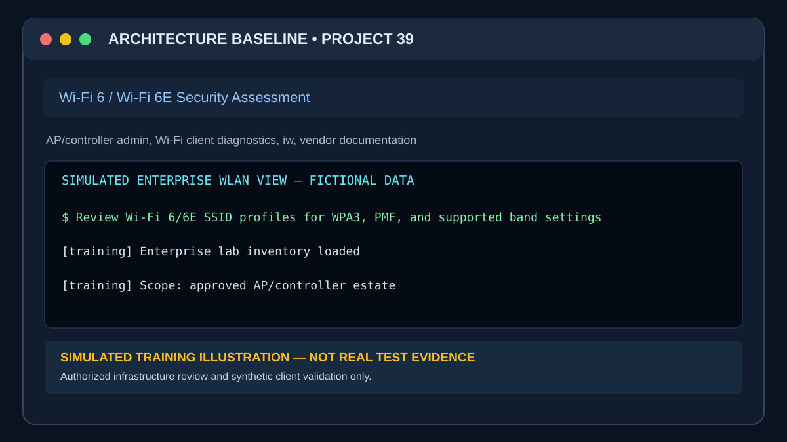
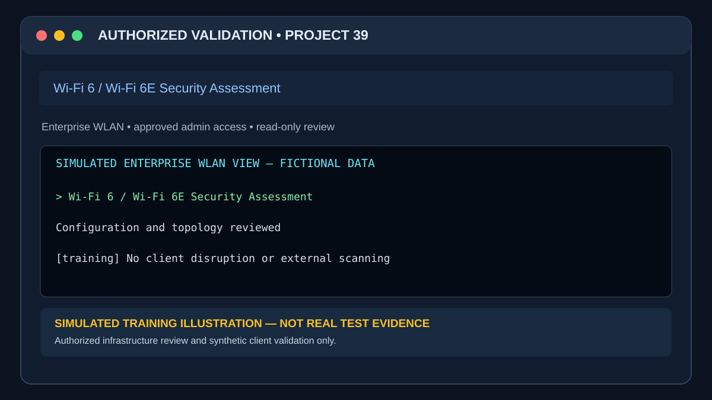

# Project 39 — Wi-Fi 6 / Wi-Fi 6E Security Assessment

**Level:** Advanced | **Estimated time:** 4–6 hours

> **Authorized enterprise lab only.** Review only infrastructure you own or are explicitly authorized to assess. Use sanitized configuration exports and approved test clients; do not disrupt production wireless services.

## Objective

Review Wi-Fi 6/6E security configuration, WPA3/PMF requirements, band policy, client compatibility, and regulatory settings.

## Scope and prerequisites

- Approved AP/controller/mesh estate and named management interfaces.
- Sanitized configuration exports, asset inventory, and authorized test clients.
- **Tools:** AP/controller admin, Wi-Fi client diagnostics, iw, vendor documentation.
- Record authorization, sites, SSIDs/BSSIDs, AP models/firmware, controller versions, client types, and maintenance windows.
- Define exclusions, change approvals, rollback, and emergency contacts.

## Step 1 — Establish architecture and baseline

Document topology, management plane, SSID profiles, identity services, VLANs, firmware, and operational dependencies. Confirm that all collected exports are sanitized and approved for use.

```bash
ip -br link
 iw dev
nmcli -f DEVICE,TYPE,STATE,CONNECTION device status
```

## Step 2 — Assessment workflow

1. Inventory Wi-Fi 6/6E APs, supported bands, firmware, and client capabilities.
2. Review security profiles for WPA3/SAE or enterprise EAP, PMF, and modern cipher suites.
3. Check 6 GHz SSID security requirements and ensure unsupported legacy modes are not offered there.
4. Review band steering, roaming, channel planning, and regulatory-domain configuration.
5. Validate with authorized Wi-Fi 6/6E clients and document compatibility exceptions.

Read-only review example:

```bash
Review Wi-Fi 6/6E SSID profiles for WPA3, PMF, and supported band settings
```

Adapt to the vendor platform. Do not perform disruptive RF tests or change production settings outside approved change control.

## Step 3 — Expected observations

A Wi-Fi 6/6E security profile matrix with bands, authentication, PMF, ciphers, firmware, and client results.

## Step 4 — Risk analysis

Inconsistent profiles or legacy compatibility exceptions can weaken security and create operational blind spots. Record affected site/AP group, evidence source, confidence, business impact, dependencies, and limitations. Distinguish a documented configuration deviation from a validated security impact.

## Step 5 — Remediation and validation

Use WPA3 and PMF as required for 6 GHz, maintain consistent profiles, update clients/APs, and document exceptions.

Implement through approved change control. Validate using configuration diffs, controller status, synthetic clients, and approved failover procedures. Keep a tested rollback path.

## Simulated training illustrations

> Fictional enterprise WLAN training illustrations only—not genuine controller screenshots, live RF captures, or evidence of an actual assessment.






## Evidence and deliverables

- Authorization, site/AP/SSID scope, exclusions, and approved change windows.
- Sanitized topology, configuration exports, firmware inventory, and tool versions.
- Validation results, configuration diffs, timestamps, and synthetic client observations.
- Risk-ranked finding register, remediation owners, dependencies, rollback, and retest status.
- No credentials, private keys, real client identifiers, or sensitive production topology in Git.

## Framework references

- Wi-Fi Alliance Wi-Fi CERTIFIED 6/6E; NIST SP 800-153
- [NIST SP 800-153](https://csrc.nist.gov/pubs/sp/800/153/final)
- [CIS Controls](https://www.cisecurity.org/controls)

## Completion checklist

- [ ] Authorization and enterprise scope confirmed
- [ ] Architecture and baseline documented
- [ ] Configuration reviewed safely
- [ ] Evidence sanitized and limitations stated
- [ ] Remediation, owners, and rollback recorded
- [ ] Retest and operational sign-off completed
