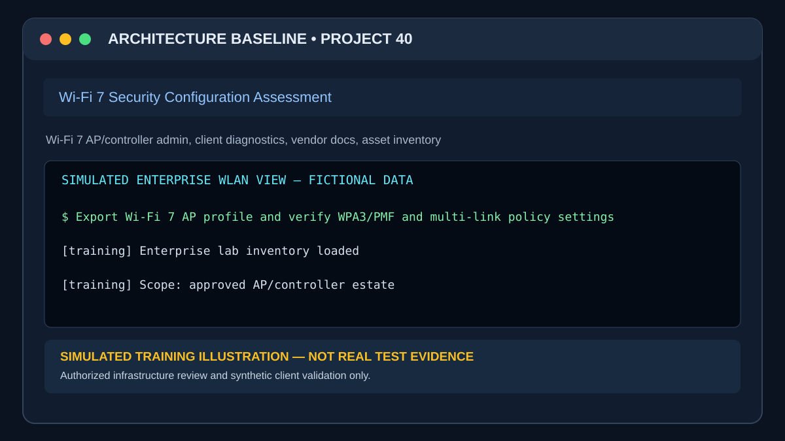
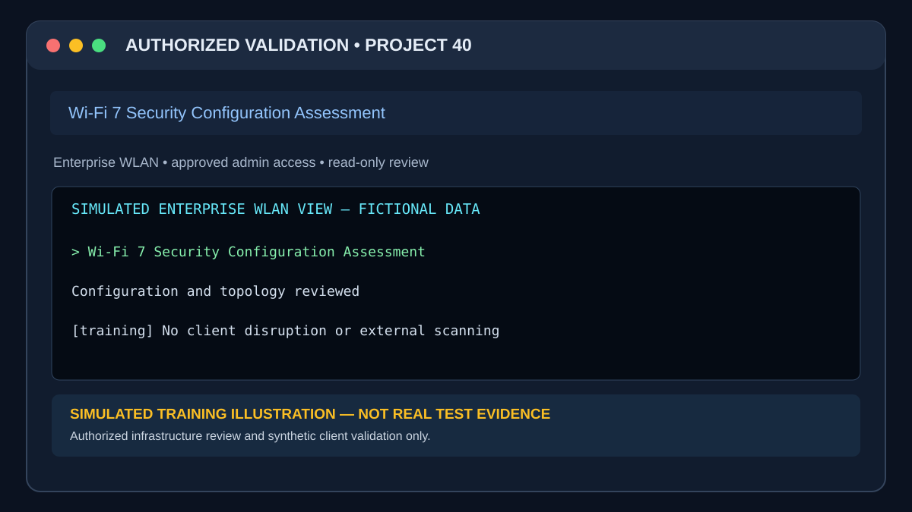

# Project 40 — Wi-Fi 7 Security Configuration Assessment

**Level:** Advanced | **Estimated time:** 4–6 hours

> **Authorized enterprise lab only.** Review only infrastructure you own or are explicitly authorized to assess. Use sanitized configuration exports and approved test clients; do not disrupt production wireless services.

## Objective

Review Wi-Fi 7 AP/client security configuration, multi-link operation policy, WPA3/PMF posture, firmware, and management controls.

## Scope and prerequisites

- Approved AP/controller/mesh estate and named management interfaces.
- Sanitized configuration exports, asset inventory, and authorized test clients.
- **Tools:** Wi-Fi 7 AP/controller admin, client diagnostics, vendor docs, asset inventory.
- Record authorization, sites, SSIDs/BSSIDs, AP models/firmware, controller versions, client types, and maintenance windows.
- Define exclusions, change approvals, rollback, and emergency contacts.

## Step 1 — Establish architecture and baseline

Document topology, management plane, SSID profiles, identity services, VLANs, firmware, and operational dependencies. Confirm that all collected exports are sanitized and approved for use.

```bash
ip -br link
 iw dev
nmcli -f DEVICE,TYPE,STATE,CONNECTION device status
```

## Step 2 — Assessment workflow

1. Inventory Wi-Fi 7 APs, clients, firmware, regulatory settings, and supported MLO modes.
2. Review WPA3/enterprise authentication, PMF, cipher suites, and transition compatibility.
3. Inspect MLO configuration and verify each link inherits the intended security policy.
4. Review firmware update, management access, logging, and vendor security advisory process.
5. Validate association and roaming with authorized Wi-Fi 7 clients and record unsupported combinations.

Read-only review example:

```bash
Export Wi-Fi 7 AP profile and verify WPA3/PMF and multi-link policy settings
```

Adapt to the vendor platform. Do not perform disruptive RF tests or change production settings outside approved change control.

## Step 3 — Expected observations

A Wi-Fi 7 configuration report with MLO, authentication, PMF, firmware, client support, and policy consistency.

## Step 4 — Risk analysis

New feature complexity and inconsistent client/AP implementations can introduce configuration gaps or operational weaknesses. Record affected site/AP group, evidence source, confidence, business impact, dependencies, and limitations. Distinguish a documented configuration deviation from a validated security impact.

## Step 5 — Remediation and validation

Apply vendor-recommended secure profiles, require WPA3/PMF, maintain firmware, validate MLO policy, and track client exceptions.

Implement through approved change control. Validate using configuration diffs, controller status, synthetic clients, and approved failover procedures. Keep a tested rollback path.

## Simulated training illustrations

> Fictional enterprise WLAN training illustrations only—not genuine controller screenshots, live RF captures, or evidence of an actual assessment.






## Evidence and deliverables

- Authorization, site/AP/SSID scope, exclusions, and approved change windows.
- Sanitized topology, configuration exports, firmware inventory, and tool versions.
- Validation results, configuration diffs, timestamps, and synthetic client observations.
- Risk-ranked finding register, remediation owners, dependencies, rollback, and retest status.
- No credentials, private keys, real client identifiers, or sensitive production topology in Git.

## Framework references

- Wi-Fi Alliance Wi-Fi CERTIFIED 7; IEEE 802.11be; NIST SP 800-153
- [NIST SP 800-153](https://csrc.nist.gov/pubs/sp/800/153/final)
- [CIS Controls](https://www.cisecurity.org/controls)

## Completion checklist

- [ ] Authorization and enterprise scope confirmed
- [ ] Architecture and baseline documented
- [ ] Configuration reviewed safely
- [ ] Evidence sanitized and limitations stated
- [ ] Remediation, owners, and rollback recorded
- [ ] Retest and operational sign-off completed
