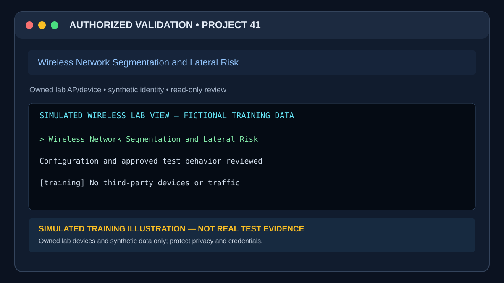

# Project 41 — Wireless Network Segmentation and Lateral Risk

**Level:** Advanced | **Estimated time:** 4–6 hours

> **Authorized lab only.** Assess owned wireless infrastructure and devices using synthetic identities/data. Do not test third-party networks, collect personal traffic, or disrupt users.

## Objective

Assess trust boundaries between corporate, guest, IoT, management, and partner wireless segments using approved test hosts and firewall policy.

## Scope and prerequisites

- Owned AP/controller and named test devices/services.
- Sanitized inventory/configuration exports and synthetic accounts/data.
- **Tools:** AP/controller admin, switch/firewall configs, test clients, SIEM.
- Record authorization, asset/device identifiers, SSID/BSSID scope, firmware, location, test window, and exclusions.
- Define stop conditions, change approvals, and rollback procedures.

## Step 1 — Establish baseline and trust boundaries

Inventory the APs, clients, network zones, identity services, and management dependencies relevant to this project. Verify that the target device/service is in scope and that evidence is sanitized.

```bash
ip -br link
 iw dev
nmcli -f DEVICE,TYPE,STATE,CONNECTION device status
```

## Step 2 — Assessment workflow

1. Map SSIDs, VLANs, subnets, gateways, and intended trust relationships.
2. Review switch trunks, ACLs, firewall rules, routing, and DNS policy for each zone.
3. Use named lab endpoints to validate only approved service paths and expected denials.
4. Review management-plane isolation and whether guest/IoT networks can reach admin services.
5. Document lateral-risk paths and validate policy changes with before/after tests.

Read-only review example:

```bash
Compare the approved SSID-to-VLAN matrix with firewall policy and lab endpoint routes
```

Adapt to the owned lab. Do not scan unrelated networks, collect third-party payloads, or bypass access controls on devices outside scope.

## Step 3 — Expected observations

A segmentation graph and allow/deny matrix with tested paths, policy owners, and residual exposure.

## Step 4 — Risk analysis

Overly permissive inter-zone access can allow compromise of a lower-trust wireless device to reach sensitive systems. Record affected assets, evidence source, confidence, business impact, prerequisites, and limitations. Keep personal/device identifiers out of public evidence.

## Step 5 — Remediation and validation

Apply deny-by-default segmentation, explicit service allowlists, isolated management networks, and continuous policy validation.

Apply approved changes, verify the configuration and client behavior, and record before/after evidence, rollback, and residual risk.

## Simulated training illustrations

> Fictional training SVGs only—not real RF captures, actual device output, or proof of an assessment.





## Evidence and deliverables

- Authorization, asset/device scope, exclusions, and stop conditions.
- Sanitized topology/configuration, firmware, device models, and tool versions.
- Approved test results, timestamps, configuration diffs, and synthetic client observations.
- Risk-ranked finding register, remediation owners, and retest status.
- No passwords, PSKs, private keys, personal data, or third-party traffic in Git.

## Framework references

- NIST SP 800-153; CIS Controls; NIST SP 800-41
- [NIST SP 800-153](https://csrc.nist.gov/pubs/sp/800/153/final)
- [CIS Controls](https://www.cisecurity.org/controls)

## Completion checklist

- [ ] Authorization and asset scope confirmed
- [ ] Baseline and trust boundaries documented
- [ ] Authorized assessment completed safely
- [ ] Evidence sanitized and limitations stated
- [ ] Remediation and retest recorded
- [ ] Residual risk and owner documented
