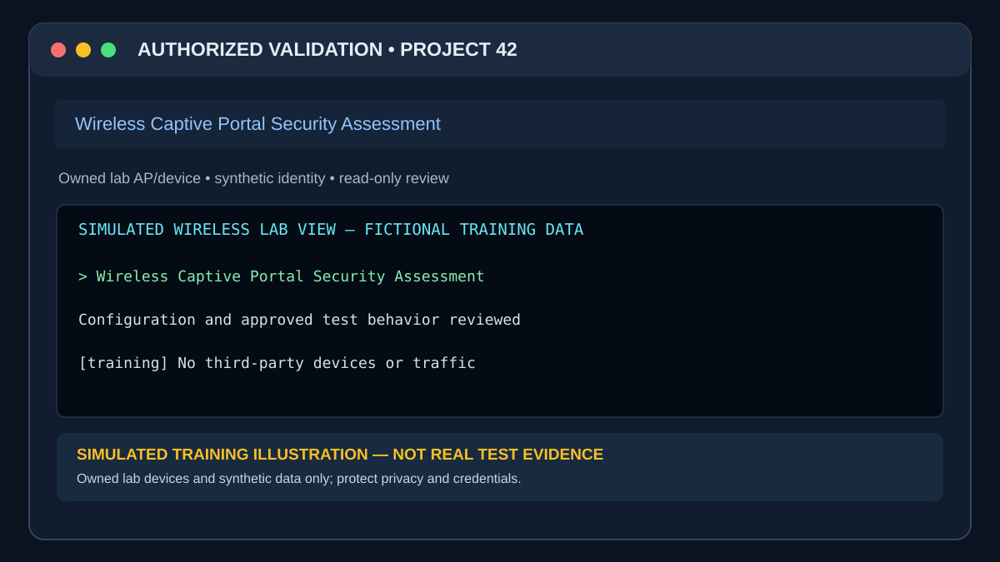

# Project 42 — Wireless Captive Portal Security Assessment

**Level:** Advanced | **Estimated time:** 4–6 hours

> **Authorized lab only.** Assess owned wireless infrastructure and devices using synthetic identities/data. Do not test third-party networks, collect personal traffic, or disrupt users.

## Objective

Review captive portal authentication, TLS, session lifecycle, privacy notices, redirect handling, and guest network boundaries.

## Scope and prerequisites

- Owned AP/controller and named test devices/services.
- Sanitized inventory/configuration exports and synthetic accounts/data.
- **Tools:** Portal admin, Burp Suite (lab portal), browser DevTools, firewall logs.
- Record authorization, asset/device identifiers, SSID/BSSID scope, firmware, location, test window, and exclusions.
- Define stop conditions, change approvals, and rollback procedures.

## Step 1 — Establish baseline and trust boundaries

Inventory the APs, clients, network zones, identity services, and management dependencies relevant to this project. Verify that the target device/service is in scope and that evidence is sanitized.

```bash
ip -br link
 iw dev
nmcli -f DEVICE,TYPE,STATE,CONNECTION device status
```

## Step 2 — Assessment workflow

1. Document portal flow, accepted terms, authentication method, and external identity dependencies.
2. Verify TLS certificate and hostname validation on test clients.
3. Review redirect allowlists, session cookies, logout, timeout, and repeated authentication behavior.
4. Use synthetic guest accounts to test expired/disabled sessions and ensure portal access cannot reach internal services.
5. Review privacy/data retention and whether the portal collects only necessary information.

Read-only review example:

```bash
Review portal TLS certificate, redirect allowlist, session expiry, and guest VLAN settings
```

Adapt to the owned lab. Do not scan unrelated networks, collect third-party payloads, or bypass access controls on devices outside scope.

## Step 3 — Expected observations

A portal flow and control matrix for TLS, redirect validation, session management, guest isolation, and privacy.

## Step 4 — Risk analysis

Weak portal redirects, insecure sessions, or poor network isolation can expose guest credentials or internal resources. Record affected assets, evidence source, confidence, business impact, prerequisites, and limitations. Keep personal/device identifiers out of public evidence.

## Step 5 — Remediation and validation

Enforce HTTPS, validate redirect destinations, use secure cookie flags, expire sessions, minimize collected data, and isolate guest traffic.

Apply approved changes, verify the configuration and client behavior, and record before/after evidence, rollback, and residual risk.

## Simulated training illustrations

> Fictional training SVGs only—not real RF captures, actual device output, or proof of an assessment.





## Evidence and deliverables

- Authorization, asset/device scope, exclusions, and stop conditions.
- Sanitized topology/configuration, firmware, device models, and tool versions.
- Approved test results, timestamps, configuration diffs, and synthetic client observations.
- Risk-ranked finding register, remediation owners, and retest status.
- No passwords, PSKs, private keys, personal data, or third-party traffic in Git.

## Framework references

- OWASP ASVS; NIST SP 800-153; vendor captive portal guidance
- [NIST SP 800-153](https://csrc.nist.gov/pubs/sp/800/153/final)
- [CIS Controls](https://www.cisecurity.org/controls)

## Completion checklist

- [ ] Authorization and asset scope confirmed
- [ ] Baseline and trust boundaries documented
- [ ] Authorized assessment completed safely
- [ ] Evidence sanitized and limitations stated
- [ ] Remediation and retest recorded
- [ ] Residual risk and owner documented
