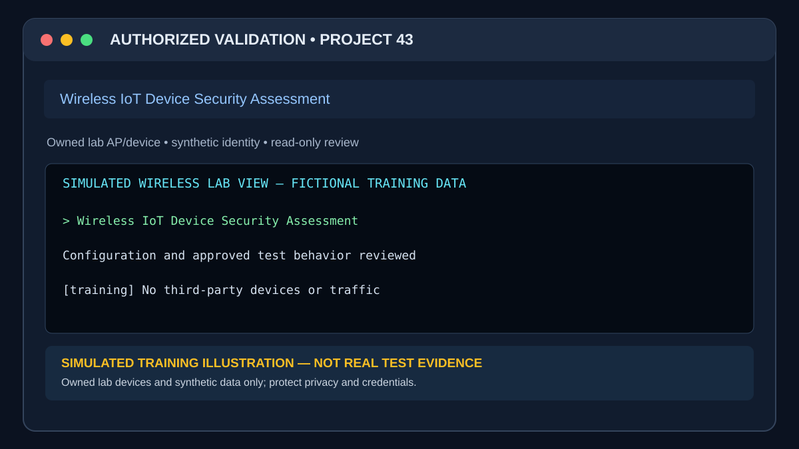

# Project 43 — Wireless IoT Device Security Assessment

**Level:** Advanced | **Estimated time:** 4–6 hours

> **Authorized lab only.** Assess owned wireless infrastructure and devices using synthetic identities/data. Do not test third-party networks, collect personal traffic, or disrupt users.

## Objective

Review wireless IoT onboarding, protocol configuration, firmware, identity, segmentation, cloud dependencies, and lifecycle controls in an owned lab.

## Scope and prerequisites

- Owned AP/controller and named test devices/services.
- Sanitized inventory/configuration exports and synthetic accounts/data.
- **Tools:** IoT device admin, AP/controller, vendor docs, Wireshark lab capture.
- Record authorization, asset/device identifiers, SSID/BSSID scope, firmware, location, test window, and exclusions.
- Define stop conditions, change approvals, and rollback procedures.

## Step 1 — Establish baseline and trust boundaries

Inventory the APs, clients, network zones, identity services, and management dependencies relevant to this project. Verify that the target device/service is in scope and that evidence is sanitized.

```bash
ip -br link
 iw dev
nmcli -f DEVICE,TYPE,STATE,CONNECTION device status
```

## Step 2 — Assessment workflow

1. Inventory owned IoT devices, radios/protocols, firmware, owners, and business purpose.
2. Review onboarding, default credential removal, unique identity, update mechanism, and support lifecycle.
3. Inspect AP/VLAN assignment and verify IoT devices can reach only documented services.
4. Use a short authorized lab capture to review metadata and destination policy; avoid collecting personal payloads.
5. Validate firmware update and decommissioning/revocation procedures with a test device.

Read-only review example:

```bash
Inventory lab IoT devices and compare firmware/security settings with vendor baseline
```

Adapt to the owned lab. Do not scan unrelated networks, collect third-party payloads, or bypass access controls on devices outside scope.

## Step 3 — Expected observations

An IoT asset and trust matrix with firmware, onboarding, network zone, allowed services, vendor support, and lifecycle.

## Step 4 — Risk analysis

Poorly managed IoT devices can become persistent entry points or expose sensitive telemetry. Record affected assets, evidence source, confidence, business impact, prerequisites, and limitations. Keep personal/device identifiers out of public evidence.

## Step 5 — Remediation and validation

Use unique device identity, secure onboarding, timely firmware updates, strict network segmentation, and end-of-life controls.

Apply approved changes, verify the configuration and client behavior, and record before/after evidence, rollback, and residual risk.

## Simulated training illustrations

> Fictional training SVGs only—not real RF captures, actual device output, or proof of an assessment.





## Evidence and deliverables

- Authorization, asset/device scope, exclusions, and stop conditions.
- Sanitized topology/configuration, firmware, device models, and tool versions.
- Approved test results, timestamps, configuration diffs, and synthetic client observations.
- Risk-ranked finding register, remediation owners, and retest status.
- No passwords, PSKs, private keys, personal data, or third-party traffic in Git.

## Framework references

- NISTIR 8259A; NIST SP 800-153; OWASP IoT Top 10
- [NIST SP 800-153](https://csrc.nist.gov/pubs/sp/800/153/final)
- [CIS Controls](https://www.cisecurity.org/controls)

## Completion checklist

- [ ] Authorization and asset scope confirmed
- [ ] Baseline and trust boundaries documented
- [ ] Authorized assessment completed safely
- [ ] Evidence sanitized and limitations stated
- [ ] Remediation and retest recorded
- [ ] Residual risk and owner documented
