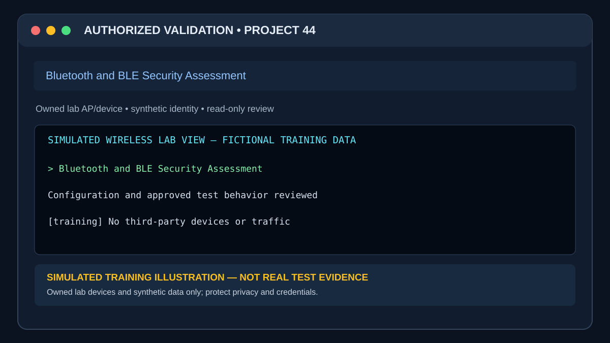

# Project 44 — Bluetooth and BLE Security Assessment

**Level:** Advanced | **Estimated time:** 4–6 hours

> **Authorized lab only.** Assess owned wireless infrastructure and devices using synthetic identities/data. Do not test third-party networks, collect personal traffic, or disrupt users.

## Objective

Review Bluetooth/BLE configuration, pairing, bonding, device discoverability, GATT permissions, firmware, and privacy on owned test devices.

## Scope and prerequisites

- Owned AP/controller and named test devices/services.
- Sanitized inventory/configuration exports and synthetic accounts/data.
- **Tools:** Android Bluetooth settings, btmon, nRF Connect, vendor tools.
- Record authorization, asset/device identifiers, SSID/BSSID scope, firmware, location, test window, and exclusions.
- Define stop conditions, change approvals, and rollback procedures.

## Step 1 — Establish baseline and trust boundaries

Inventory the APs, clients, network zones, identity services, and management dependencies relevant to this project. Verify that the target device/service is in scope and that evidence is sanitized.

```bash
ip -br link
 iw dev
nmcli -f DEVICE,TYPE,STATE,CONNECTION device status
```

## Step 2 — Assessment workflow

1. Confirm written authorization for the exact owned devices and lab area; record model and firmware.
2. Review discoverability, pairing mode, bonding, Secure Connections support, and stored peer lifecycle.
3. Use a designated test peripheral and synthetic data to inspect advertised services and GATT permissions.
4. Validate that sensitive characteristics require the expected authentication/authorization and that pairing is not left open.
5. Check firmware updates, reset/decommissioning, and privacy/address randomization behavior.

Read-only review example:

```bash
sudo btmgmt info  # inspect local Bluetooth controller capabilities
```

Adapt to the owned lab. Do not scan unrelated networks, collect third-party payloads, or bypass access controls on devices outside scope.

## Step 3 — Expected observations

A BLE device/service matrix with pairing mode, GATT access, firmware, privacy, and validated authorization behavior.

## Step 4 — Risk analysis

Weak pairing or open GATT characteristics may expose device control or sensitive telemetry. Record affected assets, evidence source, confidence, business impact, prerequisites, and limitations. Keep personal/device identifiers out of public evidence.

## Step 5 — Remediation and validation

Use secure pairing/bonding, authenticated GATT access, least-privilege characteristics, current firmware, and controlled discoverability.

Apply approved changes, verify the configuration and client behavior, and record before/after evidence, rollback, and residual risk.

## Simulated training illustrations

> Fictional training SVGs only—not real RF captures, actual device output, or proof of an assessment.





## Evidence and deliverables

- Authorization, asset/device scope, exclusions, and stop conditions.
- Sanitized topology/configuration, firmware, device models, and tool versions.
- Approved test results, timestamps, configuration diffs, and synthetic client observations.
- Risk-ranked finding register, remediation owners, and retest status.
- No passwords, PSKs, private keys, personal data, or third-party traffic in Git.

## Framework references

- Bluetooth Core Specification; OWASP MASVS-NETWORK (mobile clients); NIST SP 800-121
- [NIST SP 800-153](https://csrc.nist.gov/pubs/sp/800/153/final)
- [CIS Controls](https://www.cisecurity.org/controls)

## Completion checklist

- [ ] Authorization and asset scope confirmed
- [ ] Baseline and trust boundaries documented
- [ ] Authorized assessment completed safely
- [ ] Evidence sanitized and limitations stated
- [ ] Remediation and retest recorded
- [ ] Residual risk and owner documented
