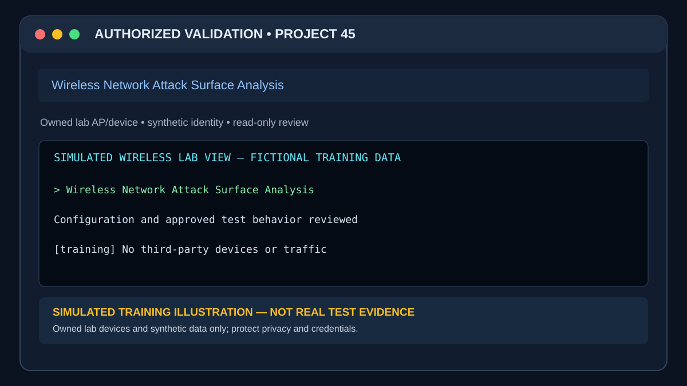

# Project 45 — Wireless Network Attack Surface Analysis

**Level:** Advanced | **Estimated time:** 4–6 hours

> **Authorized lab only.** Assess owned wireless infrastructure and devices using synthetic identities/data. Do not test third-party networks, collect personal traffic, or disrupt users.

## Objective

Consolidate wireless assets, SSIDs, AP management planes, authentication services, IoT devices, guest portals, and external dependencies into a prioritized attack-surface inventory.

## Scope and prerequisites

- Owned AP/controller and named test devices/services.
- Sanitized inventory/configuration exports and synthetic accounts/data.
- **Tools:** Controller exports, asset inventory, CMDB, Nmap for approved wired management hosts, SIEM.
- Record authorization, asset/device identifiers, SSID/BSSID scope, firmware, location, test window, and exclusions.
- Define stop conditions, change approvals, and rollback procedures.

## Step 1 — Establish baseline and trust boundaries

Inventory the APs, clients, network zones, identity services, and management dependencies relevant to this project. Verify that the target device/service is in scope and that evidence is sanitized.

```bash
ip -br link
 iw dev
nmcli -f DEVICE,TYPE,STATE,CONNECTION device status
```

## Step 2 — Assessment workflow

1. Collect AP/controller, SSID/BSSID, VLAN, RADIUS/PKI, guest portal, IoT, and management-plane inventories.
2. Identify internet-facing management dependencies, cloud controllers, vendor support paths, and certificate lifecycles.
3. Map trust boundaries and service dependencies without scanning outside approved management targets.
4. Prioritize exposed/unsupported devices, weak identity paths, broad VLAN access, and monitoring gaps.
5. Validate the inventory with owners and create a remediation roadmap.

Read-only review example:

```bash
Generate a sanitized AP/SSID inventory from the authorized controller export
```

Adapt to the owned lab. Do not scan unrelated networks, collect third-party payloads, or bypass access controls on devices outside scope.

## Step 3 — Expected observations

A wireless attack-surface register and dependency map with ownership, exposure, criticality, and remediation priority.

## Step 4 — Risk analysis

Unknown assets and undocumented dependencies can create blind spots and increase the impact of a compromise. Record affected assets, evidence source, confidence, business impact, prerequisites, and limitations. Keep personal/device identifiers out of public evidence.

## Step 5 — Remediation and validation

Maintain authoritative inventory, remove unused SSIDs/APs, secure management access, segment devices, and review vendor dependencies.

Apply approved changes, verify the configuration and client behavior, and record before/after evidence, rollback, and residual risk.

## Simulated training illustrations

> Fictional training SVGs only—not real RF captures, actual device output, or proof of an assessment.





## Evidence and deliverables

- Authorization, asset/device scope, exclusions, and stop conditions.
- Sanitized topology/configuration, firmware, device models, and tool versions.
- Approved test results, timestamps, configuration diffs, and synthetic client observations.
- Risk-ranked finding register, remediation owners, and retest status.
- No passwords, PSKs, private keys, personal data, or third-party traffic in Git.

## Framework references

- NIST SP 800-153; CIS Controls; NIST CSF 2.0
- [NIST SP 800-153](https://csrc.nist.gov/pubs/sp/800/153/final)
- [CIS Controls](https://www.cisecurity.org/controls)

## Completion checklist

- [ ] Authorization and asset scope confirmed
- [ ] Baseline and trust boundaries documented
- [ ] Authorized assessment completed safely
- [ ] Evidence sanitized and limitations stated
- [ ] Remediation and retest recorded
- [ ] Residual risk and owner documented
