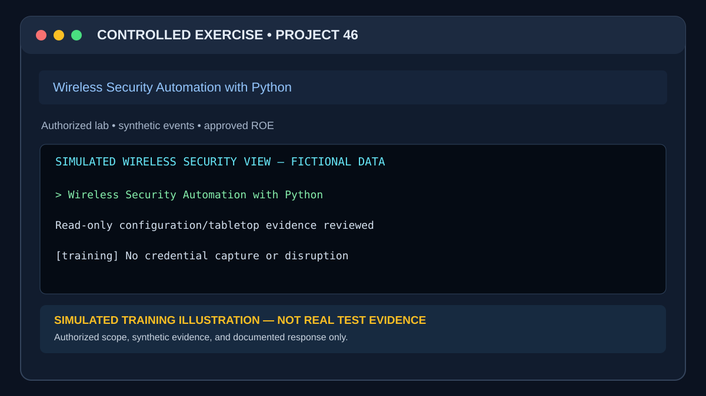

# Project 46 — Wireless Security Automation with Python

**Level:** Advanced | **Estimated time:** 4–6 hours

> **Authorized defensive lab only.** Use owned infrastructure, synthetic inventory/events, and signed rules of engagement. Do not capture credentials, impersonate networks, or disrupt users.

## Objective

Build a safe automation workflow that parses approved AP inventory/configuration exports and reports policy drift without probing third-party networks.

## Scope and prerequisites

- Written authorization, named wireless assets, and an approved lab/test environment.
- Sanitized AP/controller/WIDS data, synthetic events, and documented ownership.
- **Tools:** Python 3, csv/json, controller export, pytest.
- Record SSID/BSSID/site scope, firmware, test window, permitted methods, exclusions, emergency contacts, and stop conditions.
- For red-team-style work, use tabletop/synthetic scenarios and RF-isolated demonstrations only.

## Step 1 — Establish baseline and rules of engagement

Document the asset inventory, control baseline, evidence sources, and business objectives. Confirm the scope and response contacts before starting. Keep private network details and credentials out of public artifacts.

```bash
ip -br link
 iw dev
nmcli -f DEVICE,TYPE,STATE,CONNECTION device status
```

## Step 2 — Assessment workflow

1. Define a schema for approved APs, SSIDs, firmware, security mode, PMF, VLAN, and owner.
2. Use synthetic JSON/CSV fixtures and validate input types and required fields.
3. Implement read-only checks for missing ownership, outdated firmware flags, weak security profiles, and inconsistent PMF.
4. Add unit tests for valid, invalid, and exception cases; ensure secrets and client identifiers are redacted.
5. Generate a sanitized report and review false positives with the lab owner.

Read-only or tabletop starting point:

```bash
python3 wireless_audit.py --input lab-ap-inventory.json --output sanitized-report.json
```

Use only the approved environment. Do not run active wireless attacks, capture credentials, impersonate a real SSID, or disrupt clients.

## Step 3 — Expected observations

A tested Python utility that parses a sanitized inventory, flags policy deviations, and emits a reproducible report.

## Step 4 — Risk analysis

Automation can amplify bad assumptions or expose sensitive inventory if inputs and outputs are not controlled. Document evidence provenance, confidence, affected assets, business impact, false positives, and limitations. Label simulated exercise results clearly.

## Step 5 — Remediation and validation

Use schema validation, least-privilege inputs, redaction, version control, unit tests, and human review before remediation.

Assign owners and due dates. Validate improvements with configuration review, synthetic alert tests, and approved lab-client behavior. Record retest outcome and residual risk.

## Simulated training illustrations

> Fictional training illustrations only—not actual controller alerts, live wireless captures, or evidence of a real assessment.





## Evidence and deliverables

- Authorization, rules of engagement, exact asset scope, exclusions, and stop conditions.
- Sanitized inventory/configuration, event records, tool versions, and timestamps.
- Finding register with evidence provenance, severity rationale, owner, due date, and retest status.
- Tabletop notes, detection/response metrics, and residual-risk statement.
- No passwords, PSKs, private keys, personal data, or third-party traffic in Git.

## Framework references

- NIST SP 800-153; CIS Controls; Python documentation
- [NIST SP 800-115](https://csrc.nist.gov/pubs/sp/800/115/final)
- [NIST SP 800-153](https://csrc.nist.gov/pubs/sp/800/153/final)

## Completion checklist

- [ ] Written authorization and rules of engagement confirmed
- [ ] Baseline and evidence sources recorded
- [ ] Controlled assessment/tabletop completed safely
- [ ] Findings independently validated and prioritized
- [ ] Remediation owners and due dates assigned
- [ ] Retest and residual risk documented
