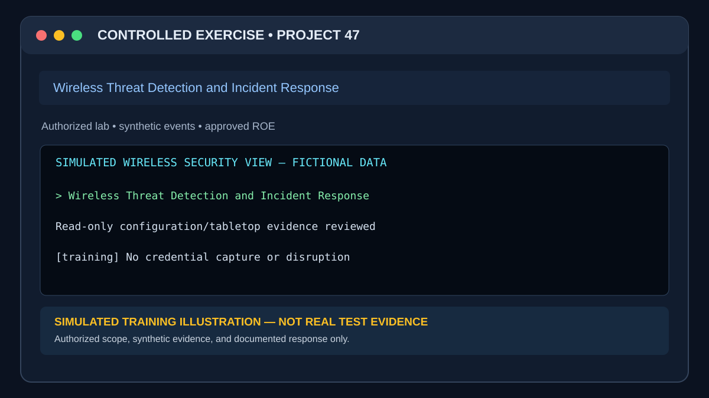

# Project 47 — Wireless Threat Detection and Incident Response

**Level:** Advanced | **Estimated time:** 4–6 hours

> **Authorized defensive lab only.** Use owned infrastructure, synthetic inventory/events, and signed rules of engagement. Do not capture credentials, impersonate networks, or disrupt users.

## Objective

Develop a wireless incident workflow for rogue AP alerts, unknown clients, authentication anomalies, configuration drift, and suspected RF disruption using synthetic events.

## Scope and prerequisites

- Written authorization, named wireless assets, and an approved lab/test environment.
- Sanitized AP/controller/WIDS data, synthetic events, and documented ownership.
- **Tools:** WIDS/WIPS, controller logs, SIEM, incident playbooks.
- Record SSID/BSSID/site scope, firmware, test window, permitted methods, exclusions, emergency contacts, and stop conditions.
- For red-team-style work, use tabletop/synthetic scenarios and RF-isolated demonstrations only.

## Step 1 — Establish baseline and rules of engagement

Document the asset inventory, control baseline, evidence sources, and business objectives. Confirm the scope and response contacts before starting. Keep private network details and credentials out of public artifacts.

```bash
ip -br link
 iw dev
nmcli -f DEVICE,TYPE,STATE,CONNECTION device status
```

## Step 2 — Assessment workflow

1. Define event categories, severity, required context, and escalation contacts.
2. Use synthetic or historical sanitized events to validate triage and evidence capture.
3. Correlate AP inventory, client association, authentication, and change-management records.
4. Document containment approval and coordination with network/physical security teams.
5. Run a tabletop exercise and measure acknowledgement, triage, escalation, and closure.

Read-only or tabletop starting point:

```bash
Review sanitized controller/WIDS events and map them to the wireless incident playbook
```

Use only the approved environment. Do not run active wireless attacks, capture credentials, impersonate a real SSID, or disrupt clients.

## Step 3 — Expected observations

A wireless incident playbook with alert triage, evidence preservation, decision points, escalation, and lessons learned.

## Step 4 — Risk analysis

Delayed or unsafe response can prolong unauthorized access or disrupt legitimate wireless service. Document evidence provenance, confidence, affected assets, business impact, false positives, and limitations. Label simulated exercise results clearly.

## Step 5 — Remediation and validation

Use approved containment authority, accurate inventory, centralized logging, rehearsed playbooks, and post-incident improvements.

Assign owners and due dates. Validate improvements with configuration review, synthetic alert tests, and approved lab-client behavior. Record retest outcome and residual risk.

## Simulated training illustrations

> Fictional training illustrations only—not actual controller alerts, live wireless captures, or evidence of a real assessment.





## Evidence and deliverables

- Authorization, rules of engagement, exact asset scope, exclusions, and stop conditions.
- Sanitized inventory/configuration, event records, tool versions, and timestamps.
- Finding register with evidence provenance, severity rationale, owner, due date, and retest status.
- Tabletop notes, detection/response metrics, and residual-risk statement.
- No passwords, PSKs, private keys, personal data, or third-party traffic in Git.

## Framework references

- NIST SP 800-61; NIST SP 800-153; MITRE ATT&CK Enterprise
- [NIST SP 800-115](https://csrc.nist.gov/pubs/sp/800/115/final)
- [NIST SP 800-153](https://csrc.nist.gov/pubs/sp/800/153/final)

## Completion checklist

- [ ] Written authorization and rules of engagement confirmed
- [ ] Baseline and evidence sources recorded
- [ ] Controlled assessment/tabletop completed safely
- [ ] Findings independently validated and prioritized
- [ ] Remediation owners and due dates assigned
- [ ] Retest and residual risk documented
