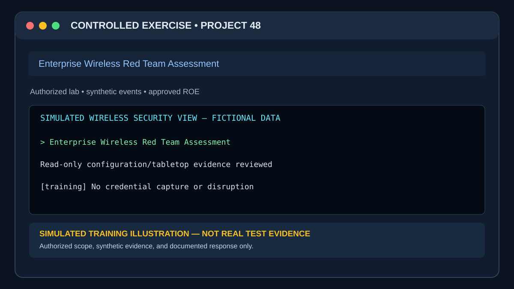

# Project 48 — Enterprise Wireless Red Team Assessment

**Level:** Advanced | **Estimated time:** 4–6 hours

> **Authorized defensive lab only.** Use owned infrastructure, synthetic inventory/events, and signed rules of engagement. Do not capture credentials, impersonate networks, or disrupt users.

## Objective

Plan a controlled red-team-style evaluation of enterprise wireless controls using tabletop scenarios, configuration evidence, and explicitly approved lab simulations.

## Scope and prerequisites

- Written authorization, named wireless assets, and an approved lab/test environment.
- Sanitized AP/controller/WIDS data, synthetic events, and documented ownership.
- **Tools:** Rules of engagement, controller/WIDS, test AP in RF enclosure, SIEM.
- Record SSID/BSSID/site scope, firmware, test window, permitted methods, exclusions, emergency contacts, and stop conditions.
- For red-team-style work, use tabletop/synthetic scenarios and RF-isolated demonstrations only.

## Step 1 — Establish baseline and rules of engagement

Document the asset inventory, control baseline, evidence sources, and business objectives. Confirm the scope and response contacts before starting. Keep private network details and credentials out of public artifacts.

```bash
ip -br link
 iw dev
nmcli -f DEVICE,TYPE,STATE,CONNECTION device status
```

## Step 2 — Assessment workflow

1. Define business objectives, exact sites/SSIDs/APs, dates, personnel, allowed methods, and emergency stop contacts.
2. Map attack paths at a conceptual level: identity, rogue AP detection, segmentation, guest access, and management plane.
3. Use tabletop injects and synthetic WIDS/controller events; use only an isolated RF-shielded lab for any hardware demonstration.
4. Validate whether monitoring, escalation, and change-control procedures work as intended.
5. Report control gaps and defensive improvements without conducting credential capture, impersonation, or disruption.

Read-only or tabletop starting point:

```bash
Review the signed wireless rules of engagement and approved lab scenario list
```

Use only the approved environment. Do not run active wireless attacks, capture credentials, impersonate a real SSID, or disrupt clients.

## Step 3 — Expected observations

A red-team assessment plan and exercise report showing objectives, scenario outcomes, detection gaps, and defensive recommendations.

## Step 4 — Risk analysis

Poorly scoped wireless exercises can affect availability, expose credentials, or involve unintended users. Document evidence provenance, confidence, affected assets, business impact, false positives, and limitations. Label simulated exercise results clearly.

## Step 5 — Remediation and validation

Use signed ROE, isolated RF lab, synthetic events, stop conditions, and coordinated blue-team observation.

Assign owners and due dates. Validate improvements with configuration review, synthetic alert tests, and approved lab-client behavior. Record retest outcome and residual risk.

## Simulated training illustrations

> Fictional training illustrations only—not actual controller alerts, live wireless captures, or evidence of a real assessment.





## Evidence and deliverables

- Authorization, rules of engagement, exact asset scope, exclusions, and stop conditions.
- Sanitized inventory/configuration, event records, tool versions, and timestamps.
- Finding register with evidence provenance, severity rationale, owner, due date, and retest status.
- Tabletop notes, detection/response metrics, and residual-risk statement.
- No passwords, PSKs, private keys, personal data, or third-party traffic in Git.

## Framework references

- NIST SP 800-115; NIST SP 800-153; MITRE ATT&CK Enterprise
- [NIST SP 800-115](https://csrc.nist.gov/pubs/sp/800/115/final)
- [NIST SP 800-153](https://csrc.nist.gov/pubs/sp/800/153/final)

## Completion checklist

- [ ] Written authorization and rules of engagement confirmed
- [ ] Baseline and evidence sources recorded
- [ ] Controlled assessment/tabletop completed safely
- [ ] Findings independently validated and prioritized
- [ ] Remediation owners and due dates assigned
- [ ] Retest and residual risk documented
