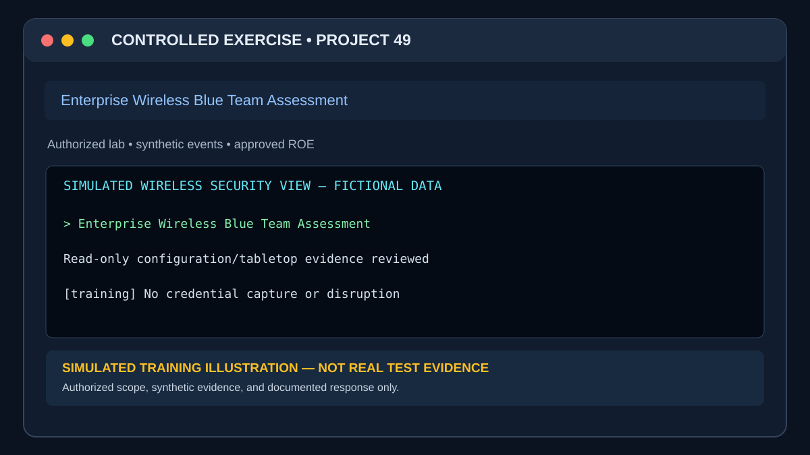

# Project 49 — Enterprise Wireless Blue Team Assessment

**Level:** Advanced | **Estimated time:** 4–6 hours

> **Authorized defensive lab only.** Use owned infrastructure, synthetic inventory/events, and signed rules of engagement. Do not capture credentials, impersonate networks, or disrupt users.

## Objective

Evaluate defensive readiness across wireless asset inventory, authentication, segmentation, WIDS monitoring, incident response, and configuration management.

## Scope and prerequisites

- Written authorization, named wireless assets, and an approved lab/test environment.
- Sanitized AP/controller/WIDS data, synthetic events, and documented ownership.
- **Tools:** Controller/WIDS, SIEM, RADIUS logs, CMDB, policy baseline.
- Record SSID/BSSID/site scope, firmware, test window, permitted methods, exclusions, emergency contacts, and stop conditions.
- For red-team-style work, use tabletop/synthetic scenarios and RF-isolated demonstrations only.

## Step 1 — Establish baseline and rules of engagement

Document the asset inventory, control baseline, evidence sources, and business objectives. Confirm the scope and response contacts before starting. Keep private network details and credentials out of public artifacts.

```bash
ip -br link
 iw dev
nmcli -f DEVICE,TYPE,STATE,CONNECTION device status
```

## Step 2 — Assessment workflow

1. Review asset inventory, approved SSIDs, AP firmware, management access, and ownership.
2. Validate WPA3/802.1X/PMF profiles, guest isolation, VLAN boundaries, and device revocation.
3. Review WIDS coverage, alert quality, log retention, and SIEM correlation.
4. Run synthetic event/tabletop exercises for rogue AP, unknown client, and authentication anomalies.
5. Create a prioritized improvement plan with owners, target dates, and repeatable metrics.

Read-only or tabletop starting point:

```bash
Export wireless alert coverage, AP inventory, and configuration compliance summary
```

Use only the approved environment. Do not run active wireless attacks, capture credentials, impersonate a real SSID, or disrupt clients.

## Step 3 — Expected observations

A blue-team maturity scorecard with validated controls, detection coverage, response readiness, and improvement actions.

## Step 4 — Risk analysis

Gaps in visibility, configuration governance, and response can allow wireless threats to persist undetected. Document evidence provenance, confidence, affected assets, business impact, false positives, and limitations. Label simulated exercise results clearly.

## Step 5 — Remediation and validation

Maintain inventory and baselines, enforce strong identity/segmentation, tune WIDS, rehearse response, and track remediation.

Assign owners and due dates. Validate improvements with configuration review, synthetic alert tests, and approved lab-client behavior. Record retest outcome and residual risk.

## Simulated training illustrations

> Fictional training illustrations only—not actual controller alerts, live wireless captures, or evidence of a real assessment.





## Evidence and deliverables

- Authorization, rules of engagement, exact asset scope, exclusions, and stop conditions.
- Sanitized inventory/configuration, event records, tool versions, and timestamps.
- Finding register with evidence provenance, severity rationale, owner, due date, and retest status.
- Tabletop notes, detection/response metrics, and residual-risk statement.
- No passwords, PSKs, private keys, personal data, or third-party traffic in Git.

## Framework references

- NIST CSF 2.0; NIST SP 800-61; NIST SP 800-153
- [NIST SP 800-115](https://csrc.nist.gov/pubs/sp/800/115/final)
- [NIST SP 800-153](https://csrc.nist.gov/pubs/sp/800/153/final)

## Completion checklist

- [ ] Written authorization and rules of engagement confirmed
- [ ] Baseline and evidence sources recorded
- [ ] Controlled assessment/tabletop completed safely
- [ ] Findings independently validated and prioritized
- [ ] Remediation owners and due dates assigned
- [ ] Retest and residual risk documented
