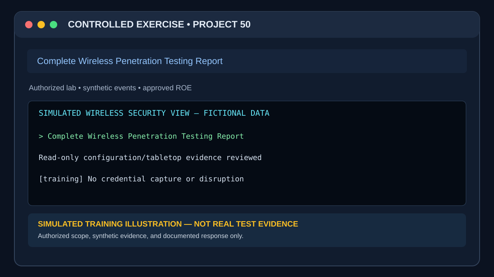

# Project 50 — Complete Wireless Penetration Testing Report

**Level:** Advanced | **Estimated time:** 4–6 hours

> **Authorized defensive lab only.** Use owned infrastructure, synthetic inventory/events, and signed rules of engagement. Do not capture credentials, impersonate networks, or disrupt users.

## Objective

Produce a complete, evidence-based wireless assessment report with scope, methodology, validated findings, remediation, retest, and residual risk.

## Scope and prerequisites

- Written authorization, named wireless assets, and an approved lab/test environment.
- Sanitized AP/controller/WIDS data, synthetic events, and documented ownership.
- **Tools:** Report template, controller exports, WIDS, Wireshark, configuration diff, evidence register.
- Record SSID/BSSID/site scope, firmware, test window, permitted methods, exclusions, emergency contacts, and stop conditions.
- For red-team-style work, use tabletop/synthetic scenarios and RF-isolated demonstrations only.

## Step 1 — Establish baseline and rules of engagement

Document the asset inventory, control baseline, evidence sources, and business objectives. Confirm the scope and response contacts before starting. Keep private network details and credentials out of public artifacts.

```bash
ip -br link
 iw dev
nmcli -f DEVICE,TYPE,STATE,CONNECTION device status
```

## Step 2 — Assessment workflow

1. Consolidate authorization, sites, SSIDs/BSSIDs, devices, exclusions, and rules of engagement.
2. Summarize methodology across configuration, authentication, encryption, segmentation, monitoring, and resilience.
3. Validate each finding with at least one primary evidence source and a second corroborating source where practical.
4. Assign severity based on exposure, exploitability, business impact, and asset criticality; document limitations.
5. Write executive summary, technical findings, remediation owners/dates, retest results, and residual-risk statement.

Read-only or tabletop starting point:

```bash
Record authorization, SSID/BSSID scope, AP/controller versions, test window, and evidence inventory
```

Use only the approved environment. Do not run active wireless attacks, capture credentials, impersonate a real SSID, or disrupt clients.

## Step 3 — Expected observations

A complete wireless report package with executive summary, technical scope, evidence index, finding register, remediation roadmap, and retest status.

## Step 4 — Risk analysis

Unclear scope, simulated evidence presented as real, or unvalidated findings can mislead stakeholders. Document evidence provenance, confidence, affected assets, business impact, false positives, and limitations. Label simulated exercise results clearly.

## Step 5 — Remediation and validation

Use strict evidence provenance, clear confidence labels, repeatable validation, accountable remediation owners, and documented risk acceptance.

Assign owners and due dates. Validate improvements with configuration review, synthetic alert tests, and approved lab-client behavior. Record retest outcome and residual risk.

## Simulated training illustrations

> Fictional training illustrations only—not actual controller alerts, live wireless captures, or evidence of a real assessment.





## Evidence and deliverables

- Authorization, rules of engagement, exact asset scope, exclusions, and stop conditions.
- Sanitized inventory/configuration, event records, tool versions, and timestamps.
- Finding register with evidence provenance, severity rationale, owner, due date, and retest status.
- Tabletop notes, detection/response metrics, and residual-risk statement.
- No passwords, PSKs, private keys, personal data, or third-party traffic in Git.

## Framework references

- NIST SP 800-115; NIST SP 800-153; NIST CSF 2.0
- [NIST SP 800-115](https://csrc.nist.gov/pubs/sp/800/115/final)
- [NIST SP 800-153](https://csrc.nist.gov/pubs/sp/800/153/final)

## Completion checklist

- [ ] Written authorization and rules of engagement confirmed
- [ ] Baseline and evidence sources recorded
- [ ] Controlled assessment/tabletop completed safely
- [ ] Findings independently validated and prioritized
- [ ] Remediation owners and due dates assigned
- [ ] Retest and residual risk documented
